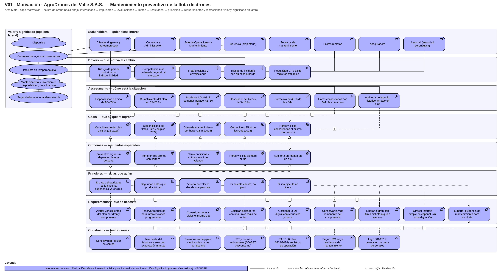

# Fase 1 · V1 — Vista de Motivación

Vista **V01 - Motivación**: por qué existe la aplicación, con elementos de la entrevista (Fase 0). Asociación (línea continua), influencia (discontinua, `+` refuerza / `−` limita) y realización (punteada).

## Inventario (cada elemento lleva la propiedad `Fuente` con pregunta P-xx / hallazgo H-xx)

| Tipo | Elementos |
|---|---|
| Interesados (8) | Gerencia · Jefe de Operaciones y Mantenimiento · Pilotos remotos · Técnicos · Clientes (ingenios y agroempresas) · Aerocivil · Aseguradora · Comercial y Administración |
| Impulsores (5) | Flota creciente y envejeciendo · Regulación UAS exige registros trazables · Riesgo de perder contratos por indisponibilidad · Competencia más ordenada llegando al mercado · Riesgo de incidente con químico a bordo |
| Evaluaciones (7) | Incidente ADV-02 (3 semanas, $8–10 M) · Cumplimiento del plan 65–70 % · Disponibilidad en pico 80–85 % · Horas consolidadas con 2–4 días de atraso · Descuadre del kardex 5–10 % · Auditoría de ingenio: histórico armado en días · Correctivo en 40 % de las OTs |
| Metas (5, con número y fecha — H-37) | Disponibilidad ≥ 92 % en pico (2027) · Cumplimiento del plan ≥ 85 % (2S-2027) · Correctivo ≤ 25 % (2028) · Horas y ciclos el mismo día (mes 1) · Costo por hora −15 % (2028) |
| Resultados (5) | Prometer tres drones con certeza · Cero condiciones críticas vencidas volando · Auditoría entregada en un día · Preventivo sin depender de una persona · Horas y ciclos siempre al día |
| Principios (5) | Seguridad antes que productividad · Si no está escrito, no pasó · Quien ejecuta no libera · El dato del fabricante es la base · Volar o no volar lo decide una persona |
| Requerimientos (9) | Consolidar horas y ciclos el mismo día · Alertar vencimientos por dron y componente · Gestionar la OT digital con repuestos · Reservar repuestos · Liberar con firma distinta · Calcular indicadores con regla única · Exportar evidencia · Conservar vida remanente del componente · Interfaz simple sin doble digitación |
| Valores (3) | Flota lista en temporada alta · Contratos de ingenios conservados · Seguridad operacional demostrable |
| Significados (2) | Mantenimiento = inversión en disponibilidad, no solo costo (corrección del experto, P11) · «Disponible» (para Comercial = existe el dron y hay piloto; para el taller = verde con service al día) |
| Restricciones (7) | Presupuesto de pyme · Conectividad regular · Telemetría solo por exportación manual (H-35) · RAC 100, Res. 0334/2024 (H-02/03) · Seguro RC exige evidencia (H-05) · Ley 1581/2012 (H-11) · SST y normas ambientales (H-08/09/10) |

Relaciones: 70 (10 interesado–impulsor, 8 impulsor–evaluación, 8 evaluación→meta/resultado, 6 resultado→meta, 12 requerimiento→resultado/meta, 8 principio→requerimiento, 8 restricción→requerimiento, más 10 asociaciones de valores y significados con los interesados). Dos requerimientos (R1, R7) llevan `Realizado por` provisional, que se confirma en V4 (base de V10).

## Análisis

- **Impulsor más fuerte:** *Riesgo de perder contratos por indisponibilidad*: concentra tres interesados (Gerencia, Clientes, Comercial) y dos evaluaciones (ADV-02 y disponibilidad en pico); los ingenios pesan 60–65 % de los ingresos.
- **Restricción que más condiciona el alcance:** *telemetría solo por exportación manual* junto con *conectividad regular*: el registro de horas no puede depender de integración paga ni de señal permanente, por lo que la telemetría se consume vía capa anticorrupción (H-35).
- **Meta que más alimenta la app:** *horas y ciclos consolidados el mismo día*: es la más urgente para el experto (P149), y de ella dependen disponibilidad, cumplimiento del plan y evidencia de auditoría.
- **Principios con efecto de diseño:** *quien ejecuta no libera* y *seguridad antes que productividad* generan los requerimientos de liberación con rol distinto y de alertas de vencimiento (invariantes en V6).
- **Supuestos abiertos:** exigencias de registro/retención del RAC 100 (S-03), alcance de la Res. 799/2025 a baterías de litio (S-05) y condicionado de la póliza.
