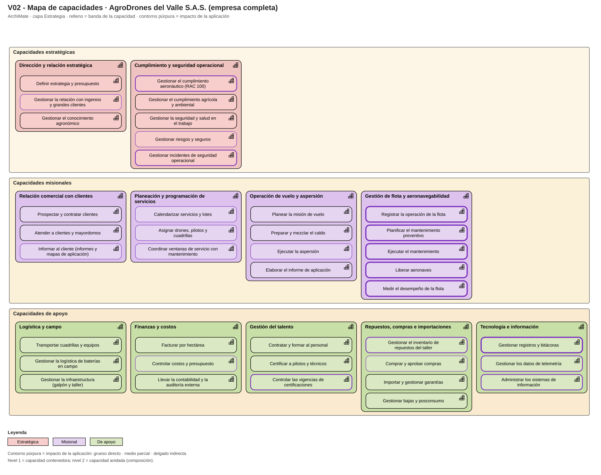
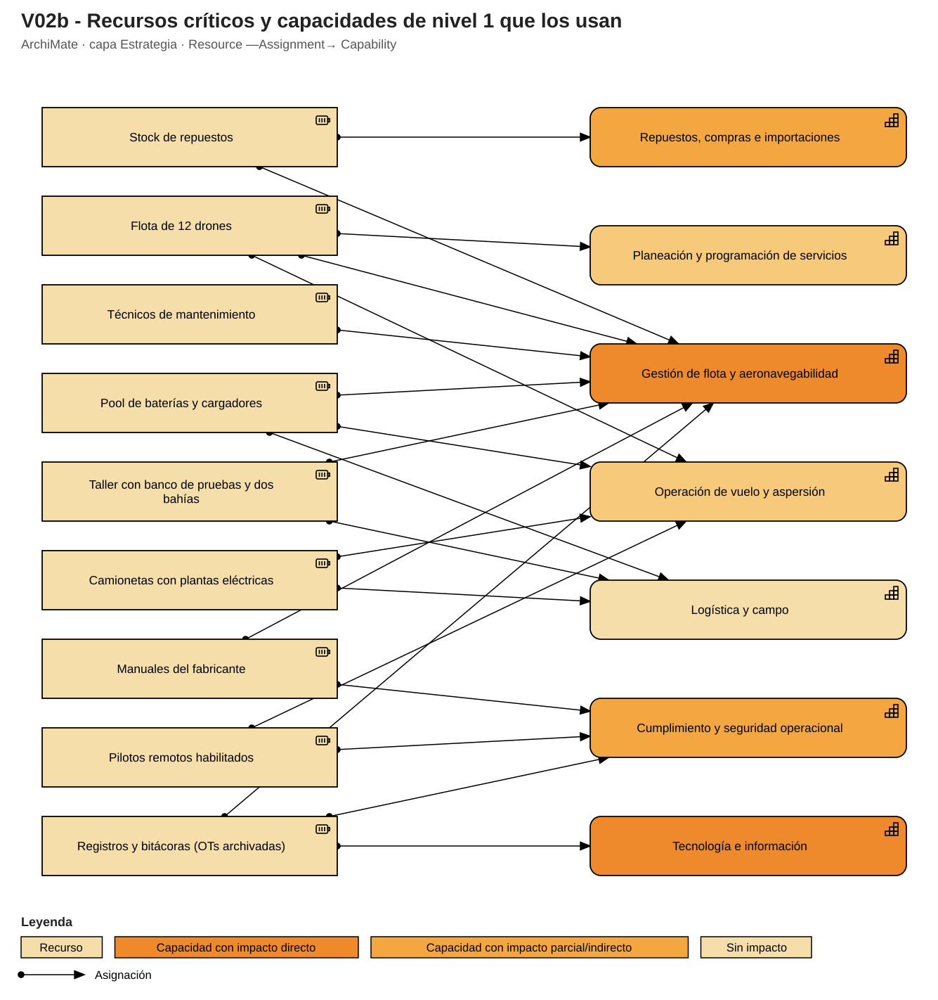
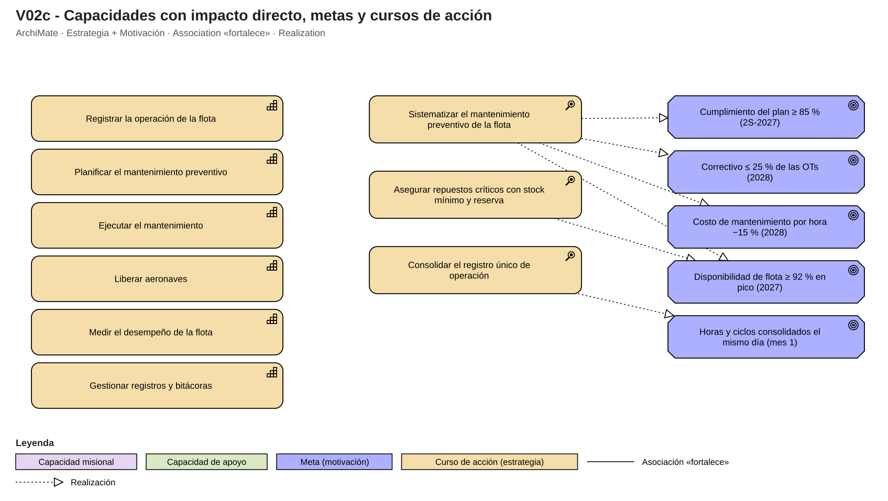

# Fase 1 · V2 — Mapa de capacidades (V02, V02b y V02c)

**Qué muestra.** El mapa completo de lo que AgroDrones del Valle debe saber hacer para existir y prestar fumigación con drones (no solo mantenimiento): 3 bandas (capacidades estratégicas, misionales y de apoyo), 11 capacidades de nivel 1 y 41 de nivel 2 con la misma profundidad en todas las ramas. Se construyó con la entrevista (Bloque 10, P97-P104: las diez funciones de punta a punta más la transversal «mantener el orden»). Las metas de V1 y los cursos de acción que justifican el proyecto se relacionan con las capacidades en la vista V02c.

**Cómo leer el color.** El relleno indica la banda de la capacidad: rojo suave = estratégica, púrpura suave = misional, verde suave = de apoyo (formato del mapa del curso). El contorno púrpura señala el impacto de la aplicación: grueso = directo, medio = parcial, delgado = indirecta. Cada capacidad lleva la propiedad `Impacto`.

## Capacidades y grado de impacto

| Nivel 0 (banda) | Capacidad nivel 1 | Capacidad nivel 2 | Impacto de la aplicación | Por qué |
|---|---|---|---|---|
| Estratégicas | Dirección y relación estratégica | Definir estrategia y presupuesto | Sin impacto | — |
| Estratégicas | Dirección y relación estratégica | Gestionar la relación con ingenios y grandes clientes | Indirecta | Los ingenios (60-65 % de los ingresos) auditan y piden evidencia de mantenimiento. |
| Estratégicas | Dirección y relación estratégica | Gestionar el conocimiento agronómico | Sin impacto | — |
| Estratégicas | Cumplimiento y seguridad operacional | Gestionar el cumplimiento aeronáutico (RAC 100) | Parcial | La aplicación aporta los registros de mantenimiento que la norma y las inspecciones exigen; los trámites ante la Aerocivil siguen en administración. |
| Estratégicas | Cumplimiento y seguridad operacional | Gestionar el cumplimiento agrícola y ambiental | Sin impacto | — |
| Estratégicas | Cumplimiento y seguridad operacional | Gestionar la seguridad y salud en el trabajo | Sin impacto | — |
| Estratégicas | Cumplimiento y seguridad operacional | Gestionar riesgos y seguros | Indirecta | La aseguradora pide evidencia de mantenimiento en siniestros. |
| Estratégicas | Cumplimiento y seguridad operacional | Gestionar incidentes de seguridad operacional | Parcial | Las OTs correctivas y hallazgos alimentan la investigación de incidentes. |
| Misionales | Relación comercial con clientes | Prospectar y contratar clientes | Sin impacto | — |
| Misionales | Relación comercial con clientes | Atender a clientes y mayordomos | Sin impacto | — |
| Misionales | Relación comercial con clientes | Informar al cliente (informes y mapas de aplicación) | Indirecta | Los ingenios piden evidencias de operación y de mantenimiento en sus informes. |
| Misionales | Planeación y programación de servicios | Calendarizar servicios y lotes | Indirecta | Consume la disponibilidad de la flota. |
| Misionales | Planeación y programación de servicios | Asignar drones, pilotos y cuadrillas | Indirecta | Decide con horas remanentes y estado de baterías. |
| Misionales | Planeación y programación de servicios | Coordinar ventanas de servicio con mantenimiento | Indirecta | Concilia el programa semanal de paradas con el calendario de clientes. |
| Misionales | Operación de vuelo y aspersión | Planear la misión de vuelo | Sin impacto | — |
| Misionales | Operación de vuelo y aspersión | Preparar y mezclar el caldo | Sin impacto | — |
| Misionales | Operación de vuelo y aspersión | Ejecutar la aspersión | Indirecta | Produce las horas y ciclos que alimentan el mantenimiento. |
| Misionales | Operación de vuelo y aspersión | Elaborar el informe de aplicación | Sin impacto | — |
| Misionales | Gestión de flota y aeronavegabilidad | Registrar la operación de la flota | Directa | Horas y ciclos por dron y componente: la base de todo (H-24). |
| Misionales | Gestión de flota y aeronavegabilidad | Planificar el mantenimiento preventivo | Directa | Plan por dron con condiciones y programación semanal. |
| Misionales | Gestión de flota y aeronavegabilidad | Ejecutar el mantenimiento | Directa | OT con repuestos y cierre (preventivo y registro del correctivo). |
| Misionales | Gestión de flota y aeronavegabilidad | Liberar aeronaves | Directa | Liberación con rol distinto al ejecutor y vuelo de prueba. |
| Misionales | Gestión de flota y aeronavegabilidad | Medir el desempeño de la flota | Directa | Indicadores de disponibilidad, cumplimiento, MTBF y costo por hora. |
| De apoyo | Logística y campo | Transportar cuadrillas y equipos | Sin impacto | — |
| De apoyo | Logística y campo | Gestionar la logística de baterías en campo | Sin impacto | — |
| De apoyo | Logística y campo | Gestionar la infraestructura (galpón y taller) | Sin impacto | — |
| De apoyo | Finanzas y costos | Facturar por hectárea | Sin impacto | — |
| De apoyo | Finanzas y costos | Controlar costos y presupuesto | Indirecta | Recibe el costo de repuestos y mano de obra por dron. |
| De apoyo | Finanzas y costos | Llevar la contabilidad y la auditoría externa | Sin impacto | — |
| De apoyo | Gestión del talento | Contratar y formar al personal | Sin impacto | — |
| De apoyo | Gestión del talento | Certificar a pilotos y técnicos | Sin impacto | — |
| De apoyo | Gestión del talento | Controlar las vigencias de certificaciones | Parcial | La aplicación consulta quién está habilitado para cada modelo; las carpetas siguen en administración. |
| De apoyo | Repuestos, compras e importaciones | Gestionar el inventario de repuestos del taller | Parcial | Reserva y consumo de repuestos del taller; el inventario general sigue fuera. |
| De apoyo | Repuestos, compras e importaciones | Comprar y aprobar compras | Indirecta | La aplicación solo genera la solicitud de reposición. |
| De apoyo | Repuestos, compras e importaciones | Importar y gestionar garantías | Sin impacto | — |
| De apoyo | Repuestos, compras e importaciones | Gestionar bajas y posconsumo | Sin impacto | — |
| De apoyo | Tecnología e información | Gestionar registros y bitácoras | Directa | Mantener el orden: registros al día, trazables y exportables. |
| De apoyo | Tecnología e información | Gestionar los datos de telemetría | Parcial | Se consumen vía capa anticorrupción; no se construyen. |
| De apoyo | Tecnología e información | Administrar los sistemas de información | Parcial | La aplicación reemplaza Excel, papel y WhatsApp para el mantenimiento. |

## Argumentación

- **Impacto directo (6 capacidades):** las cinco de «Gestión de flota y aeronavegabilidad» (registrar la operación, planificar el preventivo, ejecutar el mantenimiento, liberar aeronaves y medir el desempeño) y «Gestionar registros y bitácoras». Son exactamente el alcance de la solicitud (P146) y son las que hoy dependen de Excel, papel y WhatsApp.
- **Impacto parcial:** capacidades en las que la aplicación aporta datos pero otra área conserva la responsabilidad: cumplimiento aeronáutico (los trámites siguen en Administración), inventario del taller (el inventario general sigue fuera), vigencias de certificaciones (solo se consulta la habilitación), datos de telemetría (se consumen por capa anticorrupción) y sistemas de información (la aplicación reemplaza los Excel de mantenimiento, no los de toda la empresa).
- **Impacto indirecto:** capacidades que consumen la disponibilidad o el histórico (programación de servicios, informes al cliente, costos, compras, relación con ingenios, seguros).
- **Sin impacto y fuera de alcance:** misiones de vuelo, facturación, nómina, contabilidad y CRM (P146, P155). Se dejan visibles en el mapa porque el mapa describe a la empresa completa; quedan fuera de la aplicación y se integran, si es necesario, por V4/V9.
- **Por qué no un mapa solo de mantenimiento:** la rúbrica califica «Básico» a un mapa centrado solo en la aplicación; el mapa completo permite ver quién consume la disponibilidad (Comercial) y quién pide evidencia (ingenios, aseguradora, autoridad).

## Recursos críticos (V2b)

| Recurso | Descripción | Capacidades que lo usan |
|---|---|---|
| Flota de 12 drones | Cinco T40, cuatro T30, dos T16 y un XAG P100 Pro. | Operación de vuelo y aspersión, Gestión de flota y aeronavegabilidad, Planeación y programación de servicios |
| Pool de baterías y cargadores | Unas 30 baterías con cargadores de campo. | Operación de vuelo y aspersión, Gestión de flota y aeronavegabilidad, Logística y campo |
| Taller con banco de pruebas y dos bahías | Galpón de Palmira. | Gestión de flota y aeronavegabilidad, Logística y campo |
| Stock de repuestos | Bodega con estantería por modelo. | Gestión de flota y aeronavegabilidad, Repuestos, compras e importaciones |
| Técnicos de mantenimiento | Tres técnicos (dos en taller, uno itinerante). | Gestión de flota y aeronavegabilidad |
| Pilotos remotos habilitados | Ocho pilotos con certificado. | Operación de vuelo y aspersión, Cumplimiento y seguridad operacional |
| Registros y bitácoras (OTs archivadas) | Evidencia de aeronavegabilidad demostrable. | Tecnología e información, Cumplimiento y seguridad operacional, Gestión de flota y aeronavegabilidad |
| Manuales del fabricante | Base técnica de intervalos y procedimientos. | Gestión de flota y aeronavegabilidad, Cumplimiento y seguridad operacional |
| Camionetas con plantas eléctricas | Tres camionetas para cuadrillas y carga de baterías. | Operación de vuelo y aspersión, Logística y campo |

## Cursos de acción (justifican el proyecto y se enlazan con las metas de V1)

| Curso de acción | Qué busca | Metas (V1) | Capacidades que fortalece |
|---|---|---|---|
| Sistematizar el mantenimiento preventivo de la flota | Implementar gestión sistematizada: plan por dron, OT digital, liberación y indicadores. | G1, G2, G3, G5 | Gestión de flota y aeronavegabilidad, Tecnología e información, Repuestos, compras e importaciones, Cumplimiento y seguridad operacional |
| Consolidar el registro único de operación | Entrada única de horas y ciclos que reemplaza los tres canales manuales. | G4 | Gestión de flota y aeronavegabilidad, Tecnología e información |
| Asegurar repuestos críticos con stock mínimo y reserva | Evitar paradas largas por falta de repuestos importados (caso ADV-02). | G1 | Repuestos, compras e importaciones, Gestión de flota y aeronavegabilidad |

*Trazabilidad:* P97-P104 (capacidades), P101 (recursos), P138 (metas) y los hallazgos H-24, H-27, H-29, H-37, H-38.
