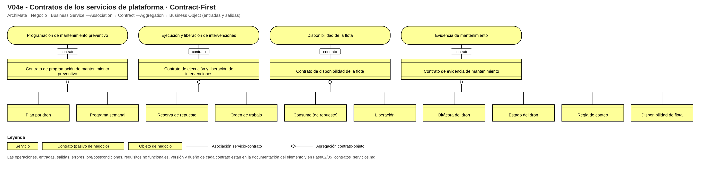
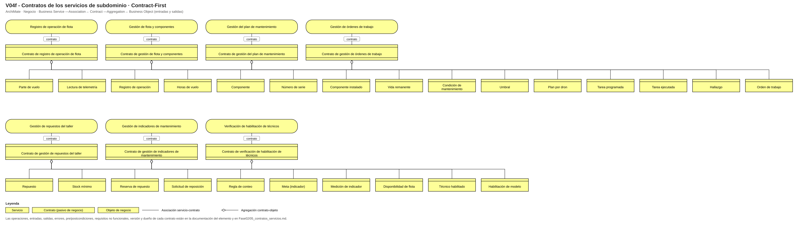
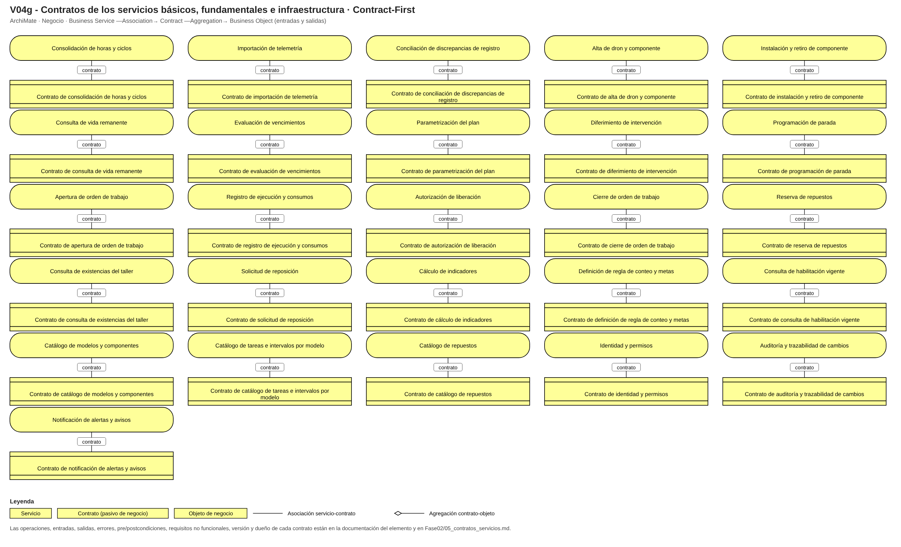

# Fase 2 · Contratos de servicio (Contract-First)

Un contrato por cada servicio **incluido** (37). Se modelan en ArchiMate como elementos *Contract* (pasivos de negocio) asociados al servicio, con los objetos de negocio que viajan agregados al contrato (vistas V04e, V04f y V04g). *Contract-First* es el acuerdo de la interfaz **entre servicios** antes de implementar; no se confunde con *Design by Contract* (invariantes del agregado, Fase 4).

### Programación de mantenimiento preventivo (N2)
| Campo | Contenido |
|---|---|
| Servicio / versión | Programación de mantenimiento preventivo · 1.0.0 |
| Propósito | Es el valor central de la solicitud: decidir cuándo entra cada dron sin chocar con servicios (P71-P73). Orquesta plan, flota, repuestos y habilitación. |
| Operaciones | Consultar vencimientos; Proponer programa semanal; Programar parada; Reprogramar parada; Diferir tarea |
| Entradas (objetos de negocio) | Dron, horas y ciclos consolidados, calendario de servicios (ACL-01), existencias del taller (ACL-02) |
| Salidas | Programa semanal con paradas, técnicos y repuestos reservados; lista de vencimientos |
| Errores y semántica | TAREA_CRITICA_NO_DIFERIBLE; BAHIAS_COMPLETAS; MISMA_LINEA_EN_TALLER; TECNICO_NO_HABILITADO; REPUESTO_NO_DISPONIBLE |
| Precondiciones / postcondiciones | Pre: plan por dron vigente y contadores informados. Post: cada parada con técnico habilitado y repuestos reservados. |
| Requisitos no funcionales | Disponibilidad 99 % en horario de taller (6:00-20:00); respuesta < 2 s; acceso por rol; datos de personas bajo la Ley 1581/2012. |
| Consumidores | Jefe de Operaciones y Mantenimiento; Coordinación de servicios (consulta) |
| Dueño / responsable | Jefe de Operaciones y Mantenimiento |
| Política de cambios y versionado | Agregar campos en lugar de modificar los existentes; versionar el contrato y avisar en el catálogo de servicios. |

### Ejecución y liberación de intervenciones (N2)
| Campo | Contenido |
|---|---|
| Servicio / versión | Ejecución y liberación de intervenciones · 1.0.0 |
| Propósito | Ejecutar y liberar el trabajo con repuestos y firma es parte explícita del alcance (P146). |
| Operaciones | Abrir orden; Registrar ejecución y consumos; Registrar vuelo de prueba; Liberar dron; Cerrar orden |
| Entradas (objetos de negocio) | Parada programada, tareas, repuestos con serie, hallazgos, firma |
| Salidas | Orden de trabajo cerrada, dron liberado, contadores y relojes actualizados |
| Errores y semántica | LIBERA_EL_MISMO_QUE_EJECUTO; PRUEBA_DE_VUELO_PENDIENTE; SERIE_FALTANTE; ORDEN_CERRADA_INMUTABLE |
| Precondiciones / postcondiciones | Pre: parada programada y técnico habilitado. Post: relojes reiniciados y bitácora actualizada. |
| Requisitos no funcionales | Disponibilidad 99 % en horario de taller (6:00-20:00); respuesta < 2 s; acceso por rol; datos de personas bajo la Ley 1581/2012. |
| Consumidores | Técnicos; Jefe de Operaciones y Mantenimiento; Almacenista |
| Dueño / responsable | Técnico de mantenimiento (líder del taller) |
| Política de cambios y versionado | Agregar campos en lugar de modificar los existentes; versionar el contrato y avisar en el catálogo de servicios. |

### Disponibilidad de la flota (N2)
| Campo | Contenido |
|---|---|
| Servicio / versión | Disponibilidad de la flota · 1.0.0 |
| Propósito | Responde al riesgo n.º 1 del negocio (flota disponible en pico) y a la pregunta de Comercial «¿cuántos drones puedo prometer?» (P92, P139). |
| Operaciones | Consultar estado del dron; Consultar disponibilidad por período; Consultar indicadores |
| Entradas (objetos de negocio) | Estado de tareas y paradas, regla de conteo |
| Salidas | Estado verde/amarillo/rojo por dron, disponibilidad y tablero mensual |
| Errores y semántica | REGLA_DE_CONTEO_NO_DEFINIDA; DRON_SIN_PLAN |
| Precondiciones / postcondiciones | Pre: contadores al día. Post: una sola cifra por período y regla. |
| Requisitos no funcionales | Disponibilidad 99 % en horario de taller (6:00-20:00); respuesta < 2 s; acceso por rol; datos de personas bajo la Ley 1581/2012. |
| Consumidores | Coordinación de servicios; Gerencia; Jefe de Operaciones y Mantenimiento |
| Dueño / responsable | Jefe de Operaciones y Mantenimiento |
| Política de cambios y versionado | Agregar campos en lugar de modificar los existentes; versionar el contrato y avisar en el catálogo de servicios. |

### Evidencia de mantenimiento (N2)
| Campo | Contenido |
|---|---|
| Servicio / versión | Evidencia de mantenimiento · 1.0.0 |
| Propósito | Auditorías de ingenios, aseguradora y autoridad exigen histórico por dron; hoy toma días (P137, H-05). |
| Operaciones | Generar histórico por dron; Exportar evidencia por destinatario |
| Entradas (objetos de negocio) | Dron, rango de fechas, destinatario (ingenio, aseguradora, autoridad) |
| Salidas | Paquete de evidencia: OTs, bitácora, consumos y series |
| Errores y semántica | HISTORIAL_INCOMPLETO; DESTINATARIO_NO_SOPORTADO |
| Precondiciones / postcondiciones | Pre: OTs cerradas con series. Post: entrega en menos de un día. |
| Requisitos no funcionales | Disponibilidad 99 % en horario de taller (6:00-20:00); respuesta < 2 s; acceso por rol; datos de personas bajo la Ley 1581/2012. |
| Consumidores | Jefe de Operaciones y Mantenimiento; Gerencia |
| Dueño / responsable | Jefe de Operaciones y Mantenimiento |
| Política de cambios y versionado | Agregar campos en lugar de modificar los existentes; versionar el contrato y avisar en el catálogo de servicios. |

### Registro de operación de flota (N3)
| Campo | Contenido |
|---|---|
| Servicio / versión | Registro de operación de flota · 1.0.0 |
| Propósito | Horas y ciclos a partir de las operaciones es el primer requerimiento de la solicitud y la función más urgente (P149). |
| Operaciones | Registrar jornada; Consolidar horas y ciclos; Importar telemetría |
| Entradas (objetos de negocio) | Parte de vuelo, lecturas de telemetría, vuelos |
| Salidas | Registro de operación, horas de vuelo y ciclos por dron/componente |
| Errores y semántica | DUPLICADO; DISCREPANCIA_MAYOR_20H |
| Precondiciones / postcondiciones | Pre: dron existente. Post: un vuelo se cuenta una sola vez. |
| Requisitos no funcionales | Respuesta < 2 s; trazabilidad de cambios; consistencia fuerte dentro del subdominio. |
| Consumidores | sv_prog, sv_disp, sv_evid |
| Dueño / responsable | Jefe de Operaciones y Mantenimiento |
| Política de cambios y versionado | Agregar campos en lugar de modificar los existentes; versionar el contrato y avisar en el catálogo de servicios. |

### Gestión de flota y componentes (N3)
| Campo | Contenido |
|---|---|
| Servicio / versión | Gestión de flota y componentes · 1.0.0 |
| Propósito | El contador pertenece al componente y viaja con él; hoy es el punto más frágil (H-20, H-21). |
| Operaciones | Alta; Instalar/retirar componente; Consultar vida remanente |
| Entradas (objetos de negocio) | Modelo, serie, posición, hora de corte |
| Salidas | Dron, componente instalado, vida remanente |
| Errores y semántica | POSICION_OCUPADA; COMPONENTE_RETIRADO |
| Precondiciones / postcondiciones | Pre: posición libre y componente utilizable. Post: contador viaja con el componente. |
| Requisitos no funcionales | Respuesta < 2 s; trazabilidad de cambios; consistencia fuerte dentro del subdominio. |
| Consumidores | sv_prog, sv_ejec, sv_evid |
| Dueño / responsable | Jefe de Operaciones y Mantenimiento |
| Política de cambios y versionado | Agregar campos en lugar de modificar los existentes; versionar el contrato y avisar en el catálogo de servicios. |

### Gestión del plan de mantenimiento (N3)
| Campo | Contenido |
|---|---|
| Servicio / versión | Gestión del plan de mantenimiento · 1.0.0 |
| Propósito | Condiciones por horas, ciclos, calendario o estado por componente: el conocimiento que hoy vive en el Excel del jefe (P68-P70). |
| Operaciones | Definir plan por modelo; Ajustar por dron; Evaluar vencimientos; Diferir; Programar parada |
| Entradas (objetos de negocio) | Boletines, umbrales, contadores |
| Salidas | Plan versionado, vencimientos, paradas |
| Errores y semántica | UMBRAL_SIN_FUENTE; AJUSTE_MAS_LAXO_QUE_MANUAL |
| Precondiciones / postcondiciones | Pre: catálogo de intervalos. Post: cada umbral con fuente. |
| Requisitos no funcionales | Respuesta < 2 s; trazabilidad de cambios; consistencia fuerte dentro del subdominio. |
| Consumidores | sv_prog, sv_disp |
| Dueño / responsable | Jefe de Operaciones y Mantenimiento |
| Política de cambios y versionado | Agregar campos en lugar de modificar los existentes; versionar el contrato y avisar en el catálogo de servicios. |

### Gestión de órdenes de trabajo (N3)
| Campo | Contenido |
|---|---|
| Servicio / versión | Gestión de órdenes de trabajo · 1.0.0 |
| Propósito | OT digital con repuestos y cierre; incluye registrar el correctivo con la misma OT marcada «C» (D-02). |
| Operaciones | Abrir; Registrar; Liberar; Cerrar |
| Entradas (objetos de negocio) | Parada, tareas, consumos |
| Salidas | OT y su historial |
| Errores y semántica | ORDEN_CERRADA_INMUTABLE |
| Precondiciones / postcondiciones | Pre: parada programada. Post: OT cerrada con series y horas de corte. |
| Requisitos no funcionales | Respuesta < 2 s; trazabilidad de cambios; consistencia fuerte dentro del subdominio. |
| Consumidores | sv_ejec, sv_evid |
| Dueño / responsable | Técnico de mantenimiento (líder del taller) |
| Política de cambios y versionado | Agregar campos en lugar de modificar los existentes; versionar el contrato y avisar en el catálogo de servicios. |

### Gestión de repuestos del taller (N3)
| Campo | Contenido |
|---|---|
| Servicio / versión | Gestión de repuestos del taller · 1.0.0 |
| Propósito | Reserva y consumo de repuestos por OT; el stock del taller está dentro del alcance, el inventario general no (P156). |
| Operaciones | Reservar; Consultar existencia; Solicitar reposición |
| Entradas (objetos de negocio) | Repuesto, cantidad, OT |
| Salidas | Reserva, existencia usable, solicitud |
| Errores y semántica | EXISTENCIA_INSUFICIENTE |
| Precondiciones / postcondiciones | Pre: referencia en catálogo. Post: reservado ≤ existencia. |
| Requisitos no funcionales | Respuesta < 2 s; trazabilidad de cambios; consistencia fuerte dentro del subdominio. |
| Consumidores | sv_prog, sv_ejec |
| Dueño / responsable | Almacenista |
| Política de cambios y versionado | Agregar campos en lugar de modificar los existentes; versionar el contrato y avisar en el catálogo de servicios. |

### Gestión de indicadores de mantenimiento (N3)
| Campo | Contenido |
|---|---|
| Servicio / versión | Gestión de indicadores de mantenimiento · 1.0.0 |
| Propósito | Los cuatro indicadores de la solicitud con una única regla de conteo (H-28). |
| Operaciones | Definir regla y metas; Calcular indicadores |
| Entradas (objetos de negocio) | Horas, OTs, costos, regla de conteo |
| Salidas | Mediciones por período |
| Errores y semántica | REGLA_DE_CONTEO_NO_DEFINIDA |
| Precondiciones / postcondiciones | Pre: regla vigente. Post: medición con versión de regla. |
| Requisitos no funcionales | Respuesta < 2 s; trazabilidad de cambios; consistencia fuerte dentro del subdominio. |
| Consumidores | sv_disp |
| Dueño / responsable | Jefe de Operaciones y Mantenimiento |
| Política de cambios y versionado | Agregar campos en lugar de modificar los existentes; versionar el contrato y avisar en el catálogo de servicios. |

### Verificación de habilitación de técnicos (N3)
| Campo | Contenido |
|---|---|
| Servicio / versión | Verificación de habilitación de técnicos · 1.0.0 |
| Propósito | Decisión D-03: se consulta quién puede hacer qué (curso del modelo vigente); las carpetas siguen en Administración. |
| Operaciones | Consultar habilitación vigente |
| Entradas (objetos de negocio) | Técnico, modelo, tarea |
| Salidas | Habilitado sí/no con vigencia |
| Errores y semántica | HABILITACION_VENCIDA |
| Precondiciones / postcondiciones | Pre: habilitaciones sincronizadas (ACL-04). Post: respuesta con fecha de vencimiento. |
| Requisitos no funcionales | Respuesta < 2 s; trazabilidad de cambios; consistencia fuerte dentro del subdominio. |
| Consumidores | sv_prog, sv_ejec |
| Dueño / responsable | Jefe de Operaciones y Mantenimiento |
| Política de cambios y versionado | Agregar campos en lugar de modificar los existentes; versionar el contrato y avisar en el catálogo de servicios. |

### Consolidación de horas y ciclos (N4)
| Campo | Contenido |
|---|---|
| Servicio / versión | Consolidación de horas y ciclos · 1.0.0 |
| Propósito | Entrada única que reemplaza app + papel + WhatsApp (H-24). |
| Operaciones | Consolidar jornada |
| Entradas (objetos de negocio) | Jornada de vuelo, canal de origen |
| Salidas | Horas de vuelo y ciclos consolidados |
| Errores y semántica | DUPLICADO |
| Precondiciones / postcondiciones | Pre: jornada con dron. Post: eventos de horas consolidadas. |
| Requisitos no funcionales | Operación atómica e idempotente; reintentos seguros. |
| Consumidores | sd_oper |
| Dueño / responsable | Jefe de Operaciones y Mantenimiento |
| Política de cambios y versionado | Agregar campos en lugar de modificar los existentes; versionar el contrato y avisar en el catálogo de servicios. |

### Importación de telemetría (N4)
| Campo | Contenido |
|---|---|
| Servicio / versión | Importación de telemetría · 1.0.0 |
| Propósito | Carga idempotente de los archivos exportados del fabricante; no se construye la telemetría (H-35). |
| Operaciones | Importar archivo de telemetría |
| Entradas (objetos de negocio) | Archivo, fuente, periodo |
| Salidas | Lecturas importadas |
| Errores y semántica | ARCHIVO_YA_IMPORTADO |
| Precondiciones / postcondiciones | Pre: huella del archivo nueva. Post: idempotente. |
| Requisitos no funcionales | Operación atómica e idempotente; reintentos seguros. |
| Consumidores | sd_oper |
| Dueño / responsable | Jefe de Operaciones y Mantenimiento |
| Política de cambios y versionado | Agregar campos en lugar de modificar los existentes; versionar el contrato y avisar en el catálogo de servicios. |

### Conciliación de discrepancias de registro (N4)
| Campo | Contenido |
|---|---|
| Servicio / versión | Conciliación de discrepancias de registro · 1.0.0 |
| Propósito | Para mantenimiento manda la plataforma; para facturar, el informe firmado (H-25). |
| Operaciones | Conciliar jornada |
| Entradas (objetos de negocio) | Registro de plataforma y parte de vuelo |
| Salidas | Jornada confirmada |
| Errores y semántica | DIFERENCIA_SIN_MOTIVO |
| Precondiciones / postcondiciones | Post: manda la plataforma. |
| Requisitos no funcionales | Operación atómica e idempotente; reintentos seguros. |
| Consumidores | sd_oper |
| Dueño / responsable | Jefe de Operaciones y Mantenimiento |
| Política de cambios y versionado | Agregar campos en lugar de modificar los existentes; versionar el contrato y avisar en el catálogo de servicios. |

### Alta de dron y componente (N4)
| Campo | Contenido |
|---|---|
| Servicio / versión | Alta de dron y componente · 1.0.0 |
| Propósito | Crea la identidad (ID interno, serie) a partir del catálogo del modelo. |
| Operaciones | Registrar dron; Registrar componente |
| Entradas (objetos de negocio) | Modelo, serie |
| Salidas | Dron/componente creado |
| Errores y semántica | SERIE_DUPLICADA |
| Precondiciones / postcondiciones | Post: ID interno único. |
| Requisitos no funcionales | Operación atómica e idempotente; reintentos seguros. |
| Consumidores | sd_flota |
| Dueño / responsable | Almacenista |
| Política de cambios y versionado | Agregar campos en lugar de modificar los existentes; versionar el contrato y avisar en el catálogo de servicios. |

### Instalación y retiro de componente (N4)
| Campo | Contenido |
|---|---|
| Servicio / versión | Instalación y retiro de componente · 1.0.0 |
| Propósito | Registra movimientos entre drones con hora de corte (H-20, H-21). |
| Operaciones | Instalar; Retirar |
| Entradas (objetos de negocio) | Dron, componente, posición, hora de corte |
| Salidas | Componente instalado/retirado |
| Errores y semántica | POSICION_OCUPADA |
| Precondiciones / postcondiciones | Post: hora de corte registrada. |
| Requisitos no funcionales | Operación atómica e idempotente; reintentos seguros. |
| Consumidores | sd_flota |
| Dueño / responsable | Técnico de mantenimiento (líder del taller) |
| Política de cambios y versionado | Agregar campos en lugar de modificar los existentes; versionar el contrato y avisar en el catálogo de servicios. |

### Consulta de vida remanente (N4)
| Campo | Contenido |
|---|---|
| Servicio / versión | Consulta de vida remanente · 1.0.0 |
| Propósito | Lectura de la vida restante por componente para decidir si se mueve o se retira. |
| Operaciones | Consultar vida remanente |
| Entradas (objetos de negocio) | Componente |
| Salidas | Vida remanente |
| Errores y semántica | COMPONENTE_INEXISTENTE |
| Precondiciones / postcondiciones | Solo lectura. |
| Requisitos no funcionales | Operación atómica e idempotente; reintentos seguros. |
| Consumidores | sd_flota |
| Dueño / responsable | Jefe de Operaciones y Mantenimiento |
| Política de cambios y versionado | Agregar campos en lugar de modificar los existentes; versionar el contrato y avisar en el catálogo de servicios. |

### Evaluación de vencimientos (N4)
| Campo | Contenido |
|---|---|
| Servicio / versión | Evaluación de vencimientos · 1.0.0 |
| Propósito | Aplica «lo que ocurra primero» sobre horas, ciclos, calendario y estado (H-17). |
| Operaciones | Evaluar vencimientos de un dron |
| Entradas (objetos de negocio) | Contadores, plan por dron |
| Salidas | Tareas por vencer/vencidas |
| Errores y semántica | PLAN_NO_ENCONTRADO |
| Precondiciones / postcondiciones | Post: manda lo que ocurra primero. |
| Requisitos no funcionales | Operación atómica e idempotente; reintentos seguros. |
| Consumidores | sd_plan |
| Dueño / responsable | Jefe de Operaciones y Mantenimiento |
| Política de cambios y versionado | Agregar campos en lugar de modificar los existentes; versionar el contrato y avisar en el catálogo de servicios. |

### Parametrización del plan (N4)
| Campo | Contenido |
|---|---|
| Servicio / versión | Parametrización del plan · 1.0.0 |
| Propósito | Umbrales con su fuente (manual o interna) y versionado por boletín (H-15). |
| Operaciones | Ajustar umbral; Publicar versión |
| Entradas (objetos de negocio) | Umbral, fuente |
| Salidas | Plan versionado |
| Errores y semántica | UMBRAL_SIN_FUENTE |
| Precondiciones / postcondiciones | Post: nueva versión. |
| Requisitos no funcionales | Operación atómica e idempotente; reintentos seguros. |
| Consumidores | sd_plan |
| Dueño / responsable | Jefe de Operaciones y Mantenimiento |
| Política de cambios y versionado | Agregar campos en lugar de modificar los existentes; versionar el contrato y avisar en el catálogo de servicios. |

### Diferimiento de intervención (N4)
| Campo | Contenido |
|---|---|
| Servicio / versión | Diferimiento de intervención · 1.0.0 |
| Propósito | Solo tareas menores, hasta 10 %, con autorización del jefe (H-19). |
| Operaciones | Diferir tarea |
| Entradas (objetos de negocio) | Tarea, motivo, autoriza |
| Salidas | Tarea diferida |
| Errores y semántica | TAREA_CRITICA_NO_DIFERIBLE |
| Precondiciones / postcondiciones | Pre: tarea menor y ≤ 10 %. |
| Requisitos no funcionales | Operación atómica e idempotente; reintentos seguros. |
| Consumidores | sd_plan |
| Dueño / responsable | Jefe de Operaciones y Mantenimiento |
| Política de cambios y versionado | Agregar campos en lugar de modificar los existentes; versionar el contrato y avisar en el catálogo de servicios. |

### Programación de parada (N4)
| Campo | Contenido |
|---|---|
| Servicio / versión | Programación de parada · 1.0.0 |
| Propósito | Agrupa tareas en una parada respetando dos bahías y la regla de misma línea (P72-P74). |
| Operaciones | Programar parada; Reprogramar |
| Entradas (objetos de negocio) | Tareas, bahía, técnico, ventana |
| Salidas | Parada programada |
| Errores y semántica | BAHIAS_COMPLETAS |
| Precondiciones / postcondiciones | Pre: máximo dos drones en taller. |
| Requisitos no funcionales | Operación atómica e idempotente; reintentos seguros. |
| Consumidores | sd_plan |
| Dueño / responsable | Jefe de Operaciones y Mantenimiento |
| Política de cambios y versionado | Agregar campos en lugar de modificar los existentes; versionar el contrato y avisar en el catálogo de servicios. |

### Apertura de orden de trabajo (N4)
| Campo | Contenido |
|---|---|
| Servicio / versión | Apertura de orden de trabajo · 1.0.0 |
| Propósito | Genera la OT desde la parada programada. |
| Operaciones | Abrir OT |
| Entradas (objetos de negocio) | Parada |
| Salidas | OT abierta |
| Errores y semántica | PARADA_INEXISTENTE |
| Precondiciones / postcondiciones | Post: OT en estado abierta. |
| Requisitos no funcionales | Operación atómica e idempotente; reintentos seguros. |
| Consumidores | sd_ot |
| Dueño / responsable | Técnico de mantenimiento (líder del taller) |
| Política de cambios y versionado | Agregar campos en lugar de modificar los existentes; versionar el contrato y avisar en el catálogo de servicios. |

### Registro de ejecución y consumos (N4)
| Campo | Contenido |
|---|---|
| Servicio / versión | Registro de ejecución y consumos · 1.0.0 |
| Propósito | Tareas, repuestos con serie retirada/instalada, horas-hombre y hallazgos (P35). |
| Operaciones | Registrar tarea, consumo y hallazgo |
| Entradas (objetos de negocio) | Tarea, repuesto con serie, horas-hombre |
| Salidas | Tarea ejecutada |
| Errores y semántica | SERIE_FALTANTE |
| Precondiciones / postcondiciones | Pre: OT abierta. |
| Requisitos no funcionales | Operación atómica e idempotente; reintentos seguros. |
| Consumidores | sd_ot |
| Dueño / responsable | Técnico de mantenimiento (líder del taller) |
| Política de cambios y versionado | Agregar campos en lugar de modificar los existentes; versionar el contrato y avisar en el catálogo de servicios. |

### Autorización de liberación (N4)
| Campo | Contenido |
|---|---|
| Servicio / versión | Autorización de liberación · 1.0.0 |
| Propósito | Quien ejecuta no libera; vuelo de prueba en mayores (H-22, H-23). |
| Operaciones | Liberar dron |
| Entradas (objetos de negocio) | OT ejecutada, vuelo de prueba, firma |
| Salidas | Dron liberado |
| Errores y semántica | LIBERA_EL_MISMO_QUE_EJECUTO |
| Precondiciones / postcondiciones | Pre: prueba OK en mayores. |
| Requisitos no funcionales | Operación atómica e idempotente; reintentos seguros. |
| Consumidores | sd_ot |
| Dueño / responsable | Jefe de Operaciones y Mantenimiento |
| Política de cambios y versionado | Agregar campos en lugar de modificar los existentes; versionar el contrato y avisar en el catálogo de servicios. |

### Cierre de orden de trabajo (N4)
| Campo | Contenido |
|---|---|
| Servicio / versión | Cierre de orden de trabajo · 1.0.0 |
| Propósito | Cierra la OT, reinicia relojes y publica el costo (P36). |
| Operaciones | Cerrar OT |
| Entradas (objetos de negocio) | OT liberada |
| Salidas | OT cerrada |
| Errores y semántica | SERIE_FALTANTE |
| Precondiciones / postcondiciones | Post: OT inmutable. |
| Requisitos no funcionales | Operación atómica e idempotente; reintentos seguros. |
| Consumidores | sd_ot |
| Dueño / responsable | Técnico de mantenimiento (líder del taller) |
| Política de cambios y versionado | Agregar campos en lugar de modificar los existentes; versionar el contrato y avisar en el catálogo de servicios. |

### Reserva de repuestos (N4)
| Campo | Contenido |
|---|---|
| Servicio / versión | Reserva de repuestos · 1.0.0 |
| Propósito | Reserva para intervenciones programadas (H-29). |
| Operaciones | Reservar; Liberar reserva |
| Entradas (objetos de negocio) | Repuesto, cantidad, OT |
| Salidas | Reserva |
| Errores y semántica | EXISTENCIA_INSUFICIENTE |
| Precondiciones / postcondiciones | Pre: reservado ≤ existencia. |
| Requisitos no funcionales | Operación atómica e idempotente; reintentos seguros. |
| Consumidores | sd_rep |
| Dueño / responsable | Almacenista |
| Política de cambios y versionado | Agregar campos en lugar de modificar los existentes; versionar el contrato y avisar en el catálogo de servicios. |

### Consulta de existencias del taller (N4)
| Campo | Contenido |
|---|---|
| Servicio / versión | Consulta de existencias del taller · 1.0.0 |
| Propósito | Existencia usable hoy, sin lo reservado. |
| Operaciones | Consultar existencia |
| Entradas (objetos de negocio) | Referencia |
| Salidas | Existencia usable |
| Errores y semántica | REFERENCIA_INEXISTENTE |
| Precondiciones / postcondiciones | Solo lectura. |
| Requisitos no funcionales | Operación atómica e idempotente; reintentos seguros. |
| Consumidores | sd_rep |
| Dueño / responsable | Almacenista |
| Política de cambios y versionado | Agregar campos en lugar de modificar los existentes; versionar el contrato y avisar en el catálogo de servicios. |

### Solicitud de reposición (N4)
| Campo | Contenido |
|---|---|
| Servicio / versión | Solicitud de reposición · 1.0.0 |
| Propósito | Termina en la solicitud: aprueba el jefe ≤ $5 M y la gerencia por encima; la compra queda fuera (P61, P156). |
| Operaciones | Solicitar reposición; Aprobar |
| Entradas (objetos de negocio) | Referencia, cantidad, monto |
| Salidas | Solicitud |
| Errores y semántica | SOLICITUD_ABIERTA |
| Precondiciones / postcondiciones | Post: nivel de aprobación por monto. |
| Requisitos no funcionales | Operación atómica e idempotente; reintentos seguros. |
| Consumidores | sd_rep |
| Dueño / responsable | Almacenista |
| Política de cambios y versionado | Agregar campos en lugar de modificar los existentes; versionar el contrato y avisar en el catálogo de servicios. |

### Cálculo de indicadores (N4)
| Campo | Contenido |
|---|---|
| Servicio / versión | Cálculo de indicadores · 1.0.0 |
| Propósito | Disponibilidad, cumplimiento, MTBF y costo por hora (P91). |
| Operaciones | Calcular indicador |
| Entradas (objetos de negocio) | Regla vigente, horas, OTs, costos |
| Salidas | Medición |
| Errores y semántica | REGLA_NO_DEFINIDA |
| Precondiciones / postcondiciones | Post: medición inmutable. |
| Requisitos no funcionales | Operación atómica e idempotente; reintentos seguros. |
| Consumidores | sd_ind |
| Dueño / responsable | Jefe de Operaciones y Mantenimiento |
| Política de cambios y versionado | Agregar campos en lugar de modificar los existentes; versionar el contrato y avisar en el catálogo de servicios. |

### Definición de regla de conteo y metas (N4)
| Campo | Contenido |
|---|---|
| Servicio / versión | Definición de regla de conteo y metas · 1.0.0 |
| Propósito | Una sola regla vigente por indicador (H-28) y metas con fecha (H-37). |
| Operaciones | Definir regla de conteo; Fijar meta |
| Entradas (objetos de negocio) | Fórmula, regla, meta |
| Salidas | Definición versionada |
| Errores y semántica | REGLA_DUPLICADA |
| Precondiciones / postcondiciones | Post: una sola regla vigente. |
| Requisitos no funcionales | Operación atómica e idempotente; reintentos seguros. |
| Consumidores | sd_ind |
| Dueño / responsable | Jefe de Operaciones y Mantenimiento |
| Política de cambios y versionado | Agregar campos en lugar de modificar los existentes; versionar el contrato y avisar en el catálogo de servicios. |

### Consulta de habilitación vigente (N4)
| Campo | Contenido |
|---|---|
| Servicio / versión | Consulta de habilitación vigente · 1.0.0 |
| Propósito | Responde si un técnico puede ejecutar una tarea en un modelo. |
| Operaciones | Consultar habilitación |
| Entradas (objetos de negocio) | Técnico, modelo |
| Salidas | Sí/no con vigencia |
| Errores y semántica | HABILITACION_VENCIDA |
| Precondiciones / postcondiciones | Solo lectura. |
| Requisitos no funcionales | Operación atómica e idempotente; reintentos seguros. |
| Consumidores | sd_hab |
| Dueño / responsable | Jefe de Operaciones y Mantenimiento |
| Política de cambios y versionado | Agregar campos en lugar de modificar los existentes; versionar el contrato y avisar en el catálogo de servicios. |

### Catálogo de modelos y componentes (N5)
| Campo | Contenido |
|---|---|
| Servicio / versión | Catálogo de modelos y componentes · 1.0.0 |
| Propósito | Datos maestros del despiece por modelo (T40, T30, T16, XAG): dos marcas, dos mundos (P42). |
| Operaciones | Consultar modelo y despiece |
| Entradas (objetos de negocio) | Modelo |
| Salidas | Despiece por subsistema |
| Errores y semántica | MODELO_INEXISTENTE |
| Precondiciones / postcondiciones | Solo lectura; versionado. |
| Requisitos no funcionales | Solo lectura para los consumidores; versionado del catálogo. |
| Consumidores | sd_flota, sd_plan |
| Dueño / responsable | Jefe de Operaciones y Mantenimiento |
| Política de cambios y versionado | Agregar campos en lugar de modificar los existentes; versionar el contrato y avisar en el catálogo de servicios. |

### Catálogo de tareas e intervalos por modelo (N5)
| Campo | Contenido |
|---|---|
| Servicio / versión | Catálogo de tareas e intervalos por modelo · 1.0.0 |
| Propósito | Fuente única de tareas e intervalos con su origen (manual/interno) (H-15). |
| Operaciones | Consultar tareas e intervalos |
| Entradas (objetos de negocio) | Modelo, tipo de componente |
| Salidas | Tareas con umbral y fuente |
| Errores y semántica | SIN_INTERVALO |
| Precondiciones / postcondiciones | Solo lectura; versionado. |
| Requisitos no funcionales | Solo lectura para los consumidores; versionado del catálogo. |
| Consumidores | sd_plan |
| Dueño / responsable | Jefe de Operaciones y Mantenimiento |
| Política de cambios y versionado | Agregar campos en lugar de modificar los existentes; versionar el contrato y avisar en el catálogo de servicios. |

### Catálogo de repuestos (N5)
| Campo | Contenido |
|---|---|
| Servicio / versión | Catálogo de repuestos · 1.0.0 |
| Propósito | Referencias, kits y costos de repuestos (P56-P57, P66). |
| Operaciones | Consultar referencia y kit |
| Entradas (objetos de negocio) | Referencia |
| Salidas | Repuesto y costo |
| Errores y semántica | REFERENCIA_INEXISTENTE |
| Precondiciones / postcondiciones | Solo lectura. |
| Requisitos no funcionales | Solo lectura para los consumidores; versionado del catálogo. |
| Consumidores | sd_rep |
| Dueño / responsable | Almacenista |
| Política de cambios y versionado | Agregar campos en lugar de modificar los existentes; versionar el contrato y avisar en el catálogo de servicios. |

### Identidad y permisos (N6)
| Campo | Contenido |
|---|---|
| Servicio / versión | Identidad y permisos · 1.0.0 |
| Propósito | Servicio genérico: roles (piloto, técnico, jefe, almacén, comercial, gerencia) con permisos distintos; se compra/integra. |
| Operaciones | Autenticar; Autorizar por rol |
| Entradas (objetos de negocio) | Credenciales |
| Salidas | Sesión con roles |
| Errores y semántica | NO_AUTORIZADO |
| Precondiciones / postcondiciones | Roles de piloto, técnico, jefe, almacén, comercial y gerencia. |
| Requisitos no funcionales | Transversal; sin lógica de negocio. |
| Consumidores | Todos |
| Dueño / responsable | Jefe de Operaciones y Mantenimiento |
| Política de cambios y versionado | Agregar campos en lugar de modificar los existentes; versionar el contrato y avisar en el catálogo de servicios. |

### Auditoría y trazabilidad de cambios (N6)
| Campo | Contenido |
|---|---|
| Servicio / versión | Auditoría y trazabilidad de cambios · 1.0.0 |
| Propósito | «Si no está escrito, no pasó»: quién cambió qué y cuándo (P140). |
| Operaciones | Registrar cambio; Consultar historial de cambios |
| Entradas (objetos de negocio) | Quién, qué, cuándo |
| Salidas | Historial inmutable |
| Errores y semántica | NO_ESCRIBIBLE |
| Precondiciones / postcondiciones | Append-only. |
| Requisitos no funcionales | Transversal; sin lógica de negocio. |
| Consumidores | sv_ejec, sv_evid |
| Dueño / responsable | Jefe de Operaciones y Mantenimiento |
| Política de cambios y versionado | Agregar campos en lugar de modificar los existentes; versionar el contrato y avisar en el catálogo de servicios. |

### Notificación de alertas y avisos (N6)
| Campo | Contenido |
|---|---|
| Servicio / versión | Notificación de alertas y avisos · 1.0.0 |
| Propósito | Avisos de vencimientos y paradas por correo o WhatsApp; hoy el aviso informal falla (P75). |
| Operaciones | Enviar aviso |
| Entradas (objetos de negocio) | Destinatario, mensaje, canal |
| Salidas | Aviso enviado/fallido |
| Errores y semántica | CANAL_NO_DISPONIBLE |
| Precondiciones / postcondiciones | Reintentos idempotentes. |
| Requisitos no funcionales | Transversal; sin lógica de negocio. |
| Consumidores | sv_prog, sv_disp |
| Dueño / responsable | Jefe de Operaciones y Mantenimiento |
| Política de cambios y versionado | Agregar campos en lugar de modificar los existentes; versionar el contrato y avisar en el catálogo de servicios. |
