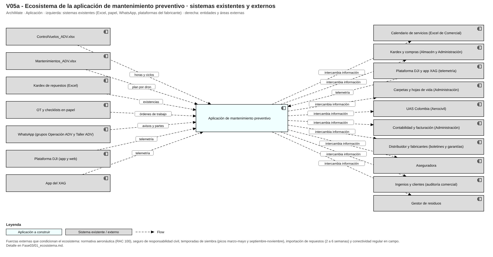

# Fase 3 · Análisis del ecosistema

## 1. Actores y organizaciones que rodean el proceso
Clientes (dos ingenios con el 60-65 % de los ingresos, arroceros del Tolima, haciendas de palma, agroempresas y pequeños productores), el distribuidor DJI de Cali y los fabricantes (DJI y XAG), un técnico electrónico externo, el gestor de importaciones, la aseguradora, la Aerocivil (UAS Colombia), el ICA, el Ministerio de Trabajo y Ambiente (SST y posconsumo), el contador externo y los gestores de residuos (P21, P25, P133). Internamente: Gerencia, Operaciones y Mantenimiento, Almacén, Administración y Comercial (17 personas).

## 2. Sistemas existentes (hoy no hay software de mantenimiento)

| Sistema existente | Qué hace hoy | Qué pasa con la aplicación |
|---|---|---|
| ControlVuelos_ADV.xlsx | Excel de horas y ciclos alimentado con fotos de los partes por WhatsApp. | Se reemplaza o se integra por archivo |
| Mantenimientos_ADV.xlsx | Excel del plan por modelo y dron con colores; lo lleva el jefe. | Se reemplaza o se integra por archivo |
| Kardex de repuestos (Excel) | Control de existencias del almacén. | Se reemplaza o se integra por archivo |
| OT y checklists en papel | Orden de trabajo autocopiable, checklists pre y postvuelo y bitácora en cuaderno. | Se reemplaza o se integra por archivo |
| WhatsApp (grupos Operación ADV y Taller ADV) | Coordinación diaria, fotos de partes y urgencias. | Se reemplaza o se integra por archivo |
| Plataforma DJI (app y web) | Logs de vuelo, horas de motor y salud de baterías de los Agras. | Se reemplaza o se integra por archivo |
| App del XAG | Plataforma aparte del XAG P100 Pro. | Se reemplaza o se integra por archivo |

## 3. Flujos de información hacia dentro y fuera (tabla ACL)

| Actor / organización externa | Qué intercambia | Capa anticorrupción |
|---|---|---|
| Programación de servicios a clientes | ← calendario de servicios (lote, hectáreas, fechas, horas estimadas ±20 %). → disponibilidad por dron (verde/amarillo/rojo), fechas de parada, horas remanentes y tope de drones prometibles. | ACL-01 |
| Inventario y compras de repuestos | ← existencias, ubicación, reservas y tiempos de entrega. → requerimiento por OT, consumos reales, solicitudes de reposición y kit de temporada. | ACL-02 |
| Telemetría de vuelo del fabricante | ← horas de motor por dron, ciclos y salud por batería (por ID), voltajes, alarmas, errores de motor/ESC, rutas y litros. | ACL-03 |
| Certificaciones de personal | ← certificaciones vigentes con vencimientos y disponibilidad de técnicos. → tareas firmadas, horas-hombre y necesidades de formación. | ACL-04 |
| Registro y supervisión aeronáutica | → registros de mantenimiento, bitácoras y evidencias para inspección; reportes de ocurrencias. ← requisitos (RAC 100), certificados y registros. | ACL-05 |
| Contabilidad y facturación | ← facturas de repuestos y servicios (costos). → costos por OT, horas-hombre y consumos. | ACL-06 |
| Soporte, garantías y boletines del fabricante | ← boletines de servicio, firmware, intervalos del manual y respuesta a garantías. → reclamos con serie, fecha, factura y evidencia de uso. | ACL-07 |
| Cobertura de seguros | → evidencia de mantenimiento (OTs y bitácoras) en siniestros. ← condiciones de la póliza. | ACL-08 |
| Auditoría comercial de clientes | → informes y evidencias de operación y mantenimiento por dron. ← solicitudes de auditoría. | ACL-09 |
| Gestión de residuos y posconsumo | → batería retirada para disposición. ← certificado de disposición. | ACL-10 |

## 4. Fuerzas externas
Normativa aeronáutica (RAC 100, Res. 0334/2024 aclarada por 00077/2025), seguro de responsabilidad civil, temporadas de siembra (picos marzo-mayo y septiembre-noviembre; taller general diciembre-enero), importación de repuestos (2 a 6 semanas, aduana) y dependencia del fabricante para telemetría y firmware (H-02, H-03, H-05, H-30, H-35).

## 5. Restricciones técnicas y organizacionales
Presupuesto de pyme sin licencias caras por usuario, conectividad regular en campo, telemetría solo por exportación manual, usuarios sin tiempo para digitar dos veces, un jefe que carga dos sombreros (operaciones y mantenimiento), cargo de inspector inexistente y datos personales bajo la Ley 1581/2012 (P142, H-11, H-22, H-35).
