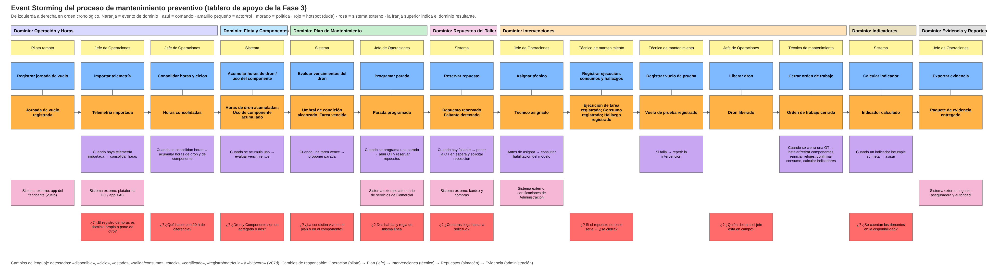

# Fase 3 · Event Storming del proceso

**Cómo se hizo.** Con los eventos y excepciones del E2E (V3 y V3b) y la entrevista, en el orden del proceso (método de 3 pasos de la clase): (1) estructura organizacional y capacidades (V2); (2) tormenta de eventos con comandos, actores, políticas, sistemas externos y hotspots; (3) líneas entre grupos de eventos donde cambian el lenguaje, el responsable, la razón para cambiar, los datos que posee o las reglas. Las convenciones de color son las clásicas del Event Storming.

Bifurcaciones identificadas: faltante de repuesto (OT en espera), condición crítica vencida en servicio, vuelo de prueba fallido, intervención no cumplida y los tres disparadores del paso «Detectar» (umbral, boletín del fabricante, hallazgo).

| # | Dominio | Actor | Comando | Evento(s) | Política | Sistema externo | Hotspot (duda) |
|---|---|---|---|---|---|---|---|
| 1 | Operación y Horas | Piloto remoto | Registrar jornada de vuelo | Jornada de vuelo registrada | — | app del fabricante (vuelo) | — |
| 2 | Operación y Horas | Jefe de Operaciones | Importar telemetría | Telemetría importada | Cuando haya telemetría importada → consolidar horas | plataforma DJI / app XAG | ¿El registro de horas es dominio propio o parte de otro? |
| 3 | Operación y Horas | Jefe de Operaciones | Consolidar horas y ciclos | Horas consolidadas | Cuando se consolidan horas → acumular horas de dron y de componente | — | ¿Qué hacer con 20 h de diferencia? |
| 4 | Flota y Componentes | Sistema | Acumular horas de dron / uso del componente | Horas de dron acumuladas; Uso de componente acumulado | Cuando se acumula uso → evaluar vencimientos | — | ¿Dron y Componente son un agregado o dos? |
| 5 | Plan de Mantenimiento | Sistema | Evaluar vencimientos del dron | Umbral de condición alcanzado; Tarea vencida | Cuando una tarea vence → proponer parada | — | ¿La condición vive en el plan o en el componente? |
| 6 | Plan de Mantenimiento | Jefe de Operaciones | Programar parada | Parada programada | Cuando se programa una parada → abrir OT y reservar repuestos | calendario de servicios de Comercial | Dos bahías y regla de misma línea |
| 7 | Repuestos del Taller | Sistema | Reservar repuesto | Repuesto reservado  /  Faltante detectado | Cuando hay faltante → poner la OT en espera y solicitar reposición | kardex y compras | ¿Compras llega hasta la solicitud? |
| 8 | Intervenciones | Jefe de Operaciones | Asignar técnico | Técnico asignado | Antes de asignar → consultar habilitación del modelo | certificaciones de Administración | — |
| 9 | Intervenciones | Técnico de mantenimiento | Registrar ejecución, consumos y hallazgos | Ejecución de tarea registrada; Consumo registrado; Hallazgo registrado | — | — | Si el repuesto no tiene serie → ¿se cierra? |
| 10 | Intervenciones | Técnico de mantenimiento | Registrar vuelo de prueba | Vuelo de prueba registrado | Si falla → repetir la intervención | — | — |
| 11 | Intervenciones | Jefe de Operaciones | Liberar dron | Dron liberado | — | — | ¿Quién libera si el jefe está en campo? |
| 12 | Intervenciones | Técnico de mantenimiento | Cerrar orden de trabajo | Orden de trabajo cerrada | Cuando se cierra una OT → instalar/retirar componentes, reiniciar relojes, confirmar consumo, calcular indicadores | — | — |
| 13 | Indicadores | Sistema | Calcular indicador | Indicador calculado | Cuando un indicador incumple su meta → avisar | — | ¿Se cuentan los donantes en la disponibilidad? |
| 14 | Evidencia y Reportes | Jefe de Operaciones | Exportar evidencia | Paquete de evidencia entregado | — | ingenio, aseguradora y autoridad | — |

## Cambios de lenguaje (candidatos a fronteras)
«Disponible» (Comercial vs. taller), «ciclo» (batería, dron, bomba), «estado» (condición, OT, semáforo), «salida/consumo» (Almacén vs. taller), «stock/existencia», «certificado» (curso vs. Aerocivil), «registro/matrícula» y «bitácora» (autoridad vs. cuaderno), «horas de motor/horas de vuelo» y «servicio/misión». Se explicitan en V07d.

## Cambios de responsable
Piloto (registro) → Jefe (plan y programación) → Técnico (ejecución) → Almacén (repuestos) → Administración (evidencia y costos). Cada cambio apunta a una frontera de dominio.

## Hotspots convertidos en decisiones
Se resuelven con argumentos en `04_dominios.md` y `Fase04/01_criterios_de_diseno.md` (por ejemplo, Dron y Componente son dos agregados; la condición vive en el Plan).
