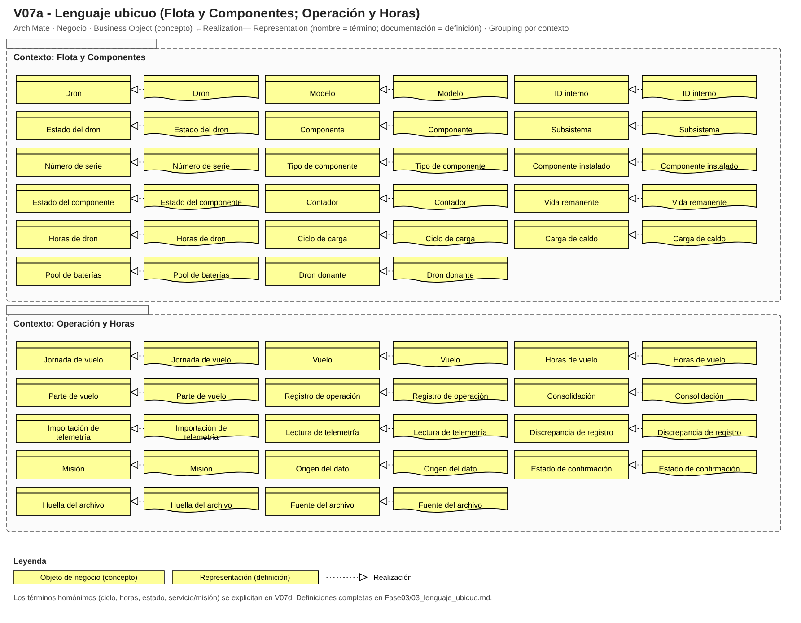
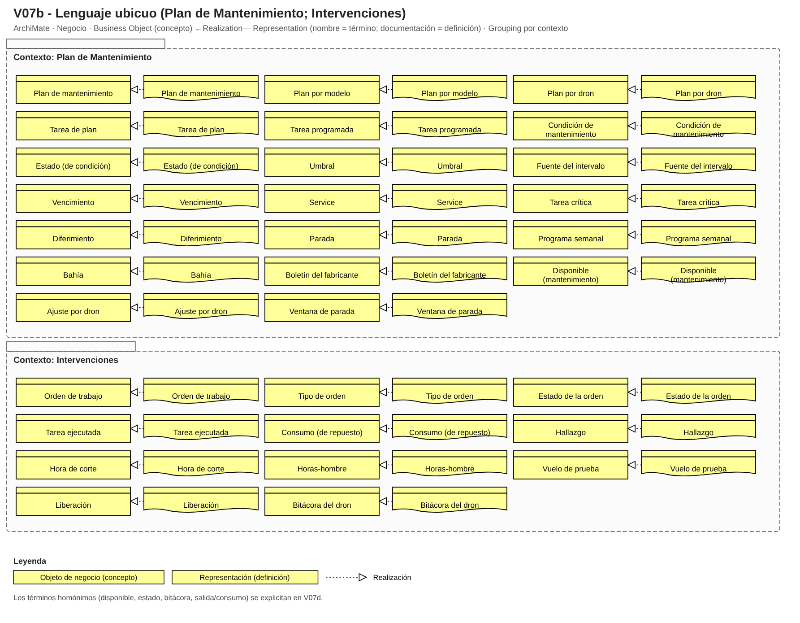
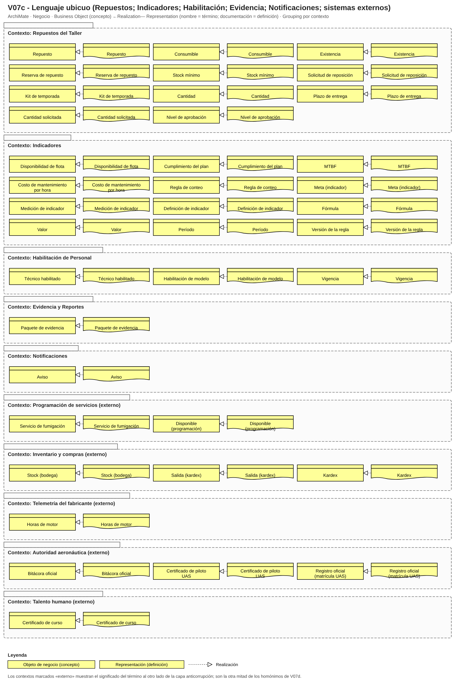
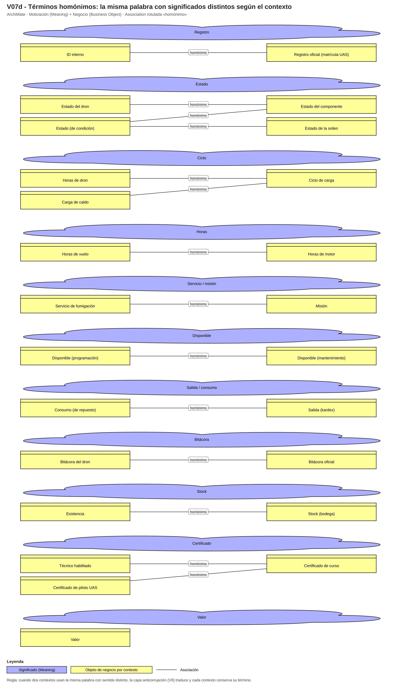

# Fase 3 · Lenguaje ubicuo (V7)

**100 términos** (la regla pide 25-40 relevantes; el resto son los términos de las partes de los agregados) y **11 grupos de homónimos** explícitos (la regla pide al menos 2). En Archi cada término es un *Business Object* (el concepto), con una *Representation* que lo realiza (nombre = término, documentación = definición, propiedades = contexto y ejemplo) y un *Meaning* para las palabras con significados distintos; cada homónimo aparece una vez por contexto, unido con una asociación rotulada «homónimo». El mismo término se usa idéntico en las vistas V3 a V11, en las tablas y en los nombres del modelo.

## Homónimos

| Palabra | Significados por contexto |
|---|---|
| Registro | **ID interno** → Flota y Componentes: Identificación propia de la empresa (ADV-01 a ADV-12) pintada en los brazos del dron.; **Registro oficial (matrícula UAS)** → Autoridad aeronáutica (externo): Registro de la aeronave ante la Aerocivil en UAS Colombia; no es el ID interno. |
| Estado | **Estado del dron** → Flota y Componentes: Semáforo operativo del dron en el tablero: verde (disponible), amarillo (por vencer o en espera) o rojo (parado).; **Estado del componente** → Flota y Componentes: Etapa de su ciclo de vida: nuevo, instalado, en bodega, donante, retirado o dispuesto.; **Estado (de condición)** → Plan de Mantenimiento: Condición física observada de una pieza: grieta, holgura, hinchazón, desviación de caudal.; **Estado de la orden** → Intervenciones: Etapa de la OT: abierta, en espera, en ejecución, ejecutada, liberada, cerrada. |
| Ciclo | **Horas de dron** → Flota y Componentes: Acumulado total de vuelo del dron; corre para siempre, como el odómetro de un carro.; **Ciclo de carga** → Flota y Componentes: Un ciclo completo de carga de una batería, contado por la plataforma del fabricante por ID de batería.; **Carga de caldo** → Flota y Componentes: Llenado del tanque con caldo; es el 'ciclo' que castiga a la bomba y al tanque. |
| Horas | **Horas de vuelo** → Operación y Horas: Tiempo en el aire del dron; base para los intervalos de mantenimiento.; **Horas de motor** → Telemetría del fabricante (externo): Tiempo de motor encendido que reporta el fabricante; también suma en pruebas de banco. |
| Servicio / misión | **Servicio de fumigación** → Programación de servicios (externo): Trabajo contratado por lote y hectáreas con fecha; para el piloto se llama 'misión' y para la oficina 'servicio'.; **Misión** → Operación y Horas: Salida de campo de un piloto con un dron para ejecutar un servicio de fumigación. |
| Disponible | **Disponible (programación)** → Programación de servicios (externo): Para quien programa servicios: el dron existe y hay piloto.; **Disponible (mantenimiento)** → Plan de Mantenimiento: Dron en verde: con service al día, componentes vigentes y baterías operativas. |
| Salida / consumo | **Consumo (de repuesto)** → Intervenciones: Repuesto realmente gastado en una OT, con la serie retirada y la instalada.; **Salida (kardex)** → Inventario y compras (externo): Movimiento de descuento en el kardex de Nubia; puede anotarse tarde y no coincidir con el consumo. |
| Bitácora | **Bitácora del dron** → Intervenciones: Cuaderno histórico de vuelos y mantenimiento de cada dron de la empresa.; **Bitácora oficial** → Autoridad aeronáutica (externo): Registro que la autoridad exige y puede inspeccionar; no es el cuaderno interno. |
| Stock | **Existencia** → Repuestos del Taller: Unidades que el taller puede usar hoy, sin contar lo reservado.; **Stock (bodega)** → Inventario y compras (externo): Para el almacén: unidades físicas en estantería, incluidas las reservadas. |
| Certificado | **Técnico habilitado** → Habilitación de Personal: Técnico con el curso del modelo al día para una tarea (en el taller, 'habilitado' = curso del modelo vigente).; **Certificado de curso** → Talento humano (externo): Constancia del fabricante o distribuidor para técnicos; no es licencia estatal.; **Certificado de piloto UAS** → Autoridad aeronáutica (externo): Certificado de idoneidad que expide la Aerocivil a los pilotos (RAC 100, capítulo G). |
| Valor | **Valor (medición)** → Indicadores: Resultado numérico de una medición (91 %).; **Valor (beneficio, V1)** → Motivación: Utilidad que aporta la aplicación: flota lista en temporada, contratos conservados, seguridad demostrable. |

## Glosario completo

| Término | Definición | Dominio / contexto | Ejemplo | Sinónimos que NO se usan | Homónimo en otro contexto | Fuente |
|---|---|---|---|---|---|---|
| Dron | Aeronave no tripulada de la flota, con identidad propia y horas acumuladas que nunca se reinician. | Flota y Componentes | ADV-03 (T40) con 240 h de dron. | equipo, máquina, avión | — | H-01; P2 |
| Modelo | Tipo de dron con despiece y plan propios (T40, T30, T16, XAG P100 Pro). | Flota y Componentes | T40: 8 motores coaxiales, tanque de 40 L. | versión, línea (salvo en la regla de 'misma línea') | — | H-01, H-33; P42 |
| ID interno | Identificación propia de la empresa (ADV-01 a ADV-12) pintada en los brazos del dron. | Flota y Componentes | ADV-02. | matrícula, registro | Registro oficial (matrícula UAS) (Autoridad aeronáutica (externo)) | H-02; P2 |
| Estado del dron | Semáforo operativo del dron en el tablero: verde (disponible), amarillo (por vencer o en espera) o rojo (parado). | Flota y Componentes | ADV-02 en rojo durante 21 días. | color, status | Estado del componente (Flota y Componentes); Estado (de condición) (Plan de Mantenimiento); Estado de la orden (Intervenciones) | P26, P91 |
| Componente | Pieza con identidad (número de serie), contadores propios y vida útil limitada: motor, batería, bomba, brazo, controlador. | Flota y Componentes | Motor serie M-4471 con 180 h propias. | pieza, parte | — | H-20, H-21; P40-P44 |
| Subsistema | Agrupación funcional del despiece de un modelo: Propulsión, Energía, Aspersión, Navegación/control, Comunicaciones, Sensores, Estructura. | Flota y Componentes | Aspersión: tanque, bomba, mangueras, filtros, boquillas. | módulo, sección | — | P40/P41 |
| Número de serie | Identificador del fabricante de un componente mayor; se anota al recibirlo y al instalarlo. | Flota y Componentes | Serie de la batería BAX601 marcada en la carcasa. | código, referencia | — | P43 |
| Tipo de componente | Clase de componente del catálogo del modelo (motor, hélice, batería, bomba, filtro, boquilla, manguera...). | Flota y Componentes | Hélice. | categoría de pieza | — | P46 |
| Componente instalado | Componente montado en una posición del despiece de un dron en un momento dado. | Flota y Componentes | Motor M-4471 en el brazo 2 del ADV-03 desde la OT 2026-117. | montado, puesto | — | H-20 |
| Estado del componente | Etapa de su ciclo de vida: nuevo, instalado, en bodega, donante, retirado o dispuesto. | Flota y Componentes | Batería retirada por salud < 80 %. | situación | Estado del dron (Flota y Componentes); Estado (de condición) (Plan de Mantenimiento); Estado de la orden (Intervenciones) | P54 |
| Contador | Acumulador propio de un componente según su tipo: horas, ciclos de carga o cargas de caldo. | Flota y Componentes | Contador de horas del motor. | odómetro (se reserva para las horas del dron) | — | H-20; P36, P48 |
| Vida remanente | Horas, ciclos o días que le quedan a un componente antes de su umbral; viaja con él al cambiar de dron. | Flota y Componentes | Motor sale del ADV-10 con 180 h; le quedan 120 h hasta las 300 h. | vida útil restante | — | H-20; P51 |
| Horas de dron | Acumulado total de vuelo del dron; corre para siempre, como el odómetro de un carro. | Flota y Componentes | 240 h de dron. | ciclos del dron | Ciclo de carga (Flota y Componentes); Carga de caldo (Flota y Componentes) | P36, P48 |
| Ciclo de carga | Un ciclo completo de carga de una batería, contado por la plataforma del fabricante por ID de batería. | Flota y Componentes | Batería con 700 ciclos y salud 75 %. | vuelo, uso | Horas de dron (Flota y Componentes); Carga de caldo (Flota y Componentes) | H-13, H-18; P48 |
| Carga de caldo | Llenado del tanque con caldo; es el 'ciclo' que castiga a la bomba y al tanque. | Flota y Componentes | 40 a 60 cargas por jornada de campo. | recarga, llenada | Horas de dron (Flota y Componentes); Ciclo de carga (Flota y Componentes) | P14, P48 |
| Pool de baterías | Conjunto de baterías que rotan entre los drones según la jornada; no pertenecen a un dron. | Flota y Componentes | Pool de unas 30 baterías para los T40. | baterías del dron | — | P44 |
| Dron donante | Dron fuera de operación normal cuyas piezas con vida restante se reutilizan en otros. | Flota y Componentes | ADV-10 (T16). | dron muerto, chatarra | — | P2, P44 |
| Jornada de vuelo | Día de trabajo de un dron con un piloto, con uno o más vuelos y un solo parte. | Operación y Horas | ADV-04, 12 de marzo, piloto Camilo. | turno, salida | — | P12-P14 |
| Vuelo | Salida del dron con duración, litros asperjados, batería usada y alarmas. | Operación y Horas | Vuelo de 6 min con la batería 14. | misión (la misión es el servicio completo) | — | P82 |
| Horas de vuelo | Tiempo en el aire del dron; base para los intervalos de mantenimiento. | Operación y Horas | 4 a 6 h por dron en una jornada. | horas de motor | Horas de motor (Telemetría del fabricante (externo)) | H-26; P3 |
| Parte de vuelo | Formato en papel que diligencia el piloto al final de la jornada: lote, cliente, producto, dosis e incidentes. | Operación y Horas | Parte fotografiado al grupo de WhatsApp. | reporte, planilla | — | P13, P82 |
| Registro de operación | Unión consolidada de la app del fabricante, el parte de vuelo y el WhatsApp para una jornada de un dron. | Operación y Horas | Registro del ADV-06 del 14 de agosto. | bitácora | — | P82 |
| Consolidación | Paso de unificar los tres canales de registro en las horas y ciclos oficiales del dron (hoy los viernes). | Operación y Horas | Consolidación del viernes con 2 a 4 días de atraso. | digitación, pasar al Excel | — | H-24; P37 |
| Importación de telemetría | Carga de un archivo exportado de la plataforma del fabricante al registro de operación; se hace una sola vez por archivo. | Operación y Horas | Exportación semanal de la cuenta DJI. | sincronización | — | H-35; P83 |
| Lectura de telemetría | Dato individual importado (horas de motor, ciclos de batería, voltaje, alarma). | Operación y Horas | Salud de la batería 14 = 82 %. | log | — | P83 |
| Discrepancia de registro | Diferencia entre canales del mismo vuelo (papel vs. plataforma) que debe conciliarse; manda la plataforma para mantenimiento. | Operación y Horas | Papel dice 5 h y la app 4,2 h. | error de digitación | — | H-25; P84 |
| Servicio de fumigación | Trabajo contratado por lote y hectáreas con fecha; para el piloto se llama 'misión' y para la oficina 'servicio'. | Programación de servicios (externo) | 220 ha de arroz en el Tolima. | misión (en la oficina) | Misión (Operación y Horas) | H-36; P128 |
| Misión | Salida de campo de un piloto con un dron para ejecutar un servicio de fumigación. | Operación y Horas | Misión del lunes a las 5:00 a.m. | servicio (en la operación) | Servicio de fumigación (Programación de servicios (externo)) | H-36; P12, P128 |
| Disponible (programación) | Para quien programa servicios: el dron existe y hay piloto. | Programación de servicios (externo) | Dron prometido a un cliente. | — | Disponible (mantenimiento) (Plan de Mantenimiento) | H-36; P128 |
| Horas de motor | Tiempo de motor encendido que reporta el fabricante; también suma en pruebas de banco. | Telemetría del fabricante (externo) | Horas de motor del ADV-03 en la plataforma. | horas de vuelo | Horas de vuelo (Operación y Horas) | H-26; P130 |
| Plan de mantenimiento | Conjunto de tareas con sus condiciones, definido por modelo y ajustado por dron. | Plan de Mantenimiento | Hoja del T40 con columnas por dron. | calendario de mantenimiento | — | P68, P69 |
| Plan por modelo | Versión del plan que nace del manual del fabricante para un modelo. | Plan de Mantenimiento | Plan del T40 versión 3. | plantilla | — | P69, P70 |
| Plan por dron | Plan de un dron concreto: tareas del modelo con sus vencimientos y ajustes propios. | Plan de Mantenimiento | Plan del ADV-03. | hoja del dron | — | P69 |
| Tarea de plan | Actividad preventiva del modelo asociada a un tipo de componente y a una condición. | Plan de Mantenimiento | Cambio de filtros cada 50-100 h. | mantenimiento (genérico) | — | P46 |
| Tarea programada | Tarea del plan de un dron con su próximo vencimiento y estado (al día, por vencer, vencida, diferida). | Plan de Mantenimiento | Service de 100 h del ADV-03: por vencer a las 95 h. | pendiente | — | P68, P79 |
| Condición de mantenimiento | Regla que dispara una tarea por horas, ciclos, calendario o estado; con varias, manda lo que ocurra primero. | Plan de Mantenimiento | Batería: 800-1.000 ciclos o salud < 80 %. | intervalo (solo cubre horas) | — | H-17; P45-P47 |
| Estado (de condición) | Condición física observada de una pieza: grieta, holgura, hinchazón, desviación de caudal. | Plan de Mantenimiento | Boquilla con caudal desviado más de 10 %. | estado de la OT | Estado del dron (Flota y Componentes); Estado del componente (Flota y Componentes); Estado de la orden (Intervenciones) | P45, P46 |
| Umbral | Valor que activa una condición (100 h, 800 ciclos, 1 año, 10 % de desvío); siempre lleva su fuente. | Plan de Mantenimiento | Motores: 300 h. | límite, tope | — | P46; H-15 |
| Fuente del intervalo | Origen de un umbral: manual del fabricante o criterio interno; el interno nunca es más laxo que el manual. | Plan de Mantenimiento | Hélices: 100 h (interna), manual por verificar. | referencia | — | H-15; P123 |
| Vencimiento | Momento en que una tarea pasa a exigible: amarillo por vencer, rojo vencido. | Plan de Mantenimiento | Vence a las 100 h; hoy 95 h. | caducidad | — | P68 |
| Service | Intervención preventiva por intervalo de horas (25 h, 100 h) o mayor de motores (~300 h). | Plan de Mantenimiento | Service de 100 h: un día en bahía. | mantenimiento general | — | P28, P78 |
| Tarea crítica | Tarea de seguridad (motores, estructura, batería hinchada) que no se difiere nunca; el dron no vuela si está vencida. | Plan de Mantenimiento | Reapriete tras golpe en brazo. | tarea urgente | — | H-19; P49-P50 |
| Diferimiento | Aplazamiento autorizado de una tarea menor hasta 10 % de su intervalo, con firma del jefe. | Plan de Mantenimiento | Filtros diferidos 8 h. | estiramiento (mala práctica) | — | H-19; P49 |
| Parada | Ingreso programado de un dron al taller para una o varias tareas agrupadas. | Plan de Mantenimiento | Parada del miércoles 19 en bahía 1. | entrada a taller | — | P72 |
| Programa semanal | Decisión del lunes 6:30 a.m.: paradas, técnicos y repuestos de la semana. | Plan de Mantenimiento | Programa de la semana 34. | agenda | — | P71 |
| Bahía | Espacio físico del taller; hay dos y no caben más de dos drones a la vez. | Plan de Mantenimiento | Bahía 1. | puesto de trabajo | — | P74 |
| Boletín del fabricante | Aviso del fabricante o distribuidor que puede cambiar un intervalo del plan. | Plan de Mantenimiento | Boletín que acorta la inspección de conectores. | circular | — | P70, P106 |
| Disponible (mantenimiento) | Dron en verde: con service al día, componentes vigentes y baterías operativas. | Plan de Mantenimiento | ADV-05 en verde. | operativo | Disponible (programación) (Programación de servicios (externo)) | H-36; P91, P128 |
| Orden de trabajo | Documento que autoriza y registra una intervención sobre un dron: tareas, repuestos con serie, horas-hombre, hallazgos y firmas. | Intervenciones | OT del service de 100 h del ADV-06. | ticket, solicitud | — | P33-P35 |
| Tipo de orden | Clase de la OT: preventiva (P), correctiva (C) o por condición. | Intervenciones | OT marcada 'C'. | categoría de OT | — | P30, P147 |
| Estado de la orden | Etapa de la OT: abierta, en espera, en ejecución, ejecutada, liberada, cerrada. | Intervenciones | OT en espera de repuesto. | estado del dron | Estado del dron (Flota y Componentes); Estado del componente (Flota y Componentes); Estado (de condición) (Plan de Mantenimiento) | P65, P76 |
| Tarea ejecutada | Trabajo realizado dentro de una OT con su resultado y quien lo hizo. | Intervenciones | Calibración de bomba realizada. | paso | — | P33 |
| Consumo (de repuesto) | Repuesto realmente gastado en una OT, con la serie retirada y la instalada. | Intervenciones | Dos boquillas y un kit de filtros. | salida | Salida (kardex) (Inventario y compras (externo)) | H-36; P129 |
| Hallazgo | Hecho encontrado durante una intervención o inspección que no estaba en el plan. | Intervenciones | Manguera con rajadura incipiente. | novedad | — | P38 |
| Hora de corte | Horas del componente al desmontarlo o instalarlo; permite arrastrar su vida remanente. | Intervenciones | Motor sale del ADV-10 con 180 h. | lectura de corte | — | H-20; P36, P86 |
| Horas-hombre | Tiempo de trabajo de los técnicos en una OT, base del costo de mano de obra. | Intervenciones | 6 h-h en un service de 100 h. | tiempo de taller | — | P35 |
| Vuelo de prueba | Vuelo de 5 a 10 minutos tras un trabajo mayor, revisando vibraciones y temperaturas. | Intervenciones | Prueba a las 6:30 a.m. del viernes 21. | vuelo de ensayo | — | H-23; P24 |
| Liberación | Firma que autoriza el regreso del dron al servicio; en trabajos mayores la da quien no ejecutó. | Intervenciones | Pompilio firma a las 8:00. | visto bueno | — | H-22; P24, P34 |
| Bitácora del dron | Cuaderno histórico de vuelos y mantenimiento de cada dron de la empresa. | Intervenciones | Bitácora del ADV-03. | libro de vida | Bitácora oficial (Autoridad aeronáutica (externo)) | H-36; P114, P132 |
| Bitácora oficial | Registro que la autoridad exige y puede inspeccionar; no es el cuaderno interno. | Autoridad aeronáutica (externo) | Bitácora mostrada en una inspección. | — | Bitácora del dron (Intervenciones) | H-36; P132 |
| Repuesto | Unidad en bodega destinada a reemplazar un componente (mayores con serie, consumibles por lote). | Repuestos del Taller | Brazo completo T40. | pieza de bodega | — | P56, P57 |
| Consumible | Repuesto que se gasta por lote: filtros, boquillas, hélices, tornillería, sellante. | Repuestos del Taller | Kit de filtros. | insumo | — | P43, P56 |
| Existencia | Unidades que el taller puede usar hoy, sin contar lo reservado. | Repuestos del Taller | 6 boquillas, 2 reservadas: existencia 4. | stock (para el taller) | Stock (bodega) (Inventario y compras (externo)) | H-36; P129 |
| Reserva de repuesto | Apartado de repuestos para una intervención programada. | Repuestos del Taller | Kit de filtros reservado para la parada del miércoles. | separado | — | H-29; P28 |
| Stock mínimo | Cantidad por debajo de la cual se solicita reposición inmediata. | Repuestos del Taller | 2 brazos T40. | mínimo de bodega | — | P59 |
| Solicitud de reposición | Pedido interno que nace al tocar el stock mínimo; aprueba el jefe hasta $5 M y la gerencia por encima. | Repuestos del Taller | Solicitud de 2 motores. | orden de compra | — | P61 |
| Kit de temporada | Paquete de filtros, boquillas y hélices que arma el distribuidor para el inicio de cada pico. | Repuestos del Taller | Kit de marzo. | paquete | — | P57 |
| Stock (bodega) | Para el almacén: unidades físicas en estantería, incluidas las reservadas. | Inventario y compras (externo) | Stock del kardex de Nubia. | — | Existencia (Repuestos del Taller) | H-36; P129 |
| Salida (kardex) | Movimiento de descuento en el kardex de Nubia; puede anotarse tarde y no coincidir con el consumo. | Inventario y compras (externo) | Vale de salida en papel. | — | Consumo (de repuesto) (Intervenciones) | H-36; P129 |
| Kardex | Registro de existencias y movimientos de repuestos que lleva el almacén en Excel. | Inventario y compras (externo) | Kardex de Nubia. | inventario | — | P58 |
| Disponibilidad de flota | Dron-días en verde sobre dron-días del período por 100. | Indicadores | Octubre: 86,8 % contando los 12 drones. | uptime | — | P91, P95 |
| Cumplimiento del plan | OTs preventivas cerradas en la ventana sobre las programadas por 100. | Indicadores | 65-70 % hoy; meta 85 %. | avance del plan | — | P91 |
| MTBF | Horas de vuelo promedio entre correctivos; debe calcularse por componente. | Indicadores | ~40 h de flota agregada. | tiempo entre daños | — | P91, P94 |
| Costo de mantenimiento por hora | (Repuestos + mano de obra + servicios externos) sobre horas de vuelo del período. | Indicadores | $80-100 mil COP/h. | costo operativo | — | P91 |
| Regla de conteo | Decisión de qué drones entran al denominador de la disponibilidad (por ejemplo los donantes); debe ser una sola. | Indicadores | Donantes excluidos del denominador. | criterio | — | H-28; P95 |
| Meta (indicador) | Valor objetivo de un indicador con fecha. | Indicadores | ≥ 92 % en pico para 2027. | objetivo (sin número) | — | H-37 |
| Medición de indicador | Valor calculado de un indicador en un período con la versión de la regla usada. | Indicadores | Disponibilidad de agosto: 91 %. | reporte | — | P91 |
| Técnico habilitado | Técnico con el curso del modelo al día para una tarea (en el taller, 'habilitado' = curso del modelo vigente). | Habilitación de Personal | Jhon Fredy para el XAG. | certificado (genérico) | Certificado de curso (Talento humano (externo)); Certificado de piloto UAS (Autoridad aeronáutica (externo)) | P131; H-04 |
| Habilitación de modelo | Vigencia del curso de un técnico para un modelo concreto. | Habilitación de Personal | Curso T40 vigente hasta dic. | licencia | — | P23, P131 |
| Certificado de curso | Constancia del fabricante o distribuidor para técnicos; no es licencia estatal. | Talento humano (externo) | Curso Agras del distribuidor en Cali. | licencia | Técnico habilitado (Habilitación de Personal); Certificado de piloto UAS (Autoridad aeronáutica (externo)) | P23, P131 |
| Certificado de piloto UAS | Certificado de idoneidad que expide la Aerocivil a los pilotos (RAC 100, capítulo G). | Autoridad aeronáutica (externo) | Certificado del piloto Camilo. | curso | Técnico habilitado (Habilitación de Personal); Certificado de curso (Talento humano (externo)) | H-04; P131 |
| Paquete de evidencia | Conjunto de OTs, bitácora, consumos y series de un dron que se entrega a un ingenio, a la aseguradora o a la autoridad. | Evidencia y Reportes | Paquete del ADV-03 para la auditoría de un ingenio. | reporte suelto | — | P137; H-05 |
| Aviso | Mensaje al personal sobre un vencimiento, una parada o una habilitación por vencer, por correo o WhatsApp. | Notificaciones | Aviso de parada del miércoles. | aviso informal | — | P75 |
| Ajuste por dron | Cambio de umbral propio de un dron respecto de su plan por modelo; solo puede ser más estricto. | Plan de Mantenimiento | Inspección de motores más frecuente en el ADV-04 por polvo y urea. | excepción | — | P18, P69 |
| Ventana de parada | Intervalo de tiempo en que un dron permanece en el taller para una parada. | Plan de Mantenimiento | Miércoles 7:00 a viernes 8:00. | horario | — | P78 |
| Origen del dato | Canal por el que llegó un registro: plataforma del fabricante, parte de vuelo en papel o WhatsApp. | Operación y Horas | Origen: plataforma. | fuente (se reserva para la fuente del intervalo) | — | P82, P84 |
| Estado de confirmación | Si una jornada está confirmada o «por confirmar» por falta de datos. | Operación y Horas | Jornada por confirmar. | pendiente | — | P85 |
| Huella del archivo | Identificador del contenido de un archivo importado que evita importarlo dos veces. | Operación y Horas | Huella del export del viernes. | nombre del archivo | — | P83 |
| Fuente del archivo | Plataforma de la que se exportó un archivo de telemetría (DJI o XAG). | Operación y Horas | DJI. | proveedor | — | P83, P87 |
| Cantidad | Unidades de un repuesto: física, reservada y disponible. | Repuestos del Taller | 6 físicas, 2 reservadas. | saldo | — | P58 |
| Plazo de entrega | Tiempo que tarda un repuesto en llegar: 1 a 3 días con el distribuidor, 2 a 6 semanas si se importa. | Repuestos del Taller | Brazo T40: 3 semanas. | lead time | — | P59 |
| Cantidad solicitada | Unidades pedidas en una solicitud de reposición. | Repuestos del Taller | 2 motores. | pedido | — | P61 |
| Nivel de aprobación | Quién debe aprobar una solicitud según su monto: jefe hasta $5 millones, gerencia por encima. | Repuestos del Taller | Brazo de $10 M: gerencia. | autorización | — | P61 |
| Definición de indicador | Descripción versionada de un indicador: fórmula, regla de conteo y meta. | Indicadores | Disponibilidad v2. | KPI | — | P91 |
| Fórmula | Expresión con la que se calcula un indicador. | Indicadores | Dron-días en verde sobre dron-días. | cálculo | — | P91 |
| Valor | Resultado numérico de una medición. | Indicadores | 91 %. | dato | Value (beneficio, V1) | P91 |
| Período | Lapso al que corresponde una medición (mes, semana, temporada). | Indicadores | Agosto. | fecha | — | P91 |
| Versión de la regla | Versión de la regla de conteo usada en una medición. | Indicadores | Regla v2: donantes fuera. | revisión | — | H-28 |
| Vigencia | Fecha hasta la cual es válida una habilitación. | Habilitación de Personal | Hasta el 15 de diciembre. | vencimiento | — | P131 |
| Registro oficial (matrícula UAS) | Registro de la aeronave ante la Aerocivil en UAS Colombia; no es el ID interno. | Autoridad aeronáutica (externo) | Registro UAS del ADV-01. | ADV-01 | ID interno (Flota y Componentes) | H-02; P132 |
