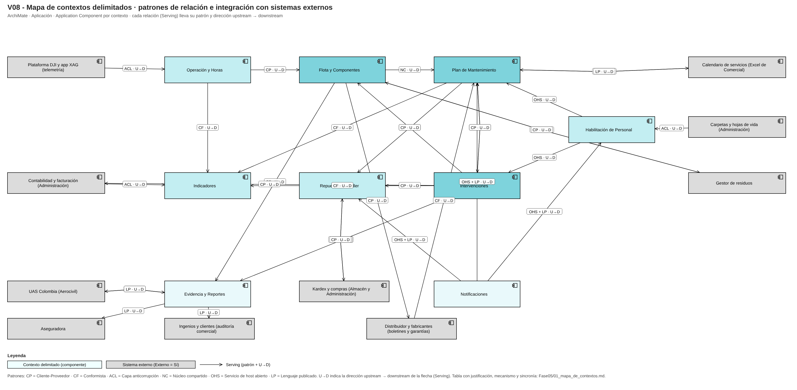
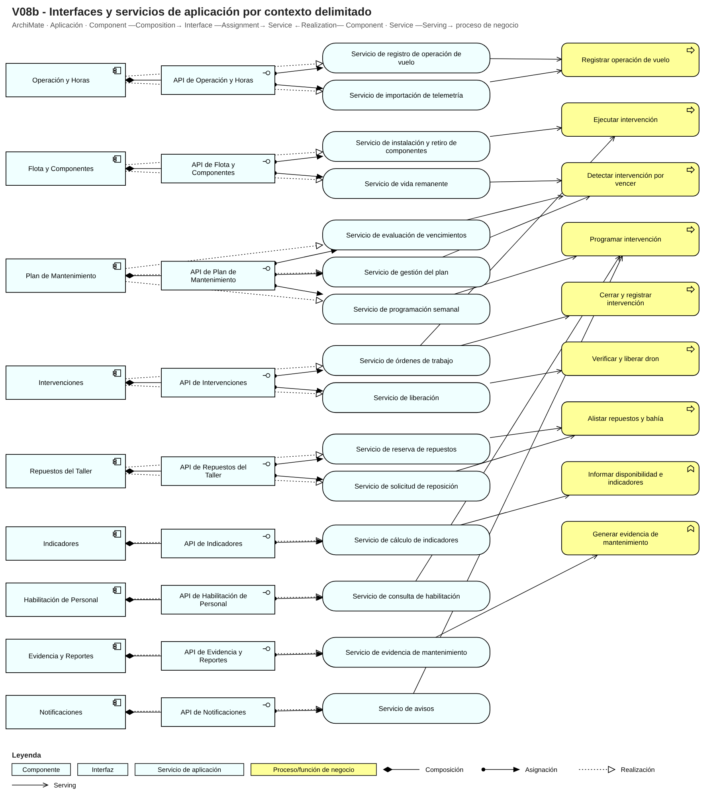

# Fase 5 · Mapa de contextos delimitados (V8)

## Contextos (1 dominio ≈ 1 contexto)
Cada dominio de la Fase 3 es un contexto con su propio modelo, lógica y base de datos; se relacionan por **eventos o APIs explícitas**, nunca por acceso directo a la base de otro contexto. No se fusionó ni se partió ningún dominio: el lenguaje de cada uno es consistente internamente (V07).

| Contexto | Clasificación | Propósito | Agregados que contiene | Responsable |
|---|---|---|---|---|
| Flota y Componentes | Core | Saber qué drones hay, qué componentes lleva cada uno y cuánta vida les queda, con el contador pegado al componente. | Dron, Componente | Jefe de Operaciones y Mantenimiento |
| Plan de Mantenimiento | Core | Decidir cuándo toca intervenir cada dron y componente y programar paradas sin chocar con los servicios. | Plan por modelo, Plan por dron, Programa semanal | Jefe de Operaciones y Mantenimiento |
| Intervenciones | Core | Ejecutar, liberar y cerrar el trabajo de mantenimiento dejando evidencia verificable. | Orden de trabajo | Técnicos y jefe |
| Operación y Horas | Soporte | Registrar las operaciones de vuelo y consolidar horas y ciclos en una entrada única. | Jornada de vuelo, Importación de telemetría | Jefe y pilotos |
| Repuestos del Taller | Soporte | Reservar y consumir repuestos por OT y pedir reposición al tocar el mínimo. | Existencia, Solicitud de reposición | Almacenista |
| Indicadores | Soporte | Calcular disponibilidad, cumplimiento del plan, MTBF y costo por hora con una sola regla de conteo. | Definición de indicador, Medición de indicador | Jefe y Gerencia |
| Habilitación de Personal | Soporte | Saber qué técnico está habilitado para qué modelo y tarea (espejo de lo que administra Talento humano). | Técnico habilitado | Administración (datos) / jefe (consulta) |
| Evidencia y Reportes | Genérico | Entregar el histórico por dron a ingenios, aseguradora y autoridad en un día. | — (se compra/integra) | Jefe de Operaciones y Mantenimiento |
| Notificaciones | Genérico | Avisar por correo o WhatsApp vencimientos, paradas y habilitaciones por vencer. | — (se compra/integra) | Jefe de Operaciones y Mantenimiento |

## Tabla de relaciones entre contextos

| Contexto A (upstream) | Contexto B (downstream) | Dirección | Patrón | Justificación | Mecanismo | Sinc./Asinc. |
|---|---|---|---|---|---|---|
| Operación y Horas | Flota y Componentes | Operación y Horas → Flota y Componentes | Cliente-Proveedor | Operación (upstream) publica las horas consolidadas; Flota (downstream) puede pedir cambios al contenido del evento; mismo equipo y producto. | Evento «Horas consolidadas» | Asíncrono |
| Flota y Componentes | Plan de Mantenimiento | Flota y Componentes → Plan de Mantenimiento | Núcleo compartido | Vida remanente (Flota) y vencimientos (Plan) comparten el modelo de condición, umbral y fuente del intervalo; se co-gobierna ese núcleo pequeño con el mismo equipo. | Biblioteca compartida (condición, umbral, fuente) + evento «Uso de componente acumulado» | Asíncrono |
| Plan de Mantenimiento | Intervenciones | Plan de Mantenimiento → Intervenciones | Cliente-Proveedor | Plan (upstream) entrega la parada programada; Intervenciones (downstream) pide ajustes (tareas agrupadas, repuestos). | Evento «Parada programada» | Asíncrono |
| Intervenciones | Flota y Componentes | Intervenciones → Flota y Componentes | Cliente-Proveedor | Intervenciones (upstream) informa instalaciones y retiros con hora de corte; Flota (downstream) puede exigir el formato. | Evento «Orden de trabajo cerrada» | Asíncrono |
| Intervenciones | Plan de Mantenimiento | Intervenciones → Plan de Mantenimiento | Cliente-Proveedor | El cierre de la OT reinicia los relojes de las tareas del plan. | Evento «Orden de trabajo cerrada» | Asíncrono |
| Plan de Mantenimiento | Repuestos del Taller | Plan de Mantenimiento → Repuestos del Taller | Cliente-Proveedor | Plan (upstream) pide reservas para sus paradas; Repuestos (downstream) negocia cantidades y kits. | Evento «Parada programada» | Asíncrono |
| Intervenciones | Repuestos del Taller | Intervenciones → Repuestos del Taller | Cliente-Proveedor | El cierre de la OT confirma el consumo real de repuestos. | Evento «Orden de trabajo cerrada» | Asíncrono |
| Habilitación de Personal | Plan de Mantenimiento | Habilitación de Personal → Plan de Mantenimiento | Servicio de host abierto | Habilitación expone una consulta estable a varios consumidores (Plan e Intervenciones). | API de consulta de habilitación | Síncrono |
| Habilitación de Personal | Intervenciones | Habilitación de Personal → Intervenciones | Servicio de host abierto | Misma consulta estable de habilitación. | API de consulta de habilitación | Síncrono |
| Operación y Horas | Indicadores | Operación y Horas → Indicadores | Conformista | Indicadores acepta el modelo de eventos de Operación tal cual; no necesita influir en él. | Evento «Horas consolidadas» | Asíncrono |
| Intervenciones | Indicadores | Intervenciones → Indicadores | Conformista | Indicadores acepta el evento «Orden de trabajo cerrada» tal cual. | Evento «Orden de trabajo cerrada» | Asíncrono |
| Plan de Mantenimiento | Indicadores | Plan de Mantenimiento → Indicadores | Conformista | Indicadores acepta los eventos de vencimiento tal cual. | Eventos «Tarea vencida» y «Umbral de condición alcanzado» | Asíncrono |
| Flota y Componentes | Evidencia y Reportes | Flota y Componentes → Evidencia y Reportes | Conformista | Evidencia lee el histórico de Flota sin pedir cambios. | Consulta de solo lectura | Síncrono |
| Intervenciones | Evidencia y Reportes | Intervenciones → Evidencia y Reportes | Conformista | Evidencia lee las OTs cerradas tal cual. | Consulta de solo lectura | Síncrono |
| Notificaciones | Plan de Mantenimiento | Notificaciones → Plan de Mantenimiento | Servicio de host abierto + Lenguaje publicado | Notificaciones expone una API estable con un esquema de mensaje documentado a muchos consumidores. | API «Enviar aviso» (esquema JSON) | Asíncrono |
| Notificaciones | Repuestos del Taller | Notificaciones → Repuestos del Taller | Servicio de host abierto + Lenguaje publicado | Mismo servicio de avisos. | API «Enviar aviso» | Asíncrono |
| Notificaciones | Habilitación de Personal | Notificaciones → Habilitación de Personal | Servicio de host abierto + Lenguaje publicado | Mismo servicio de avisos. | API «Enviar aviso» | Asíncrono |
| Plataforma DJI y app XAG (telemetría) | Operación y Horas | Plataforma DJI y app XAG (telemetría) → Operación y Horas | Capa anticorrupción | El modelo del fabricante («horas de motor», «registro de vuelo») es ajeno y cambia; Operación traduce y no se contamina (ACL-03). | Archivo exportado manualmente | Asíncrono |
| Calendario de servicios (Excel de Comercial) | Plan de Mantenimiento | Calendario de servicios (Excel de Comercial) → Plan de Mantenimiento | Capa anticorrupción | El calendario de Comercial usa «disponible» y «misión» con otro sentido; Plan traduce a ventanas de ocupación (ACL-01). | Archivo/Excel | Asíncrono |
| Plan de Mantenimiento | Calendario de servicios (Excel de Comercial) | Plan de Mantenimiento → Calendario de servicios (Excel de Comercial) | Lenguaje publicado | Se publica un formato estable de disponibilidad por dron (verde/amarillo/rojo) para Comercial (ACL-01). | Archivo/API de disponibilidad | Asíncrono |
| Kardex y compras (Almacén y Administración) | Repuestos del Taller | Kardex y compras (Almacén y Administración) → Repuestos del Taller | Capa anticorrupción | El kardex usa «salida» y «stock» con otro sentido y descuadres; Repuestos traduce a consumo y existencia (ACL-02). | Archivo/Excel | Asíncrono |
| Repuestos del Taller | Kardex y compras (Almacén y Administración) | Repuestos del Taller → Kardex y compras (Almacén y Administración) | Cliente-Proveedor | Almacén (downstream de la solicitud) puede pedir cambios en lo que solicita Repuestos. | Solicitud de reposición | Asíncrono |
| Carpetas y hojas de vida (Administración) | Habilitación de Personal | Carpetas y hojas de vida (Administración) → Habilitación de Personal | Capa anticorrupción | «Certificado» del curso no es el certificado de piloto; Habilitación traduce a vigencia por modelo (ACL-04). | PDF/Excel sincronizado | Asíncrono |
| UAS Colombia (Aerocivil) | Evidencia y Reportes | UAS Colombia (Aerocivil) → Evidencia y Reportes | Lenguaje publicado | La autoridad impone sus formatos (RAC 100 / UAS Colombia): se adopta su lenguaje publicado y se traduce el ID interno al registro oficial (ACL-05). | Archivo oficial/portal | Asíncrono |
| Evidencia y Reportes | UAS Colombia (Aerocivil) | Evidencia y Reportes → UAS Colombia (Aerocivil) | Lenguaje publicado | La evidencia se entrega en el formato que la autoridad define (ACL-05). | Archivo/portal | Asíncrono |
| Contabilidad y facturación (Administración) | Indicadores | Contabilidad y facturación (Administración) → Indicadores | Capa anticorrupción | El costo llega por factura, no por dron; se traduce a costo por OT y por dron (ACL-06). | Archivo/Excel | Asíncrono |
| Intervenciones | Contabilidad y facturación (Administración) | Intervenciones → Contabilidad y facturación (Administración) | Cliente-Proveedor | Contabilidad (downstream) recibe costos por OT y puede pedir el formato. | Evento «Orden de trabajo cerrada» | Asíncrono |
| Distribuidor y fabricantes (boletines y garantías) | Plan de Mantenimiento | Distribuidor y fabricantes (boletines y garantías) → Plan de Mantenimiento | Conformista | Los boletines y manuales del fabricante son la base de los intervalos (principio P4); se acepta su modelo y se registra la fuente (ACL-07). | Correo/PDF | Asíncrono |
| Flota y Componentes | Distribuidor y fabricantes (boletines y garantías) | Flota y Componentes → Distribuidor y fabricantes (boletines y garantías) | Cliente-Proveedor | El fabricante (upstream en garantías) define qué evidencia pide; Flota negocia el contenido del reclamo (ACL-07). | Correo | Asíncrono |
| Evidencia y Reportes | Aseguradora | Evidencia y Reportes → Aseguradora | Lenguaje publicado | La aseguradora define el formato de evidencia del condicionado (ACL-08). | Correo/PDF | Asíncrono |
| Evidencia y Reportes | Ingenios y clientes (auditoría comercial) | Evidencia y Reportes → Ingenios y clientes (auditoría comercial) | Lenguaje publicado | Cada ingenio define su formato de informe de auditoría (ACL-09). | Correo/PDF | Asíncrono |
| Gestor de residuos | Flota y Componentes | Gestor de residuos → Flota y Componentes | Capa anticorrupción | El certificado en papel del gestor se traduce a «disposición del componente» (ACL-10). | PDF/papel | Asíncrono |
| Flota y Componentes | Gestor de residuos | Flota y Componentes → Gestor de residuos | Cliente-Proveedor | Flota notifica la batería retirada; el gestor (upstream en posconsumo) fija el procedimiento (ACL-10). | Correo | Asíncrono |

## Preguntas de decisión aplicadas a las tres relaciones del enunciado
- **Autoridad aeronáutica:** ella define el modelo y no podemos pedirle cambios → *Lenguaje publicado* (sus formatos RAC 100/UAS Colombia) más traducción del ID interno al registro oficial (por eso también hay ACL-05). Poder de negociación nulo, modelo ajeno estable.
- **Telemetría del fabricante:** el modelo ajeno («horas de motor», «registro de vuelo») cambia y nos dañaría si lo adoptamos → *Capa anticorrupción*. No hay API y la importación es manual por archivo.
- **Compras e inventario:** Almacén conoce el kardex con «salida» y «stock» con otro sentido y descuadres → *Capa anticorrupción* hacia Repuestos del Taller; la solicitud de reposición hacia Almacén es *Cliente-Proveedor* porque Almacén sí puede negociar el formato.

## Patrones usados y por qué
Cliente-Proveedor entre contextos del mismo equipo con negociación; Núcleo compartido entre Flota y Plan solo para condición/umbral/fuente (D-14); Conformista de Indicadores, Evidencia y del fabricante (no pueden o no necesitan influir); Servicio de host abierto con lenguaje publicado en Habilitación y Notificaciones (muchos consumidores).
