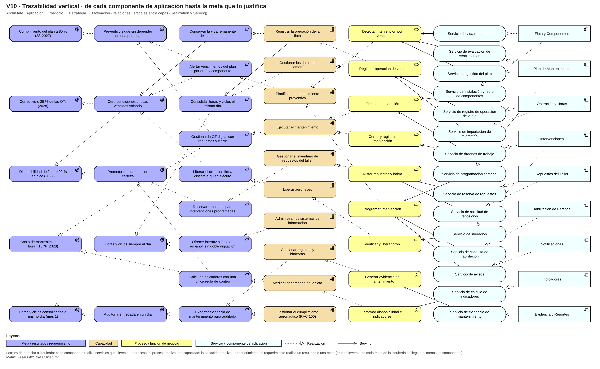

# Fase 6 · Trazabilidad vertical (V10)

Cadena objetivo (de arriba hacia abajo): **meta → requerimiento/resultado → capacidad → proceso/servicio de negocio → servicio de aplicación → componente de aplicación (contexto)**. Relaciones: componente *Realization* servicio de aplicación; servicio *Serving* proceso o función; proceso *Realization* capacidad; capacidad *Realization* requerimiento; requerimiento *Realization* resultado/meta.

**Pruebas.** Inversa: cada meta de V1 llega a al menos un componente (5 de 5 metas con fila completa). Directa: cada componente de V8 llega a al menos una meta (9 de 9 componentes con fila completa; los dos genéricos —Evidencia y Notificaciones— llegan por las funciones de evidencia y por avisos de programación). Prueba de impacto (como en clase): en Archi, seleccionar un componente → *Analysis → Model Relations* y confirmar que aparecen capacidades y metas; por ejemplo «Planificar el mantenimiento preventivo» muestra a Plan de Mantenimiento, el requerimiento «Alertar vencimientos…» y las metas de cumplimiento del plan y de correctivos.

## Matriz de trazabilidad

| Meta | Requerimiento | Capacidad | Proceso / función de negocio | Servicio de aplicación | Componente / contexto |
|---|---|---|---|---|---|
| Disponibilidad de flota ≥ 92 % en pico (2027) | Reservar repuestos para intervenciones programadas | Gestionar el inventario de repuestos del taller | Alistar repuestos y bahía | Servicio de reserva de repuestos | Repuestos del Taller |
| Disponibilidad de flota ≥ 92 % en pico (2027) | Reservar repuestos para intervenciones programadas | Gestionar el inventario de repuestos del taller | Alistar repuestos y bahía | Servicio de solicitud de reposición | Repuestos del Taller |
| Disponibilidad de flota ≥ 92 % en pico (2027) | Calcular indicadores con una única regla de conteo | Medir el desempeño de la flota | Informar disponibilidad e indicadores | Servicio de cálculo de indicadores | Indicadores |
| Disponibilidad de flota ≥ 92 % en pico (2027) | Alertar vencimientos del plan por dron y componente | Planificar el mantenimiento preventivo | Detectar intervención por vencer | Servicio de vida remanente | Flota y Componentes |
| Disponibilidad de flota ≥ 92 % en pico (2027) | Alertar vencimientos del plan por dron y componente | Planificar el mantenimiento preventivo | Detectar intervención por vencer | Servicio de evaluación de vencimientos | Plan de Mantenimiento |
| Disponibilidad de flota ≥ 92 % en pico (2027) | Alertar vencimientos del plan por dron y componente | Planificar el mantenimiento preventivo | Detectar intervención por vencer | Servicio de gestión del plan | Plan de Mantenimiento |
| Disponibilidad de flota ≥ 92 % en pico (2027) | Alertar vencimientos del plan por dron y componente | Planificar el mantenimiento preventivo | Programar intervención | Servicio de programación semanal | Plan de Mantenimiento |
| Disponibilidad de flota ≥ 92 % en pico (2027) | Alertar vencimientos del plan por dron y componente | Planificar el mantenimiento preventivo | Programar intervención | Servicio de consulta de habilitación | Habilitación de Personal |
| Disponibilidad de flota ≥ 92 % en pico (2027) | Alertar vencimientos del plan por dron y componente | Planificar el mantenimiento preventivo | Programar intervención | Servicio de avisos | Notificaciones |
| Disponibilidad de flota ≥ 92 % en pico (2027) | Liberar el dron con firma distinta a quien ejecutó | Liberar aeronaves | Verificar y liberar dron | Servicio de liberación | Intervenciones |
| Disponibilidad de flota ≥ 92 % en pico (2027) | Conservar la vida remanente del componente | Registrar la operación de la flota | Registrar operación de vuelo | Servicio de registro de operación de vuelo | Operación y Horas |
| Disponibilidad de flota ≥ 92 % en pico (2027) | Conservar la vida remanente del componente | Registrar la operación de la flota | Registrar operación de vuelo | Servicio de importación de telemetría | Operación y Horas |
| Cumplimiento del plan ≥ 85 % (2S-2027) | Alertar vencimientos del plan por dron y componente | Planificar el mantenimiento preventivo | Detectar intervención por vencer | Servicio de vida remanente | Flota y Componentes |
| Cumplimiento del plan ≥ 85 % (2S-2027) | Alertar vencimientos del plan por dron y componente | Planificar el mantenimiento preventivo | Detectar intervención por vencer | Servicio de evaluación de vencimientos | Plan de Mantenimiento |
| Cumplimiento del plan ≥ 85 % (2S-2027) | Alertar vencimientos del plan por dron y componente | Planificar el mantenimiento preventivo | Detectar intervención por vencer | Servicio de gestión del plan | Plan de Mantenimiento |
| Cumplimiento del plan ≥ 85 % (2S-2027) | Alertar vencimientos del plan por dron y componente | Planificar el mantenimiento preventivo | Programar intervención | Servicio de programación semanal | Plan de Mantenimiento |
| Cumplimiento del plan ≥ 85 % (2S-2027) | Alertar vencimientos del plan por dron y componente | Planificar el mantenimiento preventivo | Programar intervención | Servicio de consulta de habilitación | Habilitación de Personal |
| Cumplimiento del plan ≥ 85 % (2S-2027) | Alertar vencimientos del plan por dron y componente | Planificar el mantenimiento preventivo | Programar intervención | Servicio de avisos | Notificaciones |
| Cumplimiento del plan ≥ 85 % (2S-2027) | Gestionar la OT digital con repuestos y cierre | Ejecutar el mantenimiento | Ejecutar intervención | Servicio de instalación y retiro de componentes | Flota y Componentes |
| Cumplimiento del plan ≥ 85 % (2S-2027) | Gestionar la OT digital con repuestos y cierre | Ejecutar el mantenimiento | Ejecutar intervención | Servicio de órdenes de trabajo | Intervenciones |
| Cumplimiento del plan ≥ 85 % (2S-2027) | Gestionar la OT digital con repuestos y cierre | Ejecutar el mantenimiento | Cerrar y registrar intervención | Servicio de órdenes de trabajo | Intervenciones |
| Correctivo ≤ 25 % de las OTs (2028) | Alertar vencimientos del plan por dron y componente | Planificar el mantenimiento preventivo | Detectar intervención por vencer | Servicio de vida remanente | Flota y Componentes |
| Correctivo ≤ 25 % de las OTs (2028) | Alertar vencimientos del plan por dron y componente | Planificar el mantenimiento preventivo | Detectar intervención por vencer | Servicio de evaluación de vencimientos | Plan de Mantenimiento |
| Correctivo ≤ 25 % de las OTs (2028) | Alertar vencimientos del plan por dron y componente | Planificar el mantenimiento preventivo | Detectar intervención por vencer | Servicio de gestión del plan | Plan de Mantenimiento |
| Correctivo ≤ 25 % de las OTs (2028) | Alertar vencimientos del plan por dron y componente | Planificar el mantenimiento preventivo | Programar intervención | Servicio de programación semanal | Plan de Mantenimiento |
| Correctivo ≤ 25 % de las OTs (2028) | Alertar vencimientos del plan por dron y componente | Planificar el mantenimiento preventivo | Programar intervención | Servicio de consulta de habilitación | Habilitación de Personal |
| Correctivo ≤ 25 % de las OTs (2028) | Alertar vencimientos del plan por dron y componente | Planificar el mantenimiento preventivo | Programar intervención | Servicio de avisos | Notificaciones |
| Correctivo ≤ 25 % de las OTs (2028) | Liberar el dron con firma distinta a quien ejecutó | Liberar aeronaves | Verificar y liberar dron | Servicio de liberación | Intervenciones |
| Correctivo ≤ 25 % de las OTs (2028) | Conservar la vida remanente del componente | Registrar la operación de la flota | Registrar operación de vuelo | Servicio de registro de operación de vuelo | Operación y Horas |
| Correctivo ≤ 25 % de las OTs (2028) | Conservar la vida remanente del componente | Registrar la operación de la flota | Registrar operación de vuelo | Servicio de importación de telemetría | Operación y Horas |
| Horas y ciclos consolidados el mismo día (mes 1) | Exportar evidencia de mantenimiento para auditoría | Gestionar registros y bitácoras | Generar evidencia de mantenimiento | Servicio de evidencia de mantenimiento | Evidencia y Reportes |
| Horas y ciclos consolidados el mismo día (mes 1) | Consolidar horas y ciclos el mismo día | Registrar la operación de la flota | Registrar operación de vuelo | Servicio de registro de operación de vuelo | Operación y Horas |
| Horas y ciclos consolidados el mismo día (mes 1) | Consolidar horas y ciclos el mismo día | Registrar la operación de la flota | Registrar operación de vuelo | Servicio de importación de telemetría | Operación y Horas |
| Horas y ciclos consolidados el mismo día (mes 1) | Consolidar horas y ciclos el mismo día | Gestionar los datos de telemetría | Registrar operación de vuelo | Servicio de registro de operación de vuelo | Operación y Horas |
| Horas y ciclos consolidados el mismo día (mes 1) | Consolidar horas y ciclos el mismo día | Gestionar los datos de telemetría | Registrar operación de vuelo | Servicio de importación de telemetría | Operación y Horas |
| Costo de mantenimiento por hora −15 % (2028) | Gestionar la OT digital con repuestos y cierre | Ejecutar el mantenimiento | Ejecutar intervención | Servicio de instalación y retiro de componentes | Flota y Componentes |
| Costo de mantenimiento por hora −15 % (2028) | Gestionar la OT digital con repuestos y cierre | Ejecutar el mantenimiento | Ejecutar intervención | Servicio de órdenes de trabajo | Intervenciones |
| Costo de mantenimiento por hora −15 % (2028) | Gestionar la OT digital con repuestos y cierre | Ejecutar el mantenimiento | Cerrar y registrar intervención | Servicio de órdenes de trabajo | Intervenciones |
| Costo de mantenimiento por hora −15 % (2028) | Calcular indicadores con una única regla de conteo | Medir el desempeño de la flota | Informar disponibilidad e indicadores | Servicio de cálculo de indicadores | Indicadores |

