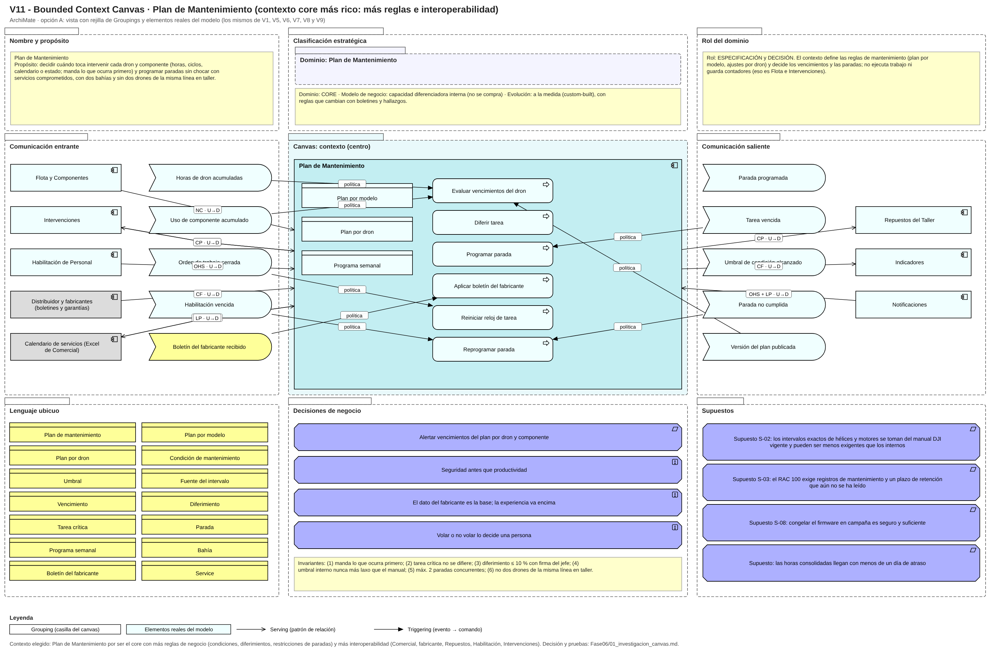

# Fase 6 · Bounded Context Canvas — Plan de Mantenimiento

| Sección | Contenido |
|---|---|
| Nombre | Plan de Mantenimiento |
| Propósito | Decidir cuándo toca intervenir cada dron y componente y programar paradas sin chocar con servicios comprometidos |
| Clasificación estratégica | Dominio: core · Modelo de negocio: capacidad diferenciadora interna · Evolución: a la medida (custom-built) |
| Rol del dominio | Especificación y decisión (define las reglas y decide vencimientos y paradas; no ejecuta ni guarda contadores) |
| Lenguaje ubicuo | Plan de mantenimiento, Plan por modelo, Plan por dron, Tarea de plan, Tarea programada, Condición de mantenimiento, Umbral, Fuente del intervalo, Vencimiento, Service, Diferimiento, Tarea crítica, Parada, Programa semanal, Bahía, Boletín del fabricante |
| Comunicación entrante | Eventos: Horas de dron acumuladas, Uso de componente acumulado (Flota, núcleo compartido); Orden de trabajo cerrada (Intervenciones); Habilitación vencida (Habilitación, OHS); Boletín del fabricante recibido (fabricante, conformista); calendario de servicios (Comercial, ACL-01) |
| Comunicación saliente | Eventos: Parada programada (a Intervenciones y Repuestos), Tarea vencida, Umbral de condición alcanzado (a Indicadores), Parada no cumplida, Versión del plan publicada; disponibilidad por dron a Comercial (lenguaje publicado); avisos a Notificaciones |
| Decisiones de negocio | Lo que ocurra primero manda; tarea crítica no se difiere; diferimiento ≤ 10 % con firma del jefe; umbral interno nunca más laxo que el manual; máximo dos paradas concurrentes; no dos drones de la misma línea en taller |
| Supuestos | S-02 intervalos exactos del manual; S-03 plazos de retención del RAC 100; S-08 congelar firmware en campaña; horas consolidadas con menos de un día de atraso |
| Preguntas abiertas | ¿Cuántas horas antes de un vencimiento se debe avisar? ¿La parada «de madrugada» en pico cuenta como una de las dos bahías? |
