# Mantenimiento preventivo de drones de fumigación — Arquitectura con ArchiMate y DDD

**Curso:** Arquitecturas de Software Empresarial · **Profesor:** César López · **Tema 1:** mantenimiento preventivo de drones de fumigación agrícola · **Empresa del caso:** AgroDrones del Valle S.A.S. (Palmira, Valle del Cauca).

> **Regla de uso de IA:** la IA participó únicamente como experto del negocio simulado (entrevista, Fase 0). La selección y el diseño de capacidades, dominios, agregados, contextos y vistas son elaboración del equipo.
> **Verificación del modelo:** el modelo se abre en Archi 5.9, fue validado con el validador de la herramienta y las relaciones marcadas fueron corregidas.

> **Sobre el uso de IA:** en el **diseño** la IA actuó solo como experto del negocio simulado (ver la regla de arriba). En la **construcción del producto**, un agente de IA escribe el código por etapas, siempre dentro de las decisiones del arquitecto y de compuertas automáticas de verificación (ver `archiforge/`).

---

# Qué hay en este repositorio

Este repositorio contiene **tres cosas que se encadenan**, más la documentación que las explica:

```
   diseno/                     archiforge/                       entrega-v3/
   EL PLANO                    EL CONSTRUCTOR                    EL PRODUCTO
 ┌──────────────────┐        ┌────────────────────────┐        ┌─────────────────────────────┐
 │ Modelo ArchiMate │  ───►  │ Lee el modelo, el      │  ───►  │ 2 servicios que funcionan   │
 │ + análisis de    │        │ arquitecto decide las  │        │ + bus de eventos (RabbitMQ) │
 │   6 fases        │        │ tecnologías y un agente│        │ + gateway + pantallas web   │
 │ (qué necesita el │        │ de IA escribe el código│        │ + datos de demostración     │
 │  negocio)        │        │ bajo compuertas        │        │ + documentación por servicio│
 └──────────────────┘        └────────────────────────┘        └─────────────────────────────┘
        ▲                                                                     
        └───────────  docs/manual/  explica todo lo anterior para quien no es técnico  ────────┘
```

| Carpeta | Qué es | Para quién |
|---|---|---|
| [`diseno/`](diseno/) | **El plano:** el modelo ArchiMate y los análisis de las 6 fases del diseño | Quien quiera entender el negocio y las decisiones de diseño |
| [`archiforge/`](archiforge/README.md) | **El constructor:** el programa que lee el modelo y construye el software (con una pantalla de terminal, la TUI) | Quien quiera construir o reconstruir servicios |
| [`entrega-v3/`](entrega-v3/README.md) | **El producto:** lo que se construyó, listo para ejecutar con Docker | Quien quiera ver funcionando el sistema |
| [`docs/`](docs/) | **La documentación:** el manual completo, las decisiones de diseño y las guías | Todos |
| [`odd/`](odd/tasks/) | **Las bitácoras** de cada bloque de trabajo (qué se pidió, qué se hizo, qué se verificó) | Quien quiera auditar cómo se trabajó |

## Por dónde empezar

| Si querés… | Hacé esto |
|---|---|
| **Entender el proyecto sin tecnicismos** | Leé el **[manual](docs/manual/README.md)** (empezá por el documento 01) |
| **Ver el sistema funcionando** (5 minutos, solo Docker) | `cd entrega-v3 && docker compose up -d --build --wait && python3 seed/seed.py` y abrí `http://localhost:8080` (detalle en el [doc 04 del manual](docs/manual/04-guia-de-uso.md)) |
| **Entender el modelo de negocio** | Leé el diseño más abajo en este README, o abrí `diseno/modelo/drones-mantenimiento.archimate` con **Archi** |
| **Usar el constructor** | `cd archiforge && python3 -m venv .venv && .venv/bin/pip install -r requirements.txt && .venv/bin/python -m forge studio` |
| **Correr las pruebas** | `cd archiforge && .venv/bin/python -m pytest tests` (el programa) · `cd entrega-v3/services/intervenciones && dotnet test` · `cd entrega-v3/services/repuestos-del-taller && PYTHONPATH=src python -m pytest` (requiere `fastapi`, `httpx` y `cryptography`) |
| **Preparar la exposición** | Manual: [preguntas frecuentes](docs/manual/09-preguntas-frecuentes.md), [decisiones por servicio](docs/manual/11-decisiones-por-servicio.md) y [límites conocidos](docs/manual/08-calidad-y-pruebas.md) |

## Mapa completo del repositorio

```text
DronesArchimate/
│
├── README.md                          ← este documento (mapa + diseño del negocio)
│
├── diseno/                            ══ EL PLANO ══
│   ├── modelo/
│   │   ├── drones-mantenimiento.archimate   ← EL modelo: 812 elementos, 1.350 relaciones, 32 vistas
│   │   └── por_fase/                        ← el mismo modelo guardado fase por fase (Fase01…Fase06)
│   ├── vistas/                              ← 33 imágenes (PNG) de las vistas del modelo
│   ├── Fase00/  entrevista al experto: guion, rol, conversación, entrevista organizada, análisis de hallazgos
│   ├── Fase01/  motivación, mapa de capacidades, cadena de valor E2E
│   ├── Fase02/  inclusión/exclusión, ACL, descomposición de servicios, contratos de servicio
│   ├── Fase03/  ecosistema, event storming, lenguaje ubicuo, dominios
│   ├── Fase04/  criterios de diseño y agregados
│   ├── Fase05/  mapa de contextos y coherencia de las ACL
│   └── Fase06/  investigación del canvas, trazabilidad, canvas
│
├── archiforge/                        ══ EL CONSTRUCTOR ══
│   ├── forge/                               ← el programa
│   │   ├── archimate.py, manifest.py            lector del modelo → resumen (IR) → lista de lo que debe existir
│   │   ├── stages.py, runner.py                 las etapas y su orquestador (reintentos, estado, commits)
│   │   ├── gates.py, conformance.py, solid.py   las compuertas de verificación
│   │   ├── decisions.py, cambios.py             decisiones del arquitecto y detección de cambios
│   │   ├── scaffold.py, skeletons/              generación determinista: bus, simuladores, compose, esqueletos
│   │   ├── agents.py, agentdefs.py              conexión con los agentes de IA (Claude Code, OpenCode)
│   │   ├── cli.py                               la línea de comandos (`python -m forge …`)
│   │   └── studio/                              la pantalla de terminal (TUI)
│   ├── prompts/                             ← las instrucciones (plantillas) que recibe el agente en cada etapa
│   │   └── guias/                               guías por decisión: arquitectura, estilo de servicio y SOLID
│   ├── catalog/                             ← catálogo de 50 patrones de diseño (explicados, sin recomendar)
│   ├── decisiones/                          ← LAS DECISIONES DEL ARQUITECTO: un archivo por servicio + plataforma.toml
│   ├── config/event-payloads.json           ← ajustes opcionales de los campos de los eventos
│   ├── reference/                           ← guía DDD de referencia usada como insumo
│   ├── docs/                                ← guía de ejecución e investigación del generador
│   ├── scripts/                             ← build.sh / build.ps1 (atajos de construcción)
│   ├── tools/                               ← fake_agent.py (agente simulado para pruebas sin gastar IA) y utilidades
│   ├── tests/                               ← las pruebas del programa
│   ├── forge.toml                           ← configuración del proyecto (insumos, motor de IA, políticas del equipo)
│   ├── forge.claude.toml, forge.dryrun.toml ← variantes: usar Claude Code / ensayo completo con agente simulado
│   └── README.md, README-archiforge.md      ← documentación del programa
│
├── entrega-v3/                        ══ EL PRODUCTO ══
│   ├── docker-compose.yml                   ← levanta los 8 contenedores (gateway, 2 servicios, bus, RabbitMQ, simuladores, 2 bases)
│   ├── services/
│   │   ├── intervenciones/                      servicio de órdenes de trabajo: C# · Clean + DDD · MongoDB
│   │   └── repuestos-del-taller/                servicio del almacén: Python · Hexagonal · PostgreSQL
│   ├── frontend/
│   │   ├── mfe-shell/                           el panel que carga las pantallas según el rol
│   │   ├── mfe-intervenciones/                  pantallas de Intervenciones (Web Component)
│   │   └── mfe-repuestos-del-taller/            pantallas de Repuestos (Web Component)
│   ├── event-bus/                           ← puente de eventos sobre RabbitMQ (+ topics.json: el catálogo de tópicos)
│   ├── simulators/                          ← los contextos no construidos, simulados
│   ├── seed/                                ← datos de demostración (script idempotente + sus pruebas)
│   ├── docs/                                ← por servicio: decisiones (ADR), trazabilidad, conformidad, verificación, supuestos; y el contrato del bus
│   ├── .platform/                           ← plataformas de humo por servicio (artefactos de verificación que genera el programa)
│   ├── nginx.conf, init-postgres.sql        ← configuración del gateway y de las bases
│   └── README.md, AGENTS.md, CLAUDE.md      ← documentación del producto e instrucciones para agentes
│
├── docs/                              ══ DOCUMENTACIÓN ══
│   ├── manual/                              ← EL MANUAL: 11 documentos + índice, con diagramas
│   ├── decisiones.md                        ← decisiones de diseño del negocio (D-01…D-18) y supuestos (S-01…S-11)
│   ├── convenciones.md                      ← convenciones de nombres y etiquetado del modelo
│   ├── guia-ejecucion-v3.md                 ← guía paso a paso de la ejecución del generador
│   └── curso/                               ← material del curso (evaluación)
│
└── odd/tasks/                         ← bitácoras de trabajo (una por bloque de cambios)
```

## Cómo se relacionan las partes (flujo de trabajo)

```
  1. DISEÑAR            2. DECIDIR                 3. CONSTRUIR                  4. PROBAR
  ──────────            ──────────                 ────────────                  ─────────
  Archi → modelo   ─►   TUI o `forge decide`  ─►   `forge build` (agente   ─►    `docker compose up`
  (diseno/)             (archiforge/decisiones/)   + compuertas) y               (entrega-v3/)
                                                    `forge assemble`
                                                    → archiforge/out/
```

- **`archiforge/out/`** (no se versiona) es donde el programa deja lo que construye. **`entrega-v3/`** es el producto entregado: se generó con el programa y
  luego se corrigió y documentó a mano (el manual cuenta qué se corrigió y por qué).
- Si cambia el modelo o una decisión, volver a construir **reconstruye solo lo afectado**.

## Los documentos más importantes

| Documento | Qué responde |
|---|---|
| [`docs/manual/README.md`](docs/manual/README.md) | Todo el proyecto explicado para no técnicos, con índice de lectura |
| [`docs/manual/02-el-modelo-archimate.md`](docs/manual/02-el-modelo-archimate.md) | Cómo debe estar etiquetado un modelo para que el programa lo entienda |
| [`docs/manual/05-el-producto-generado.md`](docs/manual/05-el-producto-generado.md) | Topología del producto y cómo se comunican los servicios |
| [`docs/manual/06-justificacion-de-tecnologias.md`](docs/manual/06-justificacion-de-tecnologias.md) | Por qué cada tecnología y por qué no otras |
| [`docs/manual/07-justificacion-de-patrones.md`](docs/manual/07-justificacion-de-patrones.md) | Por qué cada patrón y por qué no los otros |
| [`docs/manual/11-decisiones-por-servicio.md`](docs/manual/11-decisiones-por-servicio.md) | Las decisiones de cada servicio con su justificación real |
| [`docs/manual/08-calidad-y-pruebas.md`](docs/manual/08-calidad-y-pruebas.md) | Qué se probó, qué falló y los límites conocidos |
| [`entrega-v3/docs/contrato-bus.md`](entrega-v3/docs/contrato-bus.md) | El contrato de los eventos entre servicios |

---

# El diseño del negocio (Fases 0 a 6)

El resto de este documento es el **diseño de la solución**, fase por fase, con sus vistas ArchiMate.

## Índice del documento de diseño
1. [Contexto y entrevista](#1-contexto-y-entrevista)
2. [Motivación](#2-motivación)
3. [Mapa de capacidades y proceso E2E](#3-mapa-de-capacidades-y-proceso-e2e)
4. [Descomposición de servicios](#4-descomposición-de-servicios)
5. [Dominios y lenguaje ubicuo](#5-dominios-y-lenguaje-ubicuo)
6. [Agregados, comandos y eventos](#6-agregados-comandos-y-eventos)
7. [Mapa de contextos e interoperabilidad](#7-mapa-de-contextos-e-interoperabilidad)
8. [Bounded Context Canvas](#8-bounded-context-canvas)
9. [Decisiones, supuestos y trazabilidad](#9-decisiones-supuestos-y-trazabilidad)

Tabla de aportes: [ver al final](#tabla-de-aportes).

## 1. Contexto y entrevista
**Solicitud (Tema 1):** «Somos una empresa que presta servicios de fumigación de cultivos con una flota de drones. Necesitamos un software que apoye nuestro proceso de mantenimiento preventivo para mantener la flota disponible, segura y dentro de la normatividad aeronáutica». Alcance: horas y ciclos por dron, despiece con condiciones (horas, ciclos, calendario, estado), repuestos y consumibles por cambio, plan que programe las intervenciones e indicadores (disponibilidad, cumplimiento del plan, MTBF, costo por hora).

**El negocio.** 17 personas, 12 drones (5 T40, 4 T30, 2 T16, 1 XAG), ~15.000 ha y ~2.000 h de vuelo al año en Valle, norte del Cauca y norte del Tolima; los ingenios aportan el 60-65 % de los ingresos. Hoy el mantenimiento vive en Excel, papel, WhatsApp y la plataforma del fabricante: horas con 2-4 días de atraso, cumplimiento del plan del 65-70 %, disponibilidad en pico del 80-85 %, 40 % de correctivos y un incidente (ADV-02) que costó tres semanas y $8-10 M.

**Entrevista.** Cinco sesiones, 17 bloques y 168 preguntas con Pompilio Ospina (Jefe de Operaciones y Mantenimiento) en `diseno/Fase00/`: guion (`01`), instrucción de rol (`02`), conversación exportada sin editar (`03`), conversación organizada (`04`) y análisis de hallazgos (`05`). Se contrastaron los hallazgos con fuentes oficiales y manuales: **40 hallazgos, 29 aceptados, 6 ajustados y 5 pendientes registrados como supuestos** (S-01 a S-08).

## 2. Motivación
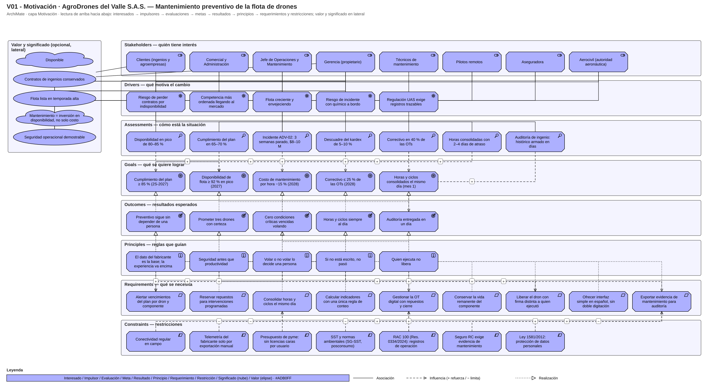

**Análisis.** Ocho interesados, tres valores y dos significados (*Value* y *Meaning*), cinco impulsores, siete evaluaciones, cinco metas con número y fecha, cinco resultados, cinco principios, nueve requerimientos y siete restricciones, todos con su `Fuente` (P-xx y H-xx). El impulsor más fuerte es *el riesgo de perder contratos por indisponibilidad* (tres interesados y dos evaluaciones). La restricción que más condiciona el alcance es la *telemetría solo por exportación manual* junto con la conectividad regular. La meta que más alimenta la aplicación es *horas y ciclos consolidados el mismo día*.
**Argumentación.** Las evaluaciones (incluso negativas) se conectan con las metas por influencia (+); los resultados realizan las metas; los requerimientos realizan resultados y metas; los principios influyen en los requerimientos y las restricciones los limitan o los refuerzan. Detalle: [`diseno/Fase01/01_motivacion.md`](diseno/Fase01/01_motivacion.md).

## 3. Mapa de capacidades y proceso E2E
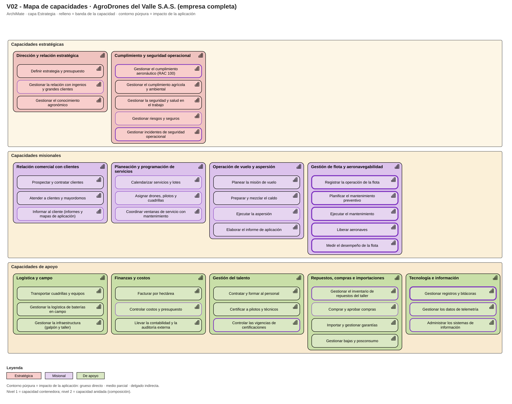

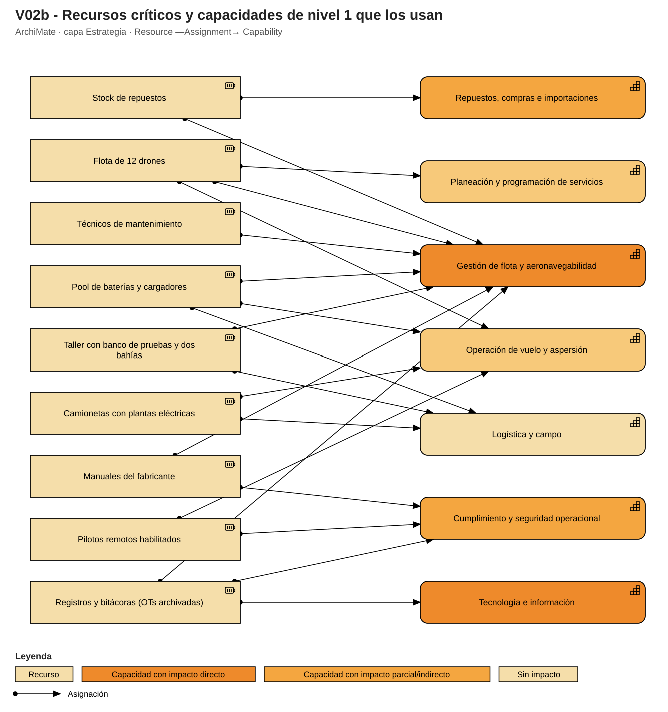

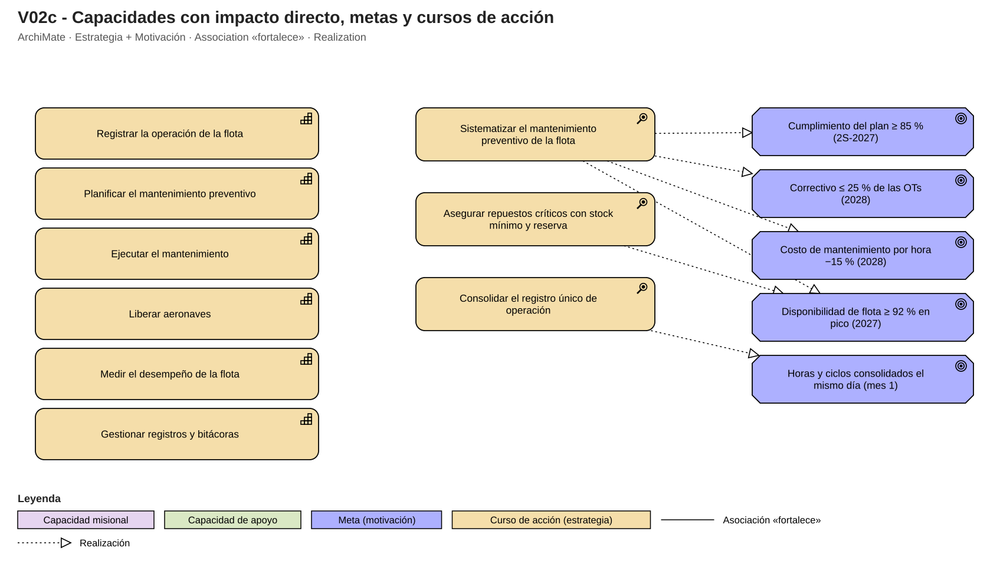

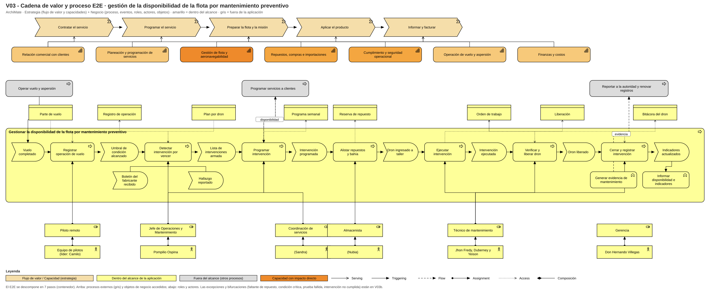

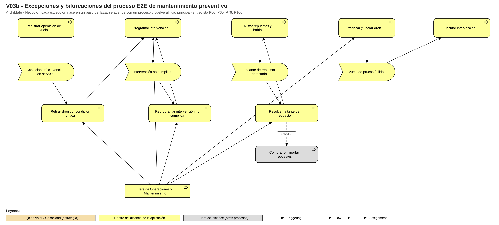

**Análisis.** El mapa cubre toda la empresa en tres bandas (11 capacidades de nivel 1 y 41 de nivel 2) con el relleno por banda y el contorno púrpura marcando el impacto de la aplicación: seis capacidades directas, cinco parciales y ocho indirectas. Nueve recursos (V2b) y tres cursos de acción enlazan las capacidades con las metas (V2c). El E2E *gestionar la disponibilidad de la flota por mantenimiento preventivo* tiene 7 pasos, 8 eventos, 4 disparadores/excepciones y roles, actores y objetos de negocio.
**Argumentación.** No se limitó el mapa a mantenimiento; los pasos fuera de la aplicación quedan visibles en gris. Decisión D-01 sobre el E2E elegido. Detalle: [`diseno/Fase01/02_mapa_de_capacidades.md`](diseno/Fase01/02_mapa_de_capacidades.md) · [`diseno/Fase01/03_cadena_de_valor_e2e.md`](diseno/Fase01/03_cadena_de_valor_e2e.md).

## 4. Descomposición de servicios
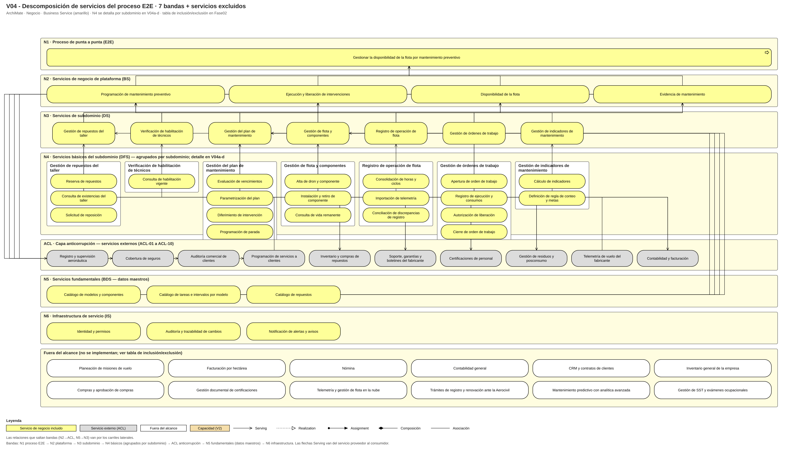

**Análisis.** Siete bandas (E2E, 4 servicios de plataforma, 7 de subdominio, 20 básicos, 10 externos en la capa anticorrupción, 3 fundamentales y 3 de infraestructura) y 12 servicios fuera del alcance; las relaciones que saltan bandas van por carriles laterales.

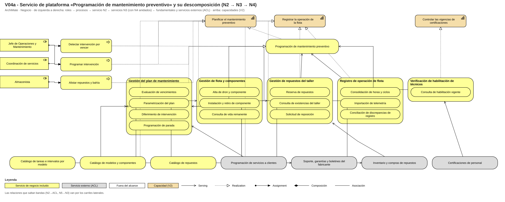

**Análisis.** *Programación de mantenimiento preventivo*: detecta vencimientos, programa paradas y reserva repuestos sin chocar con los servicios comprometidos.

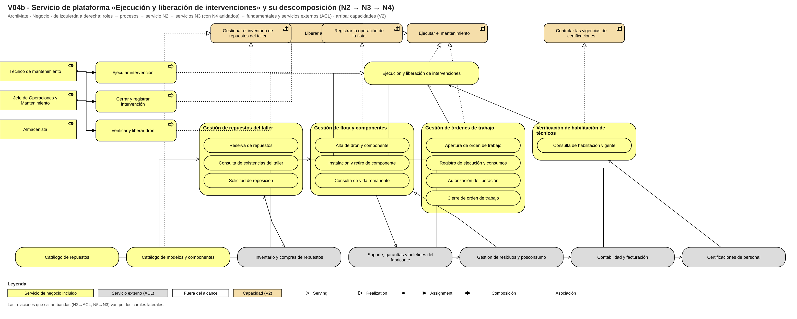

**Análisis.** *Ejecución y liberación de intervenciones*: ejecuta la OT, registra consumos con series, exige vuelo de prueba en trabajos mayores y libera con firma distinta a quien ejecutó.

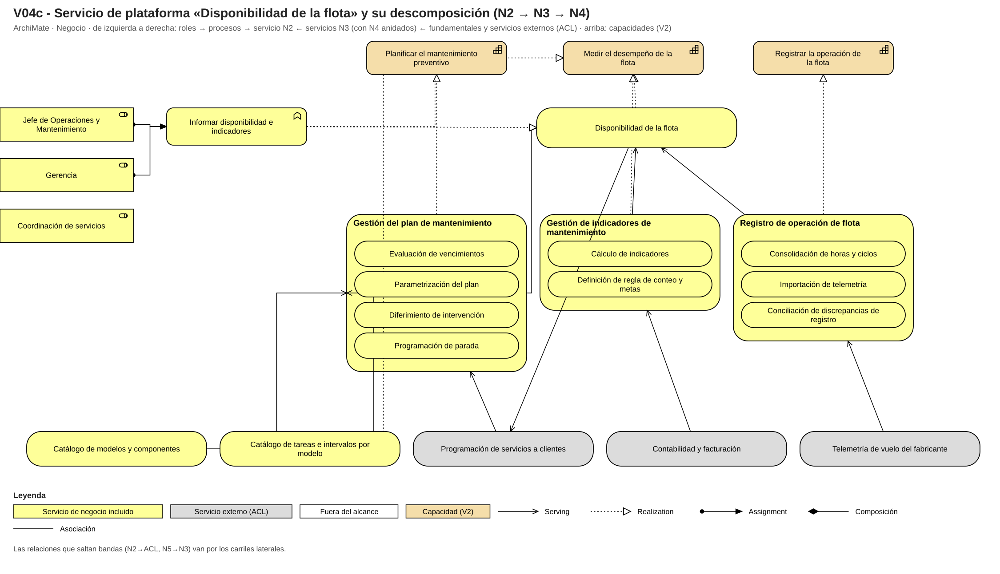

**Análisis.** *Disponibilidad de la flota*: responde cuántos drones se pueden prometer y calcula los indicadores con una sola regla de conteo.

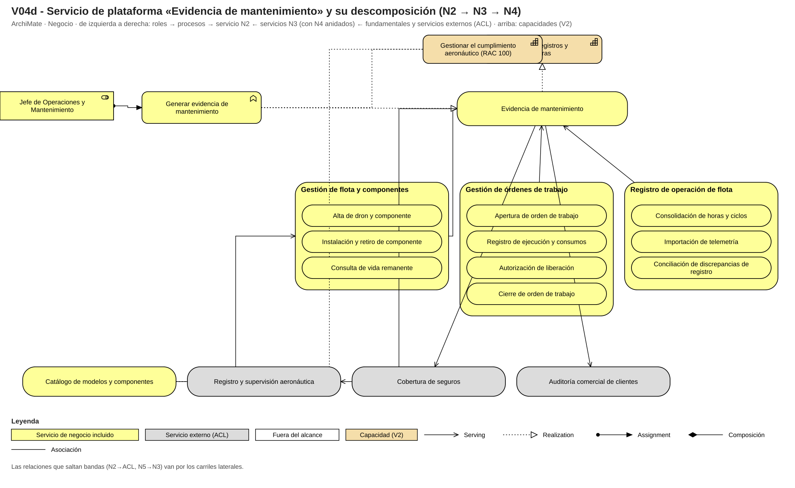

**Análisis.** *Evidencia de mantenimiento*: arma el histórico por dron para ingenios, aseguradora y autoridad en un día.

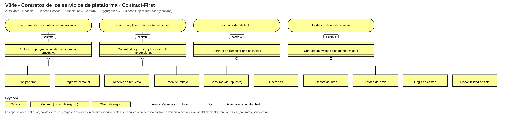

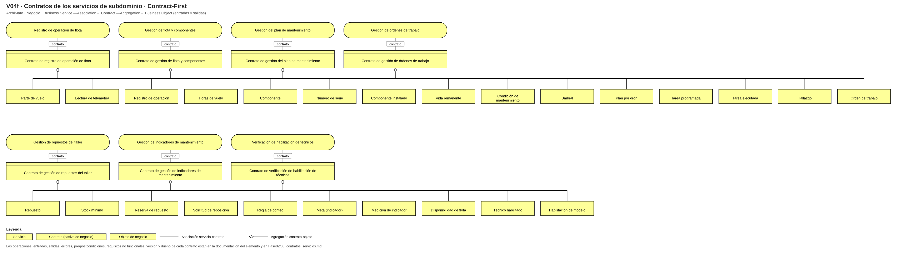

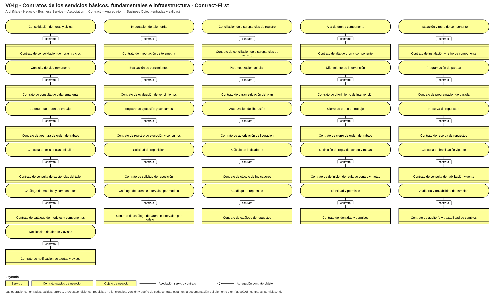

**Análisis.** Un contrato *Contract-First* por cada uno de los 37 servicios incluidos: operaciones, entradas y salidas, semántica de errores, precondiciones y postcondiciones, requisitos no funcionales, versión, consumidores y dueño.
**Argumentación.** Cada servicio incluido o excluido tiene criterio y justificación (tabla de 59 filas); los servicios externos tienen información, dirección, disparador, dueño, qué contamina y qué traduce. Documentos: [`01_tabla_inclusion_exclusion`](diseno/Fase02/01_tabla_inclusion_exclusion.md) · [`02_tabla_acl`](diseno/Fase02/02_tabla_acl.md) · [`03_descomposicion_de_servicios`](diseno/Fase02/03_descomposicion_de_servicios.md) · [`04_contratos_servicios`](diseno/Fase02/04_contratos_servicios.md).

## 5. Dominios y lenguaje ubicuo
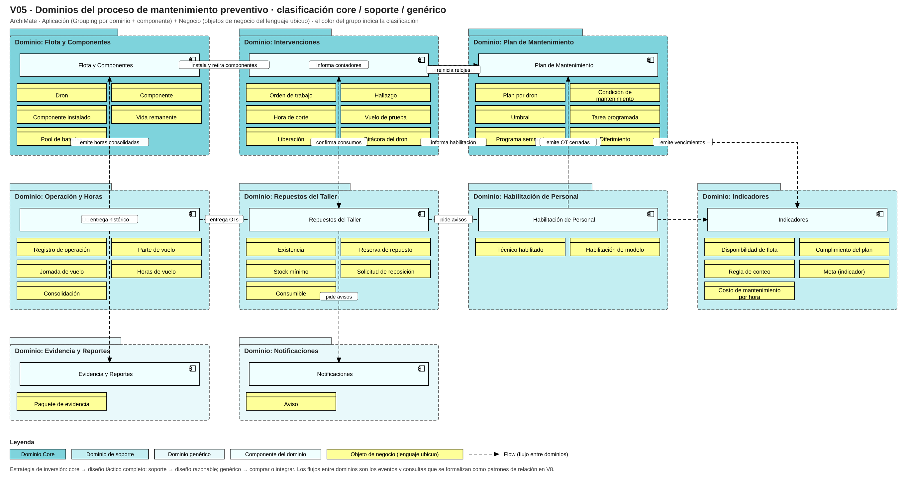

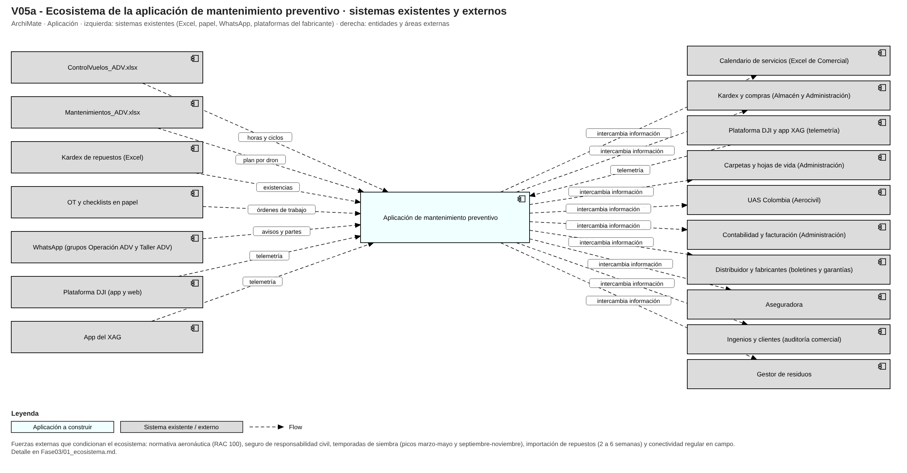

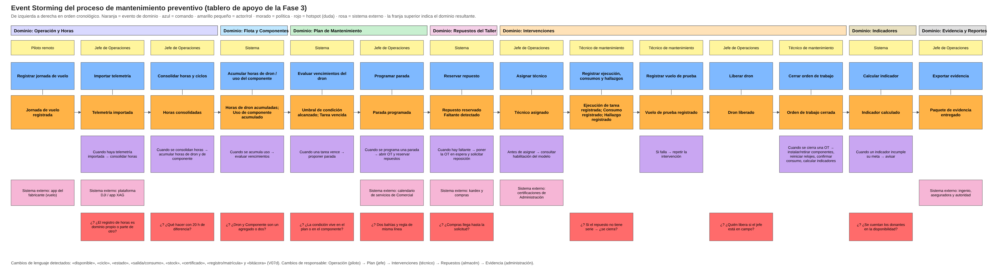

**Análisis.** Nueve dominios: 3 core (Flota y Componentes, Plan de Mantenimiento, Intervenciones), 4 de soporte (Operación y Horas, Repuestos del Taller, Indicadores, Habilitación de Personal) y 2 genéricos (Evidencia y Reportes, Notificaciones); el ecosistema muestra los sistemas existentes y los externos con los que se interopera; del Event Storming salieron los 9 clústeres por las 5 fronteras (lenguaje, responsable, razón de cambio, datos, reglas).

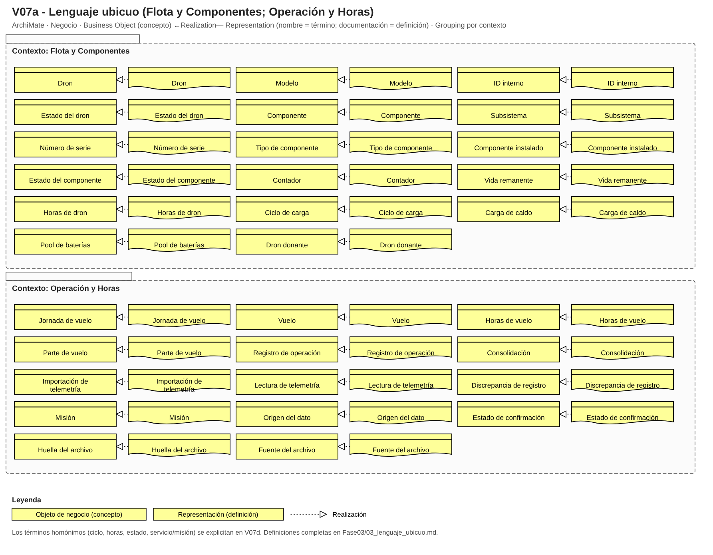

**Análisis.** Términos de Flota y Componentes (dron, componente, contador, vida remanente, ciclos) y de Operación y Horas (jornada, vuelo, parte, consolidación, telemetría).

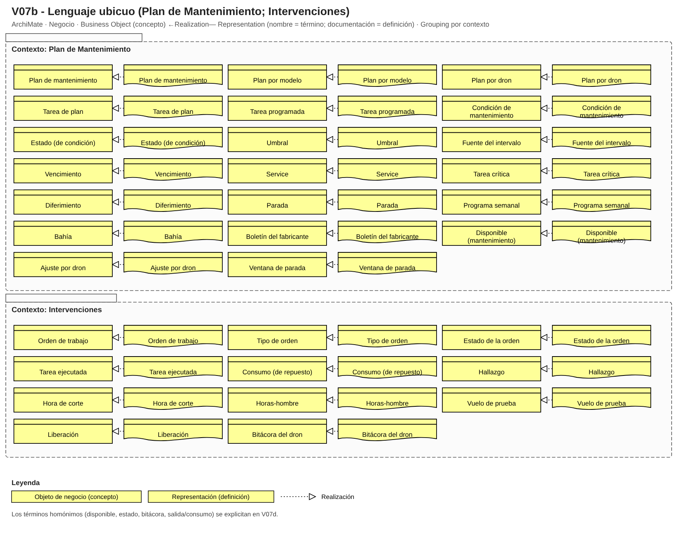

**Análisis.** Términos del Plan (condición, umbral, fuente del intervalo, vencimiento, diferimiento, parada) y de Intervenciones (OT, consumo, hallazgo, hora de corte, liberación, bitácora).

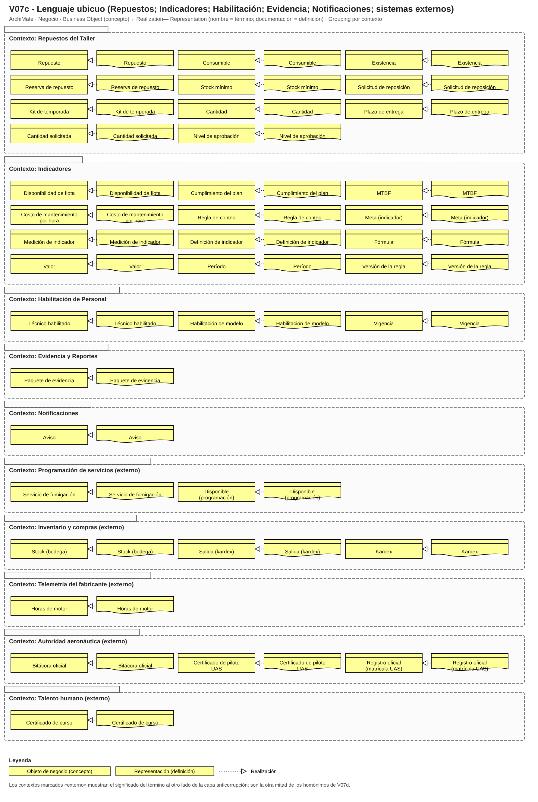

**Análisis.** Términos de Repuestos (existencia, reserva, stock mínimo, solicitud), Indicadores (regla de conteo, medición, meta), Habilitación, Evidencia y Notificaciones, más el significado que cada término tiene al otro lado de la capa anticorrupción.

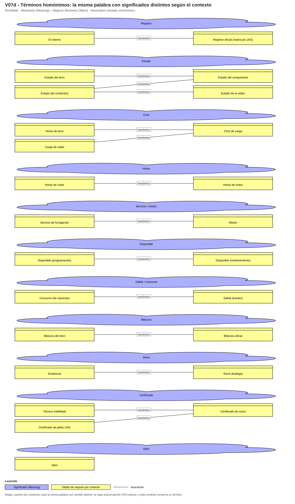

**Análisis.** 100 términos con 11 grupos de homónimos (ciclo, disponible, estado, salida/consumo, stock, certificado, registro, bitácora, horas, servicio/misión y valor), cada uno con sus significados por contexto unidos por la asociación rotulada.
**Argumentación.** Cada clasificación tiene tres argumentos y una estrategia de inversión; se responden las preguntas de tensión (indicadores, repuestos, registro de horas). Documentos: [`01_ecosistema`](diseno/Fase03/01_ecosistema.md) · [`02_event_storming`](diseno/Fase03/02_event_storming.md) · [`03_lenguaje_ubicuo`](diseno/Fase03/03_lenguaje_ubicuo.md) · [`04_dominios`](diseno/Fase03/04_dominios.md).

## 6. Agregados, comandos y eventos
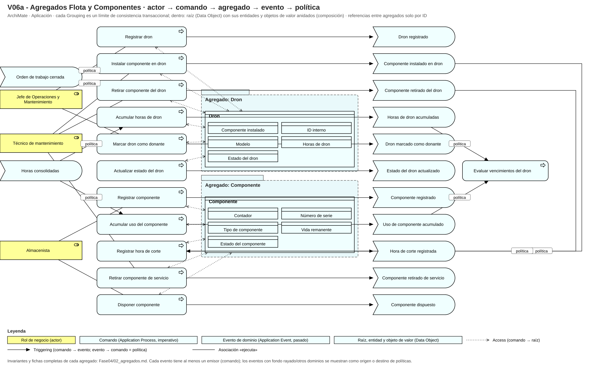

**Análisis.** *Dron* (una pieza por posición, horas que nunca disminuyen) y *Componente* (el contador viaja con la pieza): dos agregados separados porque mover una batería toca dos drones en dos transacciones.

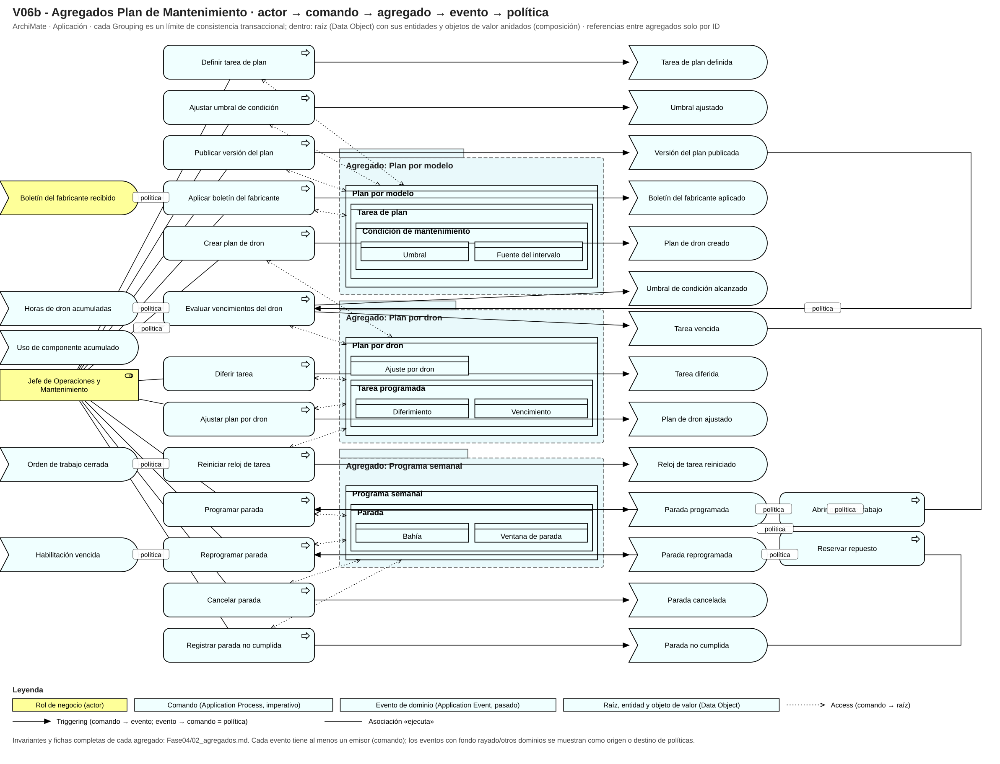

**Análisis.** *Plan por modelo* (condiciones versionadas por boletín), *Plan por dron* (vencimientos y diferimientos propios) y *Programa semanal* (dos bahías, misma línea): tres ciclos de vida distintos.

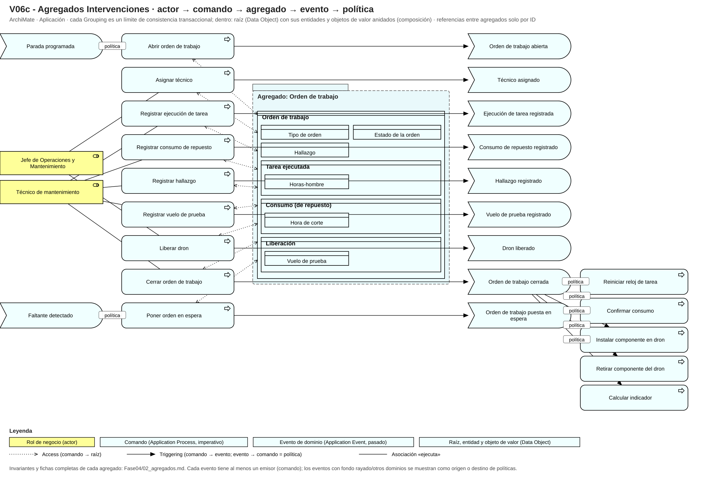

**Análisis.** *Orden de trabajo*: ejecuta, consume con series, libera con rol distinto y cierra inmutable; las políticas de retroalimentación (reprogramar, poner en espera) llegan por el carril lateral.

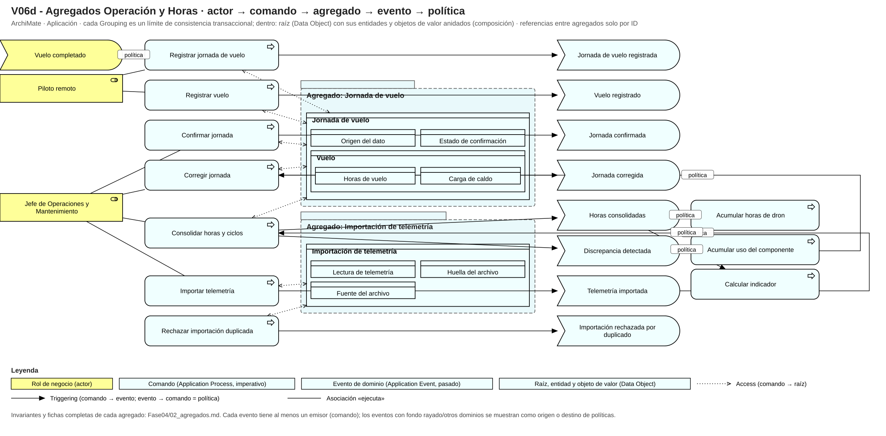

**Análisis.** *Jornada de vuelo* (un dron, un piloto, un día: sin doble conteo) e *Importación de telemetría* (el archivo entra completo o no entra: idempotencia por huella).

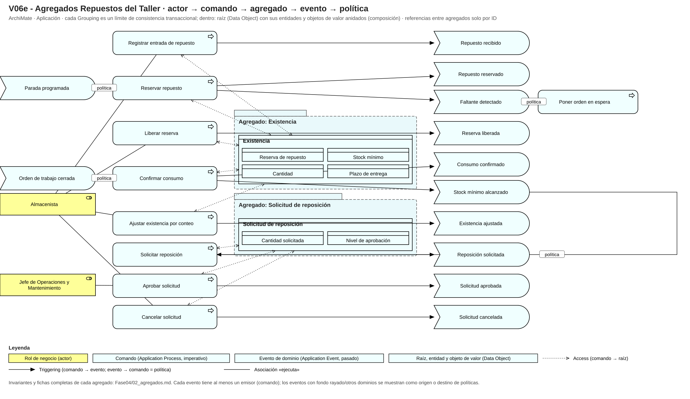

**Análisis.** *Existencia* (lo reservado nunca supera lo físico) y *Solicitud de reposición* (ciclo propio que termina donde empieza compras, fuera del alcance).

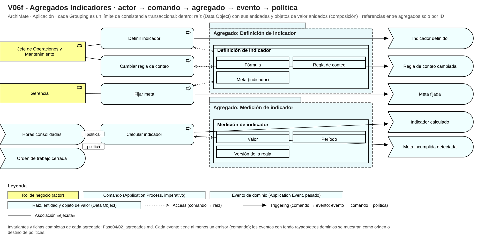

**Análisis.** *Definición de indicador* (una sola regla vigente; cambiarla versiona sin tocar el pasado) y *Medición* (hecho inmutable con su versión de regla).

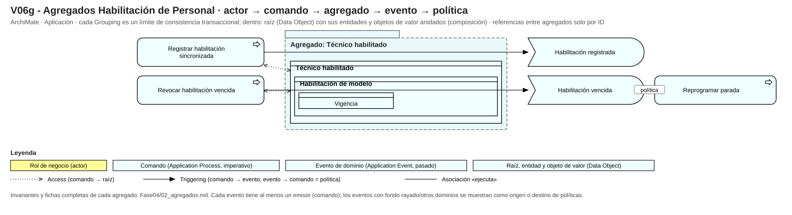

**Análisis.** *Técnico habilitado*: espejo de solo lectura de las carpetas de Administración; sin vigencia no hay asignación.
**Argumentación.** Trece agregados con invariantes y «por qué este límite / no más grande / no más pequeño»; cada evento tiene emisor y cada comando su agregado (24 políticas); la revisión cruzada intentó romper cada invariante. Documentos: [`01_criterios_de_diseno`](diseno/Fase04/01_criterios_de_diseno.md) · [`02_agregados`](diseno/Fase04/02_agregados.md).

## 7. Mapa de contextos e interoperabilidad
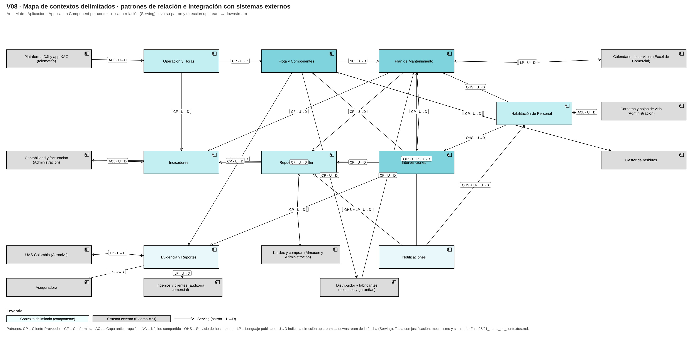

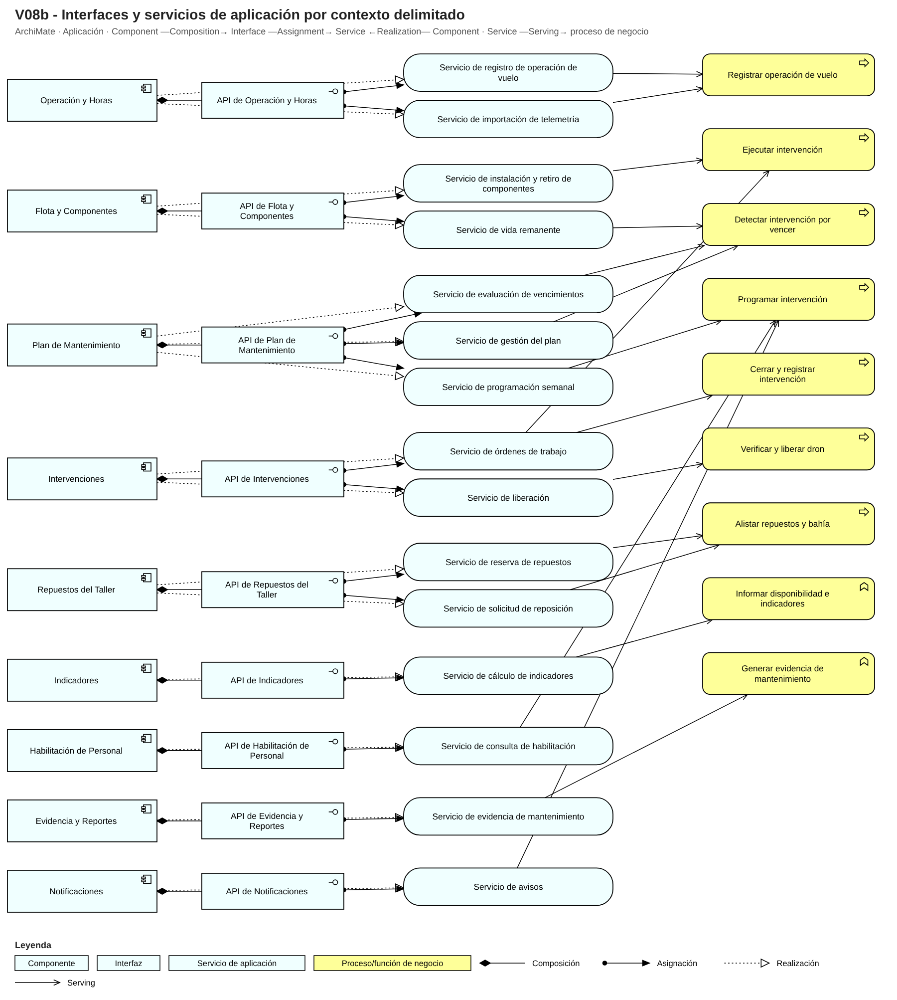

**Análisis.** Nueve contextos (uno por dominio) con sus interfaces y servicios de aplicación; cada relación lleva patrón y dirección upstream → downstream.

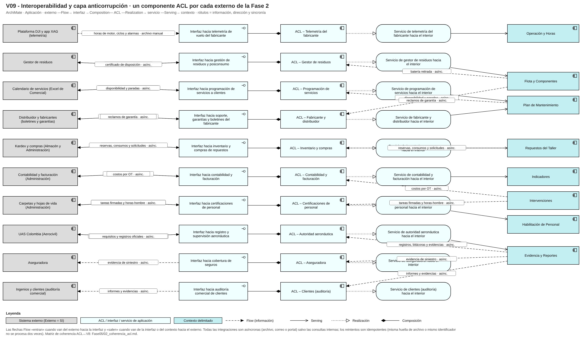

**Análisis.** Un componente ACL con interfaz y servicio por cada una de las 10 filas de la tabla ACL; todo el intercambio externo es asíncrono (archivo, correo, portal) con reintentos idempotentes.
**Argumentación.** Autoridad → lenguaje publicado + traducción del ID interno; telemetría → ACL; compras/inventario → ACL hacia Repuestos y cliente-proveedor hacia Almacén. La matriz de coherencia cierra el ciclo ACL ↔ V8 ↔ V4. Documentos: [`01_mapa_de_contextos`](diseno/Fase05/01_mapa_de_contextos.md) · [`02_coherencia_acl`](diseno/Fase05/02_coherencia_acl.md).

## 8. Bounded Context Canvas
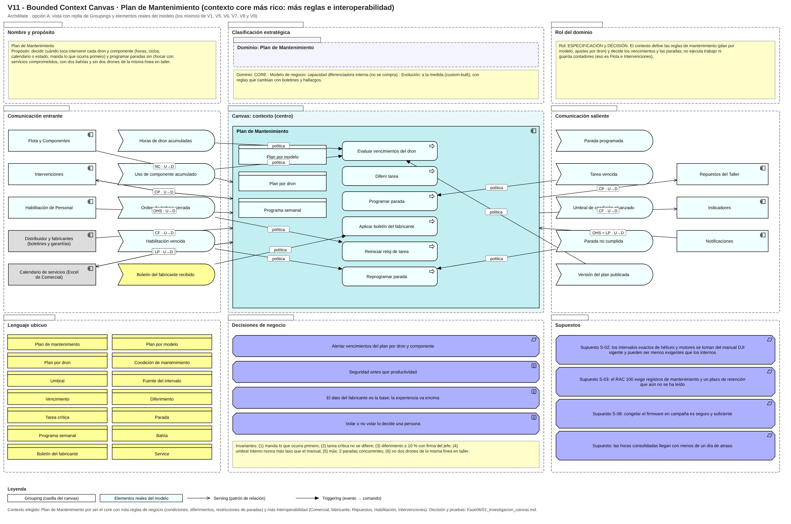

**Análisis.** Canvas de *Plan de Mantenimiento* (core más rico) en una página, con elementos reales del modelo. **Argumentación.** Opción A (vista con rejilla de groupings); la investigación y la verificación en Archi están en [`diseno/Fase06/01_investigacion_canvas.md`](diseno/Fase06/01_investigacion_canvas.md); contenido en [`03_canvas`](diseno/Fase06/03_canvas.md).

## 9. Decisiones, supuestos y trazabilidad
Dieciocho decisiones (D-01 a D-18) y once supuestos (S-01 a S-11) con alternativas, razón, riesgo y hallazgo en [`docs/decisiones.md`](docs/decisiones.md).

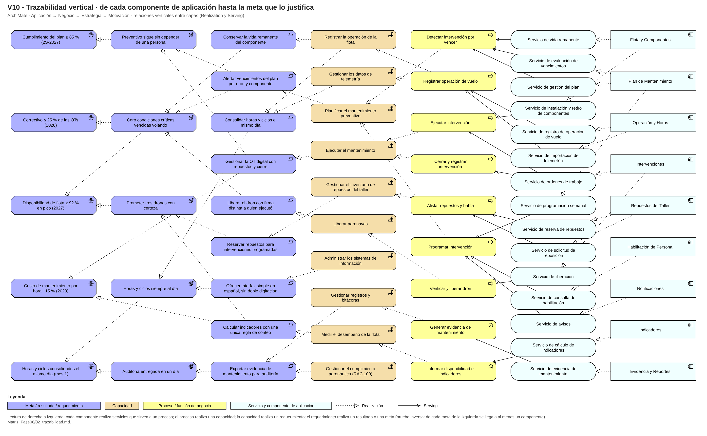

Cada meta llega a al menos un componente y cada componente a al menos una meta; la matriz completa está en [`diseno/Fase06/02_trazabilidad.md`](diseno/Fase06/02_trazabilidad.md).

## Tabla de aportes
| Integrante | Fase/Vistas | Archivos clave | Commits de referencia | Revisiones hechas |
|---|---|---|---|---|
| dishyma | Fase 0 (rol, hallazgos), Fase 1 (V02), Fase 2 (V04, contratos), Fase 3 (V07), Fase 6, modelo completo | diseno/Fase00/02, diseno/Fase00/05, diseno/Fase01/02, diseno/Fase02/01, diseno/Fase02/03, diseno/Fase02/04, diseno/Fase03/03, diseno/Fase06/, diseno/modelo/ | e6e4af2, 7d6c382, 86b3532, 1be1b45, 24318d4, e55ea28, 44b283d, 5743de4 | Revisión de coherencia V4-V8 y de Presupuesto/Diseño en Fase 4 |
| cutiepie25 | Fase 0 (guion, conversación), Fase 1 (V01, V03), Fase 2 (ACL), Fase 3 (dominios), Fase 4 (agregados soporte), README | diseno/Fase00/01, diseno/Fase00/03, diseno/Fase00/04, diseno/Fase01/01, diseno/Fase01/03, diseno/Fase02/02, diseno/Fase03/01, diseno/Fase03/02, diseno/Fase03/04, diseno/Fase04/02, README.md | 4c82516, c7da1fd, 0c74cc5, 2358311, 7b2d1b1, a485806, 02975fe, c8f83e9 | Revisión de glosario V07 y de nombres en todas las vistas |
| Drakuro | Fase 1 (V02c, modelo parcial), Fase 4 (agregados core), Fase 5 (contextos e interoperabilidad) | diseno/vistas/V02c*, diseno/modelo/por_fase/Fase01, diseno/Fase04/01, diseno/vistas/V06a-c, diseno/Fase05/, diseno/vistas/V08, diseno/vistas/V09 | 6f49146, 16bd8dc, d75b5f4 | Revisión de patrones de relación en V08 y de invariantes en V06 |

> La tabla debe poder comprobarse en el historial de commits (rutas y mensajes que correspondan). Todos los integrantes deben conocer el diseño completo; el docente sortea quién presenta cada sección. Roles de gestión por fase (líder, revisor, verificador): por asignar.
