# Mantenimiento preventivo de drones de fumigación — Arquitectura con ArchiMate y DDD

**Curso:** Arquitecturas de Software Empresarial · **Profesor:** César López · **Tema 1:** mantenimiento preventivo de drones de fumigación agrícola · **Empresa del caso:** AgroDrones del Valle S.A.S. (Palmira, Valle del Cauca).

> **Regla de uso de IA:** la IA participó únicamente como experto del negocio simulado (entrevista, Fase 0). La selección y el diseño de capacidades, dominios, agregados, contextos y vistas son elaboración del equipo.
> **Verificación del modelo:** el modelo se abre en Archi 5.9, fue validado con el validador de la herramienta y las relaciones marcadas fueron corregidas.

## Índice
1. [Contexto y entrevista](#1-contexto-y-entrevista)
2. [Motivación](#2-motivación)
3. [Mapa de capacidades y proceso E2E](#3-mapa-de-capacidades-y-proceso-e2e)
4. [Descomposición de servicios](#4-descomposición-de-servicios)
5. [Dominios y lenguaje ubicuo](#5-dominios-y-lenguaje-ubicuo)
6. [Agregados, comandos y eventos](#6-agregados-comandos-y-eventos)
7. [Mapa de contextos e interoperabilidad](#7-mapa-de-contextos-e-interoperabilidad)
8. [Bounded Context Canvas](#8-bounded-context-canvas)
9. [Decisiones, supuestos y trazabilidad](#9-decisiones-supuestos-y-trazabilidad)

Tabla de aportes: [ver al final](#tabla-de-aportes).

## Estructura del repositorio
```text
/
├── README.md                       ← este documento
├── Fase00/                         ← entrevista al experto (guion, rol, conversación, análisis de hallazgos)
├── Fase01/ … Fase06/               ← análisis y tablas de cada fase (enlazados abajo)
├── docs/                           ← convenciones y decisiones
├── modelo/
│   └── drones-mantenimiento.archimate   ← UN solo modelo con todas las vistas
└── vistas/                         ← V01 … V11 (con subvistas) exportadas como PNG
```

## 1. Contexto y entrevista
**Solicitud (Tema 1):** «Somos una empresa que presta servicios de fumigación de cultivos con una flota de drones. Necesitamos un software que apoye nuestro proceso de mantenimiento preventivo para mantener la flota disponible, segura y dentro de la normatividad aeronáutica». Alcance: horas y ciclos por dron, despiece con condiciones (horas, ciclos, calendario, estado), repuestos y consumibles por cambio, plan que programe las intervenciones e indicadores (disponibilidad, cumplimiento del plan, MTBF, costo por hora).

**El negocio.** 17 personas, 12 drones (5 T40, 4 T30, 2 T16, 1 XAG), ~15.000 ha y ~2.000 h de vuelo al año en Valle, norte del Cauca y norte del Tolima; los ingenios aportan el 60-65 % de los ingresos. Hoy el mantenimiento vive en Excel, papel, WhatsApp y la plataforma del fabricante: horas con 2-4 días de atraso, cumplimiento del plan del 65-70 %, disponibilidad en pico del 80-85 %, 40 % de correctivos y un incidente (ADV-02) que costó tres semanas y $8-10 M.

**Entrevista.** Cinco sesiones, 17 bloques y 168 preguntas con Pompilio Ospina (Jefe de Operaciones y Mantenimiento) en `Fase00/`: guion (`01`), instrucción de rol (`02`), conversación exportada sin editar (`03`), conversación organizada (`04`) y análisis de hallazgos (`05`). Se contrastaron los hallazgos con fuentes oficiales y manuales: **40 hallazgos, 29 aceptados, 6 ajustados y 5 pendientes registrados como supuestos** (S-01 a S-08).

## 2. Motivación


**Análisis.** Ocho interesados, tres valores y dos significados (*Value* y *Meaning*), cinco impulsores, siete evaluaciones, cinco metas con número y fecha, cinco resultados, cinco principios, nueve requerimientos y siete restricciones, todos con su `Fuente` (P-xx y H-xx). El impulsor más fuerte es *el riesgo de perder contratos por indisponibilidad* (tres interesados y dos evaluaciones). La restricción que más condiciona el alcance es la *telemetría solo por exportación manual* junto con la conectividad regular. La meta que más alimenta la aplicación es *horas y ciclos consolidados el mismo día*.
**Argumentación.** Las evaluaciones (incluso negativas) se conectan con las metas por influencia (+); los resultados realizan las metas; los requerimientos realizan resultados y metas; los principios influyen en los requerimientos y las restricciones los limitan o los refuerzan. Detalle: [`Fase01/01_motivacion.md`](Fase01/01_motivacion.md).

## 3. Mapa de capacidades y proceso E2E


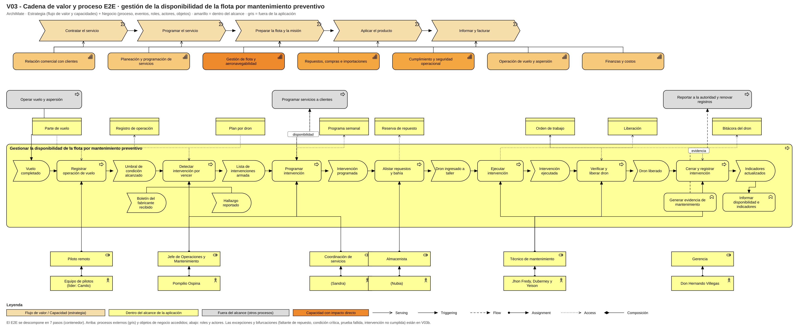

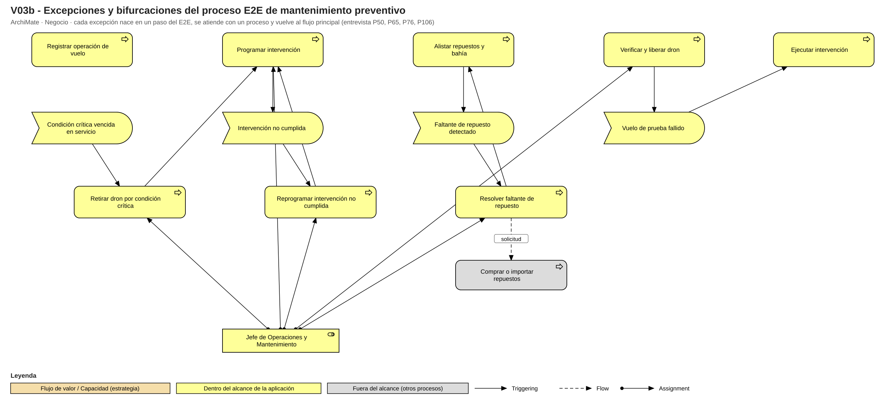

**Análisis.** El mapa cubre toda la empresa en tres bandas (11 capacidades de nivel 1 y 41 de nivel 2) con el relleno por banda y el contorno púrpura marcando el impacto de la aplicación: seis capacidades directas, cinco parciales y ocho indirectas. Nueve recursos (V2b) y tres cursos de acción enlazan las capacidades con las metas (V2c). El E2E *gestionar la disponibilidad de la flota por mantenimiento preventivo* tiene 7 pasos, 8 eventos, 4 disparadores/excepciones y roles, actores y objetos de negocio.
**Argumentación.** No se limitó el mapa a mantenimiento; los pasos fuera de la aplicación quedan visibles en gris. Decisión D-01 sobre el E2E elegido. Detalle: [`Fase01/02_mapa_de_capacidades.md`](Fase01/02_mapa_de_capacidades.md) · [`Fase01/03_cadena_de_valor_e2e.md`](Fase01/03_cadena_de_valor_e2e.md).

## 4. Descomposición de servicios
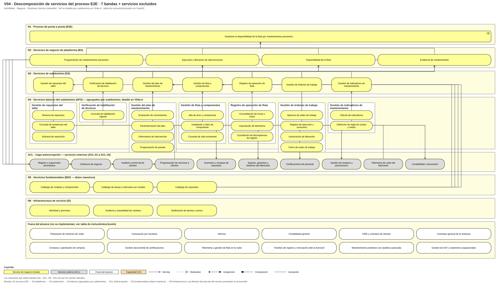

**Análisis.** Siete bandas (E2E, 4 servicios de plataforma, 7 de subdominio, 20 básicos, 10 externos en la capa anticorrupción, 3 fundamentales y 3 de infraestructura) y 12 servicios fuera del alcance; las relaciones que saltan bandas van por carriles laterales.

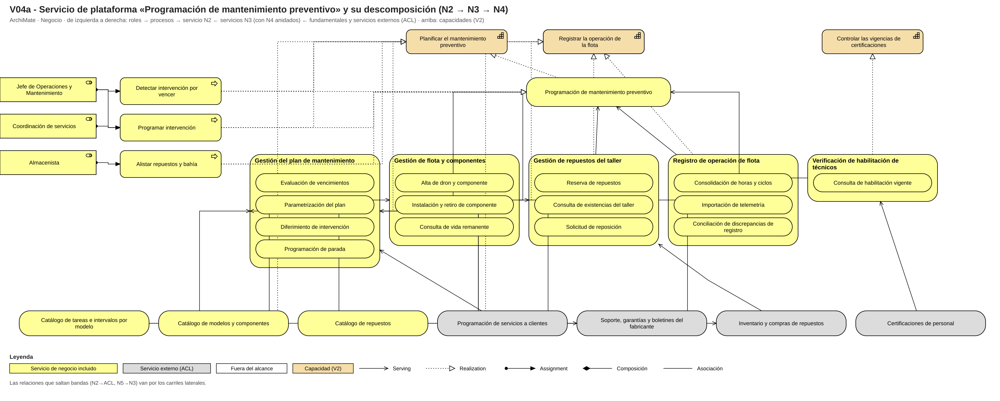

**Análisis.** *Programación de mantenimiento preventivo*: detecta vencimientos, programa paradas y reserva repuestos sin chocar con los servicios comprometidos.

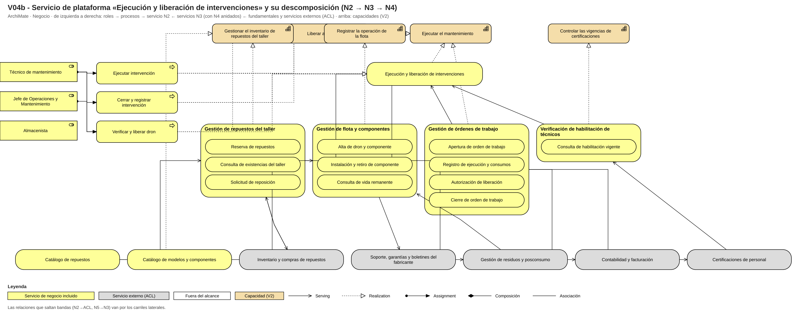

**Análisis.** *Ejecución y liberación de intervenciones*: ejecuta la OT, registra consumos con series, exige vuelo de prueba en trabajos mayores y libera con firma distinta a quien ejecutó.

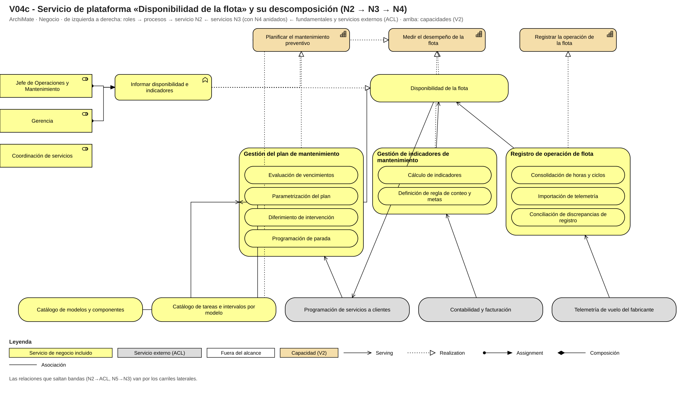

**Análisis.** *Disponibilidad de la flota*: responde cuántos drones se pueden prometer y calcula los indicadores con una sola regla de conteo.

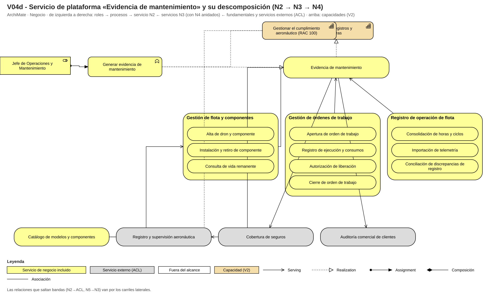

**Análisis.** *Evidencia de mantenimiento*: arma el histórico por dron para ingenios, aseguradora y autoridad en un día.


**Análisis.** Un contrato *Contract-First* por cada uno de los 37 servicios incluidos: operaciones, entradas y salidas, semántica de errores, precondiciones y postcondiciones, requisitos no funcionales, versión, consumidores y dueño.
**Argumentación.** Cada servicio incluido o excluido tiene criterio y justificación (tabla de 59 filas); los servicios externos tienen información, dirección, disparador, dueño, qué contamina y qué traduce. Documentos: [`01_tabla_inclusion_exclusion`](Fase02/01_tabla_inclusion_exclusion.md) · [`02_tabla_acl`](Fase02/02_tabla_acl.md) · [`03_descomposicion_de_servicios`](Fase02/03_descomposicion_de_servicios.md) · [`04_contratos_servicios`](Fase02/04_contratos_servicios.md).

## 5. Dominios y lenguaje ubicuo
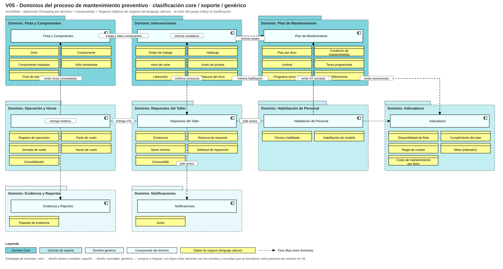


**Análisis.** Nueve dominios: 3 core (Flota y Componentes, Plan de Mantenimiento, Intervenciones), 4 de soporte (Operación y Horas, Repuestos del Taller, Indicadores, Habilitación de Personal) y 2 genéricos (Evidencia y Reportes, Notificaciones); el ecosistema muestra los sistemas existentes y los externos con los que se interopera; del Event Storming salieron los 9 clústeres por las 5 fronteras (lenguaje, responsable, razón de cambio, datos, reglas).


**Análisis.** Términos de Flota y Componentes (dron, componente, contador, vida remanente, ciclos) y de Operación y Horas (jornada, vuelo, parte, consolidación, telemetría).


**Análisis.** Términos del Plan (condición, umbral, fuente del intervalo, vencimiento, diferimiento, parada) y de Intervenciones (OT, consumo, hallazgo, hora de corte, liberación, bitácora).


**Análisis.** Términos de Repuestos (existencia, reserva, stock mínimo, solicitud), Indicadores (regla de conteo, medición, meta), Habilitación, Evidencia y Notificaciones, más el significado que cada término tiene al otro lado de la capa anticorrupción.


**Análisis.** 100 términos con 11 grupos de homónimos (ciclo, disponible, estado, salida/consumo, stock, certificado, registro, bitácora, horas, servicio/misión y valor), cada uno con sus significados por contexto unidos por la asociación rotulada.
**Argumentación.** Cada clasificación tiene tres argumentos y una estrategia de inversión; se responden las preguntas de tensión (indicadores, repuestos, registro de horas). Documentos: [`01_ecosistema`](Fase03/01_ecosistema.md) · [`02_event_storming`](Fase03/02_event_storming.md) · [`03_lenguaje_ubicuo`](Fase03/03_lenguaje_ubicuo.md) · [`04_dominios`](Fase03/04_dominios.md).

## 6. Agregados, comandos y eventos
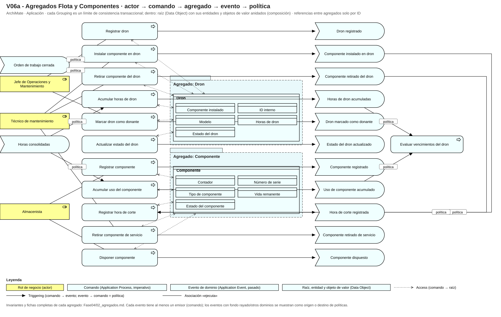

**Análisis.** *Dron* (una pieza por posición, horas que nunca disminuyen) y *Componente* (el contador viaja con la pieza): dos agregados separados porque mover una batería toca dos drones en dos transacciones.

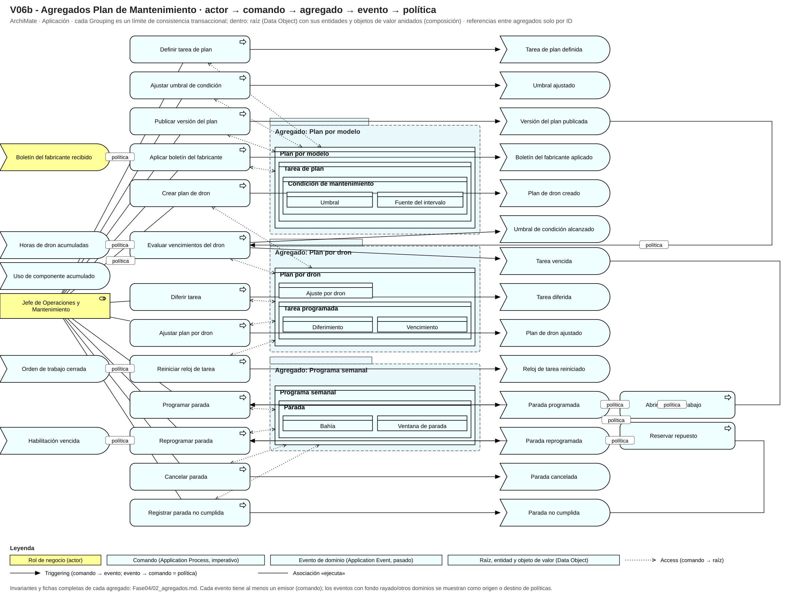

**Análisis.** *Plan por modelo* (condiciones versionadas por boletín), *Plan por dron* (vencimientos y diferimientos propios) y *Programa semanal* (dos bahías, misma línea): tres ciclos de vida distintos.

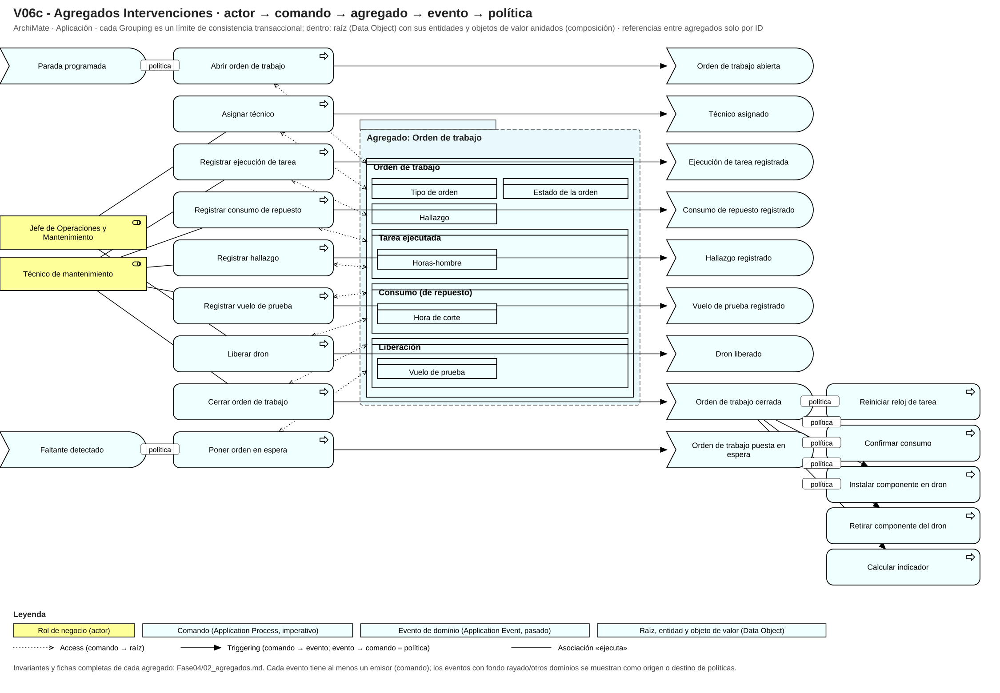

**Análisis.** *Orden de trabajo*: ejecuta, consume con series, libera con rol distinto y cierra inmutable; las políticas de retroalimentación (reprogramar, poner en espera) llegan por el carril lateral.

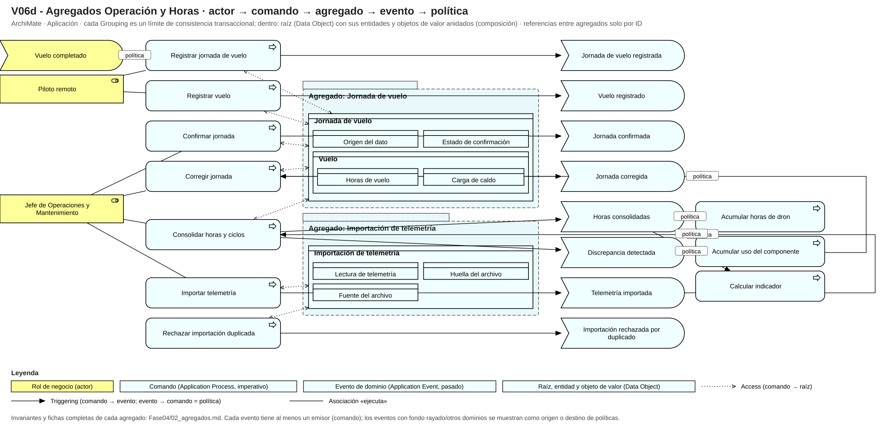

**Análisis.** *Jornada de vuelo* (un dron, un piloto, un día: sin doble conteo) e *Importación de telemetría* (el archivo entra completo o no entra: idempotencia por huella).

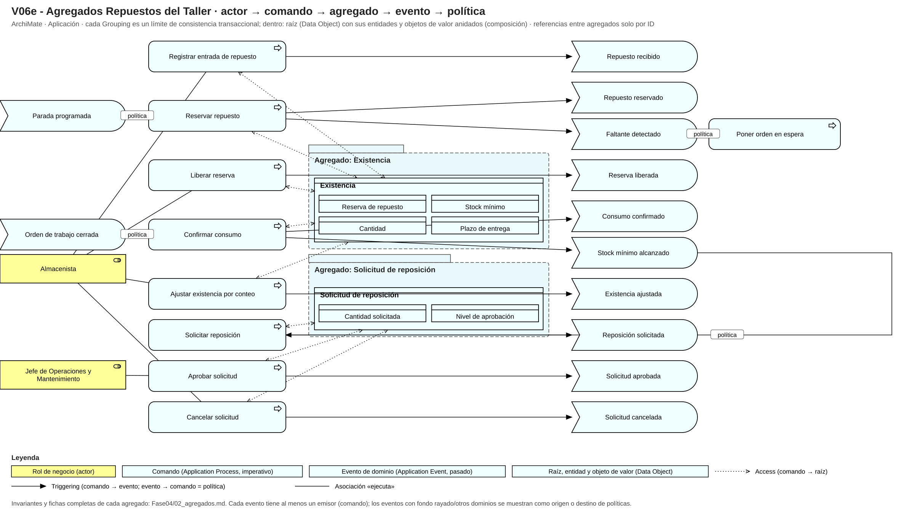

**Análisis.** *Existencia* (lo reservado nunca supera lo físico) y *Solicitud de reposición* (ciclo propio que termina donde empieza compras, fuera del alcance).

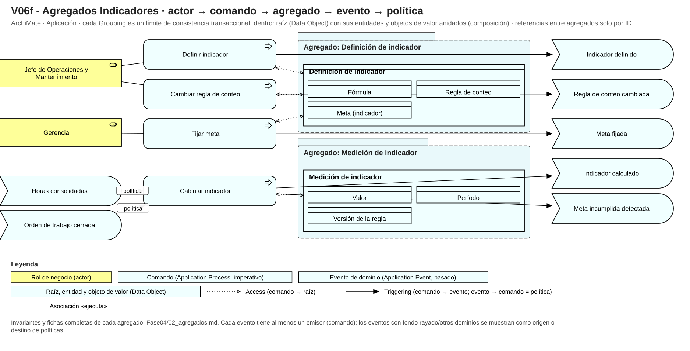

**Análisis.** *Definición de indicador* (una sola regla vigente; cambiarla versiona sin tocar el pasado) y *Medición* (hecho inmutable con su versión de regla).

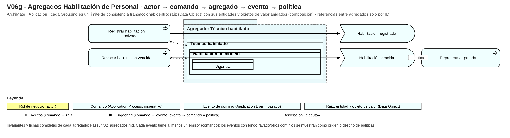

**Análisis.** *Técnico habilitado*: espejo de solo lectura de las carpetas de Administración; sin vigencia no hay asignación.
**Argumentación.** Trece agregados con invariantes y «por qué este límite / no más grande / no más pequeño»; cada evento tiene emisor y cada comando su agregado (24 políticas); la revisión cruzada intentó romper cada invariante. Documentos: [`01_criterios_de_diseno`](Fase04/01_criterios_de_diseno.md) · [`02_agregados`](Fase04/02_agregados.md).

## 7. Mapa de contextos e interoperabilidad


**Análisis.** Nueve contextos (uno por dominio) con sus interfaces y servicios de aplicación; cada relación lleva patrón y dirección upstream → downstream.

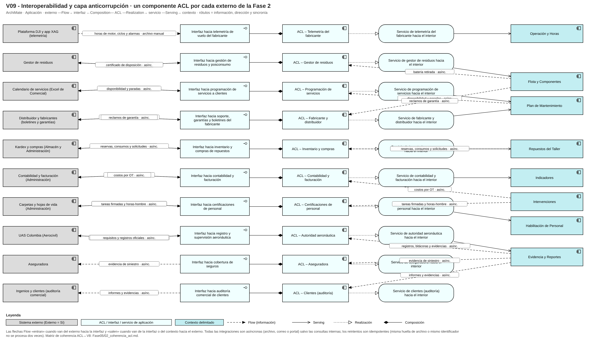

**Análisis.** Un componente ACL con interfaz y servicio por cada una de las 10 filas de la tabla ACL; todo el intercambio externo es asíncrono (archivo, correo, portal) con reintentos idempotentes.
**Argumentación.** Autoridad → lenguaje publicado + traducción del ID interno; telemetría → ACL; compras/inventario → ACL hacia Repuestos y cliente-proveedor hacia Almacén. La matriz de coherencia cierra el ciclo ACL ↔ V8 ↔ V4. Documentos: [`01_mapa_de_contextos`](Fase05/01_mapa_de_contextos.md) · [`02_coherencia_acl`](Fase05/02_coherencia_acl.md).

## 8. Bounded Context Canvas


**Análisis.** Canvas de *Plan de Mantenimiento* (core más rico) en una página, con elementos reales del modelo. **Argumentación.** Opción A (vista con rejilla de groupings); la investigación y la verificación en Archi están en [`Fase06/01_investigacion_canvas.md`](Fase06/01_investigacion_canvas.md); contenido en [`03_canvas`](Fase06/03_canvas.md).

## 9. Decisiones, supuestos y trazabilidad
Dieciocho decisiones (D-01 a D-18) y ocho supuestos (S-01 a S-08) con alternativas, razón, riesgo y hallazgo en [`docs/decisiones.md`](docs/decisiones.md).


Cada meta llega a al menos un componente y cada componente a al menos una meta; la matriz completa está en [`Fase06/02_trazabilidad.md`](Fase06/02_trazabilidad.md).

## Tabla de aportes
| Integrante | Fase/Vistas | Archivos clave | Commits de referencia | Revisiones hechas |
|---|---|---|---|---|
| dishyma | Fase 0 (rol, hallazgos), Fase 1 (V02), Fase 2 (V04, contratos), Fase 3 (V07), Fase 6, modelo completo | Fase00/02, Fase00/05, Fase01/02, Fase02/01, Fase02/03, Fase02/04, Fase03/03, Fase06/, modelo/ | e6e4af2, 7d6c382, 86b3532, 1be1b45, 24318d4, e55ea28, 44b283d, 5743de4 | Revisión de coherencia V4-V8 y de Presupuesto/Diseño en Fase 4 |
| cutiepie25 | Fase 0 (guion, conversación), Fase 1 (V01, V03), Fase 2 (ACL), Fase 3 (dominios), Fase 4 (agregados soporte), README | Fase00/01, Fase00/03, Fase00/04, Fase01/01, Fase01/03, Fase02/02, Fase03/01, Fase03/02, Fase03/04, Fase04/02, README.md | 4c82516, c7da1fd, 0c74cc5, 2358311, 7b2d1b1, a485806, 02975fe, c8f83e9 | Revisión de glosario V07 y de nombres en todas las vistas |
| Drakuro | Fase 1 (V02c, modelo parcial), Fase 4 (agregados core), Fase 5 (contextos e interoperabilidad) | vistas/V02c*, modelo/por_fase/Fase01, Fase04/01, vistas/V06a-c, Fase05/, vistas/V08, vistas/V09 | 6f49146, 16bd8dc, d75b5f4 | Revisión de patrones de relación en V08 y de invariantes en V06 |

> La tabla debe poder comprobarse en el historial de commits (rutas y mensajes que correspondan). Todos los integrantes deben conocer el diseño completo; el docente sortea quién presenta cada sección. Roles de gestión por fase (líder, revisor, verificador): por asignar.
